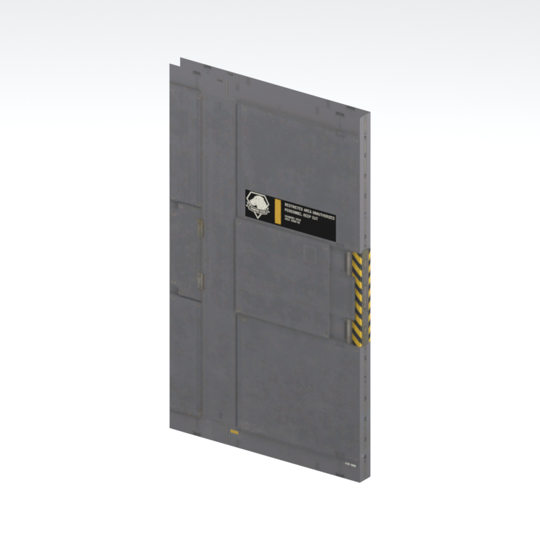
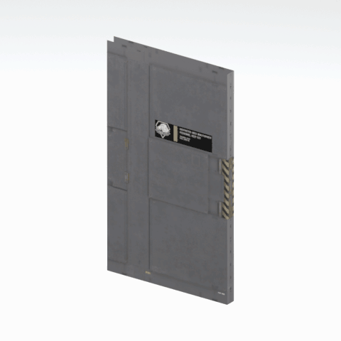

# Door panel

An individual industrial door panel with its surface fittings. This is the panel model, not a complete installed doorway or proven working door.

[Architecture table](../tables/architecture-batch-1.md) | [Library](../README.md) | [Credits](../sources-and-credits.md) | [Batch source data](../batch-provenance.json)

## Still reference

## 360-degree reference

Static model; 48 camera views, 100ms/frame,4.8-second loop. This is a reference-camera orbit, not native animation. Actual retained base textures/UVs use approximate studio lighting. FOX shader, collision, interactions and complete assembly are untested.

## Identity and source

| Field | Value |
|---|---|
| Category | Architecture > Access components |
| Tags | door, panel, mother-base, metal |
| Native model | `/Assets/tpp/environ/object/mother_base/door/mtbs_door006/scenes/mtbs_door006_door004.fmdl` |
| Native SHA256 | `cc763ccaf47ad829dd7275349d0cb7aa39144e9dd4c059aa3754b747ba6a37df` |
| Retained container | `/Assets/tpp/pack/location/mtbs/pack_unique/mtbs_unique_0030.fpk` |
| Retained container SHA256 | `60c224b72fd78d4ed9ca4968773e6eef0a4bb9b806b33d7f70b00a447b174e99` |
| Location evidence | Retained member record joined by native SHA/path; selected raw hash rechecked. Archive not freshly unpacked. |
| Current installed DAT / priority | Not verified; outer DAT unknown for this record |
| Upstream preparation | Retained pre-extracted native FMDL/converted DDS; no converter invoked by this job |

Source namespace is a path identity, not exclusive original use. Lowercased lookup keys are separate from the exact retained member spelling.

## Quality and native LOD inventory

Texture pixels/mips, geometric detail and approximate studio shader fidelity are separate. Only LOD0 was rendered for this imported batch. Other levels are inventoried, not newly previewed; identical decoded index sets map to their recorded counterpart. The decoded-indices hash uses UTF-8 canonical JSON of triangle-index lists grouped by mesh, not the original packed index-buffer bytes. No upscaling or invented geometry.

| Native LOD | Triangles | Decoded indices SHA256 | Duplicate mapping | Preview status |
|---|---:|---|---|---|
| 0 | 10 | `4926dcb70a21cb6ae4333076ccf230023d2c438c971fb978ce09ed47f59b85f1` | Distinct within retained model | Rendered above |
| 1 | 10 | `4926dcb70a21cb6ae4333076ccf230023d2c438c971fb978ce09ed47f59b85f1` | LOD0 | Same index set as LOD0; no separate preview |
| 2 | 10 | `4926dcb70a21cb6ae4333076ccf230023d2c438c971fb978ce09ed47f59b85f1` | LOD0 | Same index set as LOD0; no separate preview |
| 3 | 10 | `4926dcb70a21cb6ae4333076ccf230023d2c438c971fb978ce09ed47f59b85f1` | LOD0 | Same index set as LOD0; no separate preview |

## Base textures

| Material | Native sampler / path hash | Pixels | Mip levels | Retained DDS SHA256 |
|---|---|---|---|---|
| 0 | Unknown sampler name (base binding) / `1542866609095518400` | 512 x 512 | 8 native/header verified | `9885f18d45e872ea17337740e11d2b01dca2f0d06c7b62007ebea5731c8c7feb` |
| 1 | Unknown sampler name (base binding) / `1543545116049712726` | 256 x 128 | 7 native/header verified | `88d3c8c7a79a1f222050e69baf4811b208952b3a051312d1e9a2d505dfdd76c5` |

Texture virtual filenames are unknown where only native hashes are available. Larger native textures elsewhere in the game were not searched. Only actual base-color maps are applied; normal/specular/packed shader channels are not recreated.

## Attribution and limits

Game models/textures: Konami. Project owner: arsenal-pt. Authored importer/metadata/reference work: OpenAI Codex (AI/LLM). [Community tools and detailed credits](../sources-and-credits.md). No endorsement is implied. Game artwork is outside the original-code license.

Only rendered references and descriptive metadata are distributed. Raw assets, native files, textures, decoded geometry, Blender scenes, private source paths and clean frame caches remain private. [Catalogue](../catalogue.json) and [batch provenance](../batch-provenance.json) preserve identity and media hashes.
