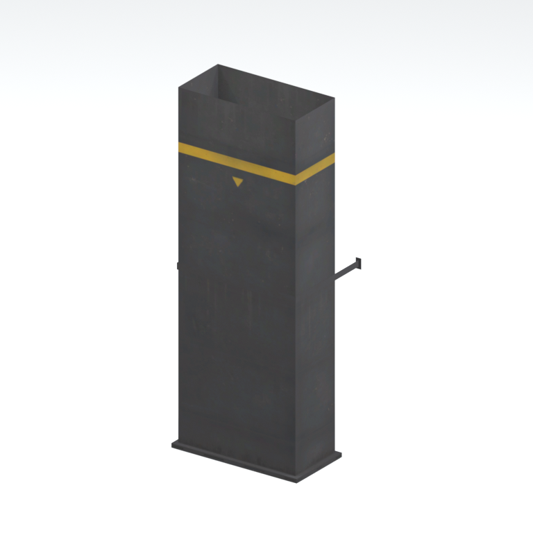
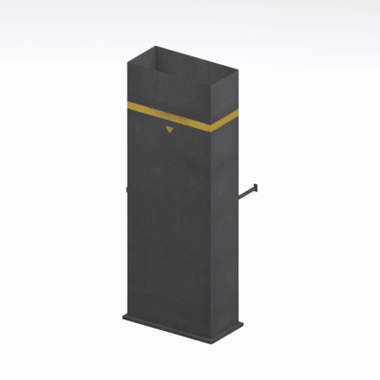

# Duct section

A metal duct section with bent connector geometry. This is a static native variant, not an assembled or functional ventilation system.

[Library](../README.md) | [Category](../tables/utility-components-1.md) | [Source / advanced data](../catalogue.json) | [Credits](../sources-and-credits.md)

**Game filename:** mtbs_duct002_vrtn001.fmdl  
**Category:** Architecture &gt; Utility components  
**Variant:** vrtn001; **LOD:** 0  
**Tags:** duct, ventilation, metal, mother-base

## Still reference



## 360-degree reference



The camera circles a static model. This is not a native animation. Source base textures and UVs use approximate studio shading; interaction, collision, complete assembly and FOX shader equivalence are not established.

## Identity and naming

| Field | Value |
|---|---|
| Library ID | mgsv-tpp-mtbs_duct002_vrtn001-729a38018dc0 |
| Naming status | reviewed |
| Naming confidence | high |
| Naming evidence | {"kind": "accepted-existing", "native_path": "/Assets/tpp/environ/object/mother_base/duct/mtbs_duct002/scenes/mtbs_duct002_vrtn001.fmdl", "note": "Original accepted display name, category, subcategory, description and tags retained exactly; no relabeling.", "source": "media/asset-previews/2026-10-16-retained-batch/mgsv-tpp-mtbs_duct002_vrtn001-729a38018dc0.png"} |
| Native model | /Assets/tpp/environ/object/mother_base/duct/mtbs_duct002/scenes/mtbs_duct002_vrtn001.fmdl |
| Model SHA256 | 729a38018dc08fb68bb29813fa50b2d38c0d4fac432780e22b712f3748ed9b0d |
| Container | /Assets/tpp/pack/location/mtbs/pack_common/mtbs_common.fpk |
| Container SHA256 | 8d0dbf7b3710768ba90f8b0efa820ee00f33181b7cfc465b67cf29eda9a1700d |
| Captured source / location scope | Retained member record joined by native SHA/path; selected raw hash rechecked. Archive not freshly unpacked. |
| Raw record SHA256 | 1638a0a96f792131f182fca16afce3ef0fa323965f10231d0cda4721c640ac66 |

Naming review is descriptive metadata only. It does not change model completion or identify a working game interaction.

## Native LOD inventory

| Native LOD | Triangles | Preview status | Decoded indices SHA256 |
|---|---:|---|---|
| 0 | 38 | rendered | 13cfc0721f290ee2c0bbf0c695d357b9010169e13c4863d0d314288258faf394 |
| 1 | 37 | not separately rendered | d3bbcd4968e07cbfac4e9ee210eef74ad509c8d35d01d956f9875db052e09f98 |
| 2 | 37 | not separately rendered | d3bbcd4968e07cbfac4e9ee210eef74ad509c8d35d01d956f9875db052e09f98 |
| 3 | 37 | not separately rendered | d3bbcd4968e07cbfac4e9ee210eef74ad509c8d35d01d956f9875db052e09f98 |

Mesh detail and texture pixels/mips are separate. Index hashes describe decoded triangle arrays, not packed index-buffer bytes. Only source-recorded native levels are listed.

<details>
<summary>Texture, source and naming technical metadata</summary>

```json
{
  "source": {
    "nativePath": "/Assets/tpp/environ/object/mother_base/duct/mtbs_duct002/scenes/mtbs_duct002_vrtn001.fmdl",
    "nativeSha256": "729a38018dc08fb68bb29813fa50b2d38c0d4fac432780e22b712f3748ed9b0d",
    "stableIdentity": "/assets/tpp/environ/object/mother_base/duct/mtbs_duct002/scenes/mtbs_duct002_vrtn001.fmdl#729a38018dc08fb68bb29813fa50b2d38c0d4fac432780e22b712f3748ed9b0d",
    "container": {
      "nativePath": "/Assets/tpp/pack/location/mtbs/pack_common/mtbs_common.fpk",
      "sha256": "8d0dbf7b3710768ba90f8b0efa820ee00f33181b7cfc465b67cf29eda9a1700d",
      "status": "Retained member/source metadata joined and selected source bytes checked during pipeline job; container not freshly unpacked"
    },
    "historicalDatOrigin": null,
    "locationStatus": "Retained member record joined by native SHA/path; selected raw hash rechecked. Archive not freshly unpacked.",
    "currentInstalledDatVerified": false,
    "evidence": {
      "duplicateRetainedOccurrences": 7,
      "exactMemberRecord": true,
      "memberEvidence": "Retained member record joined by native SHA/path; selected raw hash rechecked. Archive not freshly unpacked.",
      "normalizedLookupKey": "/assets/tpp/environ/object/mother_base/duct/mtbs_duct002/scenes/mtbs_duct002_vrtn001.fmdl",
      "upstreamPreparation": "Already extracted native FMDL and converted DDS; GzsTool/FtexTool not invoked for this entry."
    }
  },
  "materials": [
    {
      "sampler": "Unknown sampler name (base binding)",
      "materialIndex": 0,
      "nativePathHash": "1543493658329268165",
      "nativeVirtualPath": null,
      "ddsSha256": "0c147e66620df71e7b5c8dcad4a6f47cf2ce20c838e06f37045c4b16b2cff97b",
      "dimensions": [
        512,
        1024
      ],
      "mipCount": 9,
      "nativeMipCountVerified": true,
      "connectedInPreview": true
    }
  ],
  "quality": {
    "highestRetainedGeometricLod": 0,
    "distinctNativeLods": 2,
    "baseTextureDimensions": [
      512,
      1024
    ],
    "baseTextureNativeMipCount": 9,
    "largerRetainedBaseTextureFound": null,
    "nativeLods": [
      {
        "indicesSha256": "13cfc0721f290ee2c0bbf0c695d357b9010169e13c4863d0d314288258faf394",
        "nativeLod": 0,
        "triangles": 38
      },
      {
        "indicesSha256": "d3bbcd4968e07cbfac4e9ee210eef74ad509c8d35d01d956f9875db052e09f98",
        "nativeLod": 1,
        "triangles": 37
      },
      {
        "duplicateOf": 1,
        "indicesSha256": "d3bbcd4968e07cbfac4e9ee210eef74ad509c8d35d01d956f9875db052e09f98",
        "nativeLod": 2,
        "triangles": 37
      },
      {
        "duplicateOf": 1,
        "indicesSha256": "d3bbcd4968e07cbfac4e9ee210eef74ad509c8d35d01d956f9875db052e09f98",
        "nativeLod": 3,
        "triangles": 37
      }
    ],
    "renderedNativeLods": [
      0
    ],
    "baseTextureSummary": "512 x 1024; 9 native/DDS mips",
    "highestDetailScope": "Triangle-count comparison within this selected retained FMDL only; no all-game maximum proof",
    "decodedIndicesHashDerivation": "SHA256 of UTF-8 canonical JSON for decoded triangle-index lists grouped by mesh: json.dumps(level_faces, sort_keys=True, separators=(comma, colon), ensure_ascii=False). This is not a hash of the original packed index-buffer bytes."
  }
}
```

</details>

[Original source / advanced record](../catalogue.json)
