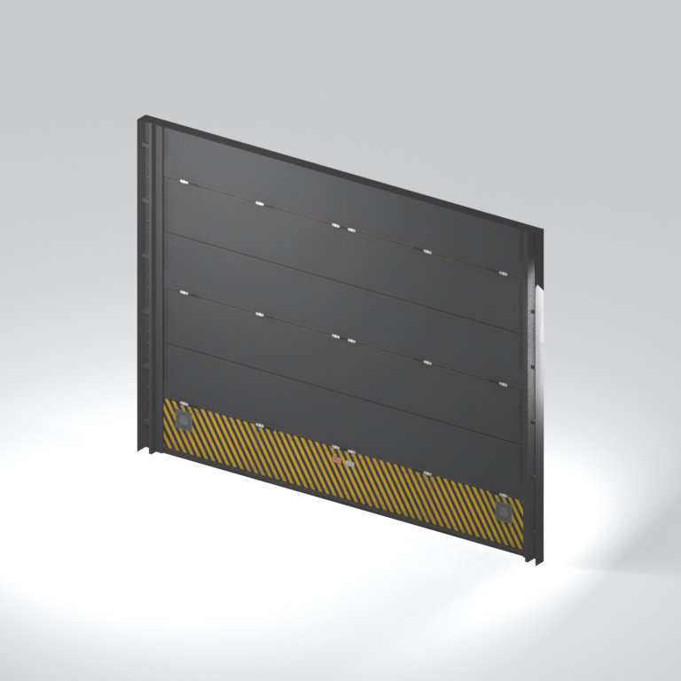
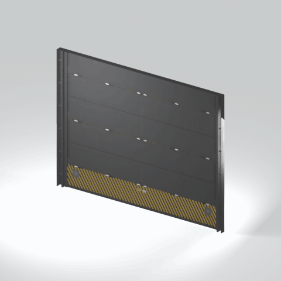

# Gate / shutter panel

A large ribbed gate or shutter panel. The reference shows a native component; surrounding structure and opening behavior are not established.

[Architecture table](../tables/architecture-batch-1.md) | [Library](../README.md) | [Credits](../sources-and-credits.md) | [Batch source data](../batch-provenance.json)

## Still reference

## 360-degree reference

Static model; 48 camera views, 100ms/frame,4.8-second loop. This is a reference-camera orbit, not native animation. Actual retained base textures/UVs use approximate studio lighting. FOX shader, collision, interactions and complete assembly are untested.

## Identity and source

| Field | Value |
|---|---|
| Category | Architecture > Access components |
| Tags | gate, shutter, panel, mother-base |
| Native model | `/Assets/tpp/environ/object/mother_base/gate/mtbs_gate001/scenes/mtbs_gate001_vrtn001.fmdl` |
| Native SHA256 | `b30a73a378b25f575f65e5c24db7d2a8b8be2f770c21f734b860dca86a0aca5d` |
| Retained container | `/Assets/tpp/pack/location/mtbs/pack_common/mtbs_common.fpk` |
| Retained container SHA256 | `8d0dbf7b3710768ba90f8b0efa820ee00f33181b7cfc465b67cf29eda9a1700d` |
| Location evidence | Retained member record joined by native SHA/path; selected raw hash rechecked. Archive not freshly unpacked. |
| Current installed DAT / priority | Not verified; outer DAT unknown for this record |
| Upstream preparation | Retained pre-extracted native FMDL/converted DDS; no converter invoked by this job |

Source namespace is a path identity, not exclusive original use. Lowercased lookup keys are separate from the exact retained member spelling.

## Quality and native LOD inventory

Texture pixels/mips, geometric detail and approximate studio shader fidelity are separate. Only LOD0 was rendered for this imported batch. Other levels are inventoried, not newly previewed; identical decoded index sets map to their recorded counterpart. The decoded-indices hash uses UTF-8 canonical JSON of triangle-index lists grouped by mesh, not the original packed index-buffer bytes. No upscaling or invented geometry.

| Native LOD | Triangles | Decoded indices SHA256 | Duplicate mapping | Preview status |
|---|---:|---|---|---|
| 0 | 118 | `81b2de6efeb047294b2da6c05b806609d051923cfa21dd18dbcffa18e9745b16` | Distinct within retained model | Rendered above |
| 1 | 99 | `b7abb74438e57634ba4c1235d9d9c62af60879c3930fb68ac705e9b63d41d22d` | Distinct within retained model | Not rendered |
| 2 | 89 | `909f94cf762e8296fb88af456b42da6d4c9e9fca21dfc2f324a26a1ab201f039` | Distinct within retained model | Not rendered |
| 3 | 82 | `43d9fbe641716292e53860602876004261d61ebfd121fb463db522e7df0b65b9` | Distinct within retained model | Not rendered |

## Base textures

| Material | Native sampler / path hash | Pixels | Mip levels | Retained DDS SHA256 |
|---|---|---|---|---|
| 0 | Unknown sampler name (base binding) / `1542942216061825639` | 256 x 512 | 8 native/header verified | `54e77011469c3e4031130a922ed8a88b30b6c0c7b79076ebb63349bb118c0b7d` |
| 1 | Unknown sampler name (base binding) / `1542796963953415591` | 1024 x 1024 | 9 native/header verified | `ff0799f37522e387ec7ec8918710ed2b1566aedeaa3e90ff9592d4a3466e4313` |

Texture virtual filenames are unknown where only native hashes are available. Larger native textures elsewhere in the game were not searched. Only actual base-color maps are applied; normal/specular/packed shader channels are not recreated.

## Attribution and limits

Game models/textures: Konami. Project owner: arsenal-pt. Authored importer/metadata/reference work: OpenAI Codex (AI/LLM). [Community tools and detailed credits](../sources-and-credits.md). No endorsement is implied. Game artwork is outside the original-code license.

Only rendered references and descriptive metadata are distributed. Raw assets, native files, textures, decoded geometry, Blender scenes, private source paths and clean frame caches remain private. [Catalogue](../catalogue.json) and [batch provenance](../batch-provenance.json) preserve identity and media hashes.
