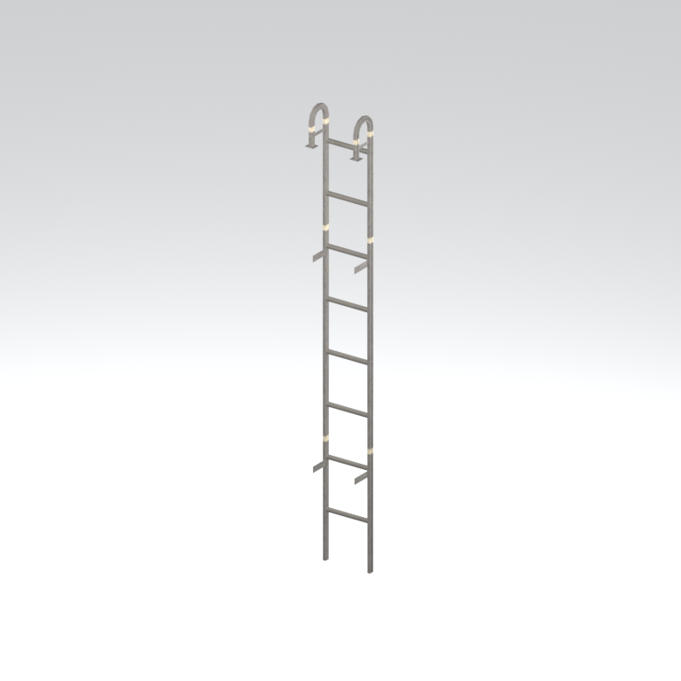
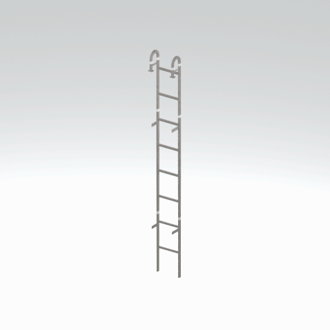

# Ladder section

A vertical metal ladder section. This reference is one native model variant; placement, climbing and complete assembly are untested.

[Architecture table](../tables/architecture-batch-1.md) | [Library](../README.md) | [Credits](../sources-and-credits.md) | [Batch source data](../batch-provenance.json)

## Still reference

## 360-degree reference

Static model; 48 camera views, 100ms/frame,4.8-second loop. This is a reference-camera orbit, not native animation. Actual retained base textures/UVs use approximate studio lighting. FOX shader, collision, interactions and complete assembly are untested.

## Identity and source

| Field | Value |
|---|---|
| Category | Architecture > Access components |
| Tags | ladder, access, metal, mother-base |
| Native model | `/Assets/tpp/environ/object/mother_base/ladder/mtbs_lddr001/scenes/mtbs_lddr001_vrtn002.fmdl` |
| Native SHA256 | `ff0e0462d63af0984397392031b18ebadca85403a28de90530a7cee5185feadb` |
| Retained container | `/Assets/tpp/pack/location/mtbs/pack_unique/mtbs_unique_0000.fpk` |
| Retained container SHA256 | `662115b68ff93858ee4f10865936b08e60923f9517bc824245c046e5409a551c` |
| Location evidence | Retained member record joined by native SHA/path; selected raw hash rechecked. Archive not freshly unpacked. |
| Current installed DAT / priority | Not verified; outer DAT unknown for this record |
| Upstream preparation | Retained pre-extracted native FMDL/converted DDS; no converter invoked by this job |

Source namespace is a path identity, not exclusive original use. Lowercased lookup keys are separate from the exact retained member spelling.

## Quality and native LOD inventory

Texture pixels/mips, geometric detail and approximate studio shader fidelity are separate. Only LOD0 was rendered for this imported batch. Other levels are inventoried, not newly previewed; identical decoded index sets map to their recorded counterpart. The decoded-indices hash uses UTF-8 canonical JSON of triangle-index lists grouped by mesh, not the original packed index-buffer bytes. No upscaling or invented geometry.

| Native LOD | Triangles | Decoded indices SHA256 | Duplicate mapping | Preview status |
|---|---:|---|---|---|
| 0 | 236 | `1d4051b3d41ac883cea2c19a67468953506c11b35ea982186e0443ca1dbf9f36` | Distinct within retained model | Rendered above |
| 1 | 212 | `015e2116c308447c466b85fb01377fc64c681fb724a8a9211a0e341e9e666f54` | Distinct within retained model | Not rendered |
| 2 | 198 | `4bf2704d95b5b6ceea84b8f50aeae770f45bc0182aa539a10d83e81a9f7c1cd8` | Distinct within retained model | Not rendered |
| 3 | 188 | `0499287e2f3a50d0c9ff6bf6d6096577e50d7d15ab4faf2f94634c72118e2a3a` | Distinct within retained model | Not rendered |

## Base textures

| Material | Native sampler / path hash | Pixels | Mip levels | Retained DDS SHA256 |
|---|---|---|---|---|
| 0 | Unknown sampler name (base binding) / `1542922407453283634` | 512 x 128 | 8 native/header verified | `8a421f0fdeb624ac6e6f36dc69d7cef2dc28d452acd08e24ec45a6b09acae770` |

Texture virtual filenames are unknown where only native hashes are available. Larger native textures elsewhere in the game were not searched. Only actual base-color maps are applied; normal/specular/packed shader channels are not recreated.

## Attribution and limits

Game models/textures: Konami. Project owner: arsenal-pt. Authored importer/metadata/reference work: OpenAI Codex (AI/LLM). [Community tools and detailed credits](../sources-and-credits.md). No endorsement is implied. Game artwork is outside the original-code license.

Only rendered references and descriptive metadata are distributed. Raw assets, native files, textures, decoded geometry, Blender scenes, private source paths and clean frame caches remain private. [Catalogue](../catalogue.json) and [batch provenance](../batch-provenance.json) preserve identity and media hashes.
