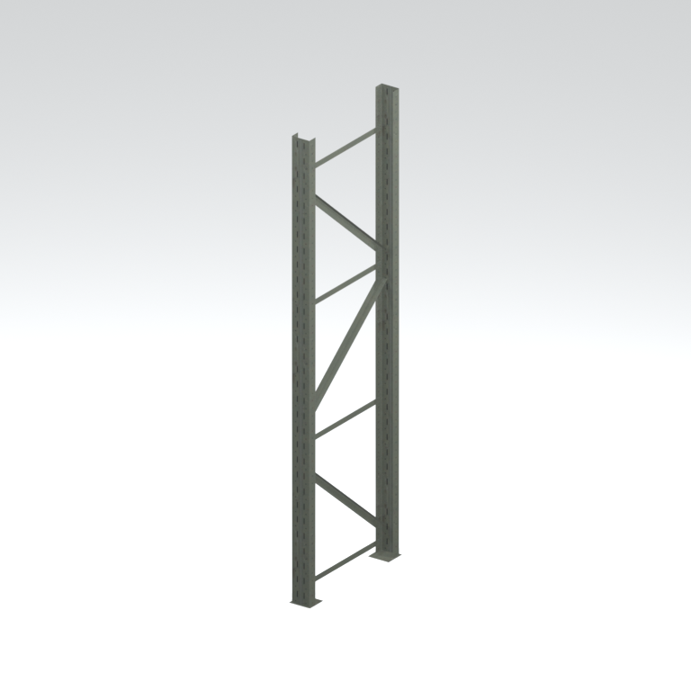
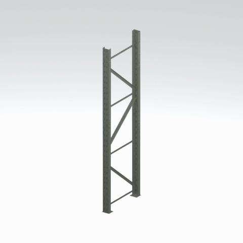

# Shelf upright / frame component

An individual shelf upright or frame component, rather than a complete assembled shelf.

[Furniture table](../tables/furniture-batch-1.md) | [Library](../README.md) | [Credits](../sources-and-credits.md) | [Batch source data](../batch-provenance.json)

## Still reference

## 360-degree reference

Static model; 48 camera views, 100ms/frame,4.8-second loop. This is a reference-camera orbit, not native animation. Actual retained base textures/UVs use approximate studio lighting. FOX shader, collision, interactions and complete assembly are untested.

## Identity and source

| Field | Value |
|---|---|
| Category | Furniture > Storage components |
| Tags | shelf, upright, frame, storage, mother-base |
| Native model | `/Assets/tpp/environ/object/mother_base/shelf/mtbs_shlf007/scenes/mtbs_shlf007_vrtn001.fmdl` |
| Native SHA256 | `026dfb56725cac8be0d8e0e303e289d84022219c663a1a406d8fa1e3ebf84aa9` |
| Retained container | `/Assets/tpp/pack/location/mtbs/pack_common/mtbs_common.fpk` |
| Retained container SHA256 | `8d0dbf7b3710768ba90f8b0efa820ee00f33181b7cfc465b67cf29eda9a1700d` |
| Location evidence | Retained member record joined by native SHA/path; selected raw hash rechecked. Archive not freshly unpacked. |
| Current installed DAT / priority | Not verified; outer DAT unknown for this record |
| Upstream preparation | Retained pre-extracted native FMDL/converted DDS; no converter invoked by this job |

Source namespace is a path identity, not exclusive original use. Lowercased lookup keys are separate from the exact retained member spelling.

## Quality and native LOD inventory

Texture pixels/mips, geometric detail and approximate studio shader fidelity are separate. Only LOD0 was rendered for this imported batch. Other levels are inventoried, not newly previewed; identical decoded index sets map to their recorded counterpart. The decoded-indices hash uses UTF-8 canonical JSON of triangle-index lists grouped by mesh, not the original packed index-buffer bytes. No upscaling or invented geometry.

| Native LOD | Triangles | Decoded indices SHA256 | Duplicate mapping | Preview status |
|---|---:|---|---|---|
| 0 | 36 | `c202e513c9cadbc74cffdcd42a63821250da33e751c645baed4910d8e93e9920` | Distinct within retained model | Rendered above |
| 1 | 28 | `9a5f1e7e360fec30075c9861d370e3857d1a5151b7eae85b6f3487083868dc14` | Distinct within retained model | Not rendered |
| 2 | 23 | `1961dd4ed74b56a592990baad42e0adefc3eef5819767b749b00fd1701cd0f69` | Distinct within retained model | Not rendered |
| 3 | 20 | `d2a5ffde1f6352c29fea7ada9652b7223c62778b3b64dc7689012d81e536c72b` | Distinct within retained model | Not rendered |

## Base textures

| Material | Native sampler / path hash | Pixels | Mip levels | Retained DDS SHA256 |
|---|---|---|---|---|
| 0 | Unknown sampler name (base binding) / `1543210546336962691` | 512 x 512 | 8 native/header verified | `229a21460d3f6da1aca9664382a13afc3355d97b540d785e313334b6e69fd4f4` |

Texture virtual filenames are unknown where only native hashes are available. Larger native textures elsewhere in the game were not searched. Only actual base-color maps are applied; normal/specular/packed shader channels are not recreated.

## Attribution and limits

Game models/textures: Konami. Project owner: arsenal-pt. Authored importer/metadata/reference work: OpenAI Codex (AI/LLM). [Community tools and detailed credits](../sources-and-credits.md). No endorsement is implied. Game artwork is outside the original-code license.

Only rendered references and descriptive metadata are distributed. Raw assets, native files, textures, decoded geometry, Blender scenes, private source paths and clean frame caches remain private. [Catalogue](../catalogue.json) and [batch provenance](../batch-provenance.json) preserve identity and media hashes.
