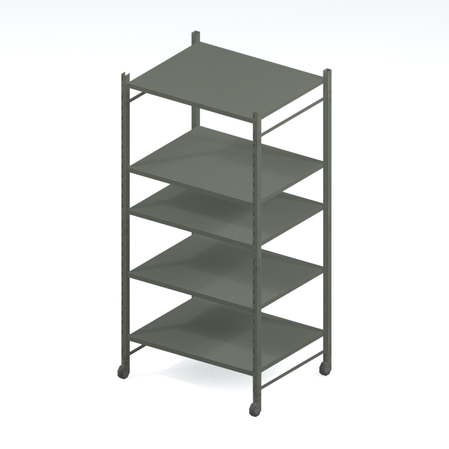
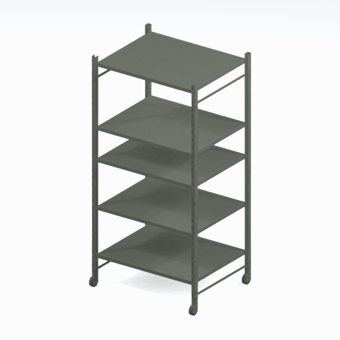

# Shelf component / variant 002

A native metal shelf component or variant. The full assembled storage unit and interaction are not established.

[Library](../README.md) | [Category](../tables/storage-components-1.md) | [Source / advanced data](../catalogue.json) | [Credits](../sources-and-credits.md)

**Game filename:** mtbs_shlf007_vrtn002.fmdl  
**Category:** Furniture &gt; Storage components  
**Variant:** vrtn002; **LOD:** 0  
**Tags:** shelf, storage, component, mother-base

## Still reference



## 360-degree reference



The camera circles a static model. This is not a native animation. Source base textures and UVs use approximate studio shading; interaction, collision, complete assembly and FOX shader equivalence are not established.

## Identity and naming

| Field | Value |
|---|---|
| Library ID | mgsv-tpp-mtbs_shlf007_vrtn002-f2cf2c909150 |
| Naming status | reviewed |
| Naming confidence | high |
| Naming evidence | {"kind": "accepted-existing", "native_path": "/Assets/tpp/environ/object/mother_base/shelf/mtbs_shlf007/scenes/mtbs_shlf007_vrtn002.fmdl", "note": "Original accepted display name, category, subcategory, description and tags retained exactly; no relabeling.", "source": "media/asset-previews/2026-10-16-retained-batch/mgsv-tpp-mtbs_shlf007_vrtn002-f2cf2c909150.png"} |
| Native model | /Assets/tpp/environ/object/mother_base/shelf/mtbs_shlf007/scenes/mtbs_shlf007_vrtn002.fmdl |
| Model SHA256 | f2cf2c9091500cbf17911fc372b75d1c8a1b7bd8cc6dd3b851a94b91ce705ce9 |
| Container | /Assets/tpp/pack/mission2/free/f30050/f30050_hanger_btg00.fpk |
| Container SHA256 | 4ad3d31598aff8eff00f8d507f80e5b6e491c71c0bda03fb991391a2560453c9 |
| Captured source / location scope | Retained member record joined by native SHA/path; selected raw hash rechecked. Archive not freshly unpacked. |
| Raw record SHA256 | 2c24567c7a58f56b5dd76076804490944638f92a7c4d3c7f7d435d13212923d2 |

Naming review is descriptive metadata only. It does not change model completion or identify a working game interaction.

## Native LOD inventory

| Native LOD | Triangles | Preview status | Decoded indices SHA256 |
|---|---:|---|---|
| 0 | 240 | rendered | 17bf18617d592cd38f1fb0903db32c8a0cc0addb9b1ba3d693213d52bd9e1c3d |
| 1 | 174 | not separately rendered | efe0c224afe720114f0d21a8dc002579232fd93bc223b5e15078ffcc7b1f563d |
| 2 | 140 | not separately rendered | 89a85acc35a472fe6f7c7cfe3d5297c03dc2c7f49e1eb3a82c7dbf9315e01ca6 |
| 3 | 120 | not separately rendered | d06bc356a0084ab15b7b62954c374839c468c56ccb0872c459f435e9a74fbcb9 |

Mesh detail and texture pixels/mips are separate. Index hashes describe decoded triangle arrays, not packed index-buffer bytes. Only source-recorded native levels are listed.

<details>
<summary>Texture, source and naming technical metadata</summary>

```json
{
  "source": {
    "nativePath": "/Assets/tpp/environ/object/mother_base/shelf/mtbs_shlf007/scenes/mtbs_shlf007_vrtn002.fmdl",
    "nativeSha256": "f2cf2c9091500cbf17911fc372b75d1c8a1b7bd8cc6dd3b851a94b91ce705ce9",
    "stableIdentity": "/assets/tpp/environ/object/mother_base/shelf/mtbs_shlf007/scenes/mtbs_shlf007_vrtn002.fmdl#f2cf2c9091500cbf17911fc372b75d1c8a1b7bd8cc6dd3b851a94b91ce705ce9",
    "container": {
      "nativePath": "/Assets/tpp/pack/mission2/free/f30050/f30050_hanger_btg00.fpk",
      "sha256": "4ad3d31598aff8eff00f8d507f80e5b6e491c71c0bda03fb991391a2560453c9",
      "status": "Retained member/source metadata joined and selected source bytes checked during pipeline job; container not freshly unpacked"
    },
    "historicalDatOrigin": null,
    "locationStatus": "Retained member record joined by native SHA/path; selected raw hash rechecked. Archive not freshly unpacked.",
    "currentInstalledDatVerified": false,
    "evidence": {
      "duplicateRetainedOccurrences": 6,
      "exactMemberRecord": true,
      "memberEvidence": "Retained member record joined by native SHA/path; selected raw hash rechecked. Archive not freshly unpacked.",
      "normalizedLookupKey": "/assets/tpp/environ/object/mother_base/shelf/mtbs_shlf007/scenes/mtbs_shlf007_vrtn002.fmdl",
      "upstreamPreparation": "Already extracted native FMDL and converted DDS; GzsTool/FtexTool not invoked for this entry."
    }
  },
  "materials": [
    {
      "sampler": "Unknown sampler name (base binding)",
      "materialIndex": 0,
      "nativePathHash": "1543210546336962691",
      "nativeVirtualPath": null,
      "ddsSha256": "229a21460d3f6da1aca9664382a13afc3355d97b540d785e313334b6e69fd4f4",
      "dimensions": [
        512,
        512
      ],
      "mipCount": 8,
      "nativeMipCountVerified": true,
      "connectedInPreview": true
    },
    {
      "sampler": "Unknown sampler name (base binding)",
      "materialIndex": 1,
      "nativePathHash": "1543210546336962691",
      "nativeVirtualPath": null,
      "ddsSha256": "229a21460d3f6da1aca9664382a13afc3355d97b540d785e313334b6e69fd4f4",
      "dimensions": [
        512,
        512
      ],
      "mipCount": 8,
      "nativeMipCountVerified": true,
      "connectedInPreview": true
    }
  ],
  "quality": {
    "highestRetainedGeometricLod": 0,
    "distinctNativeLods": 4,
    "baseTextureDimensions": [
      512,
      512
    ],
    "baseTextureNativeMipCount": 8,
    "largerRetainedBaseTextureFound": null,
    "nativeLods": [
      {
        "indicesSha256": "17bf18617d592cd38f1fb0903db32c8a0cc0addb9b1ba3d693213d52bd9e1c3d",
        "nativeLod": 0,
        "triangles": 240
      },
      {
        "indicesSha256": "efe0c224afe720114f0d21a8dc002579232fd93bc223b5e15078ffcc7b1f563d",
        "nativeLod": 1,
        "triangles": 174
      },
      {
        "indicesSha256": "89a85acc35a472fe6f7c7cfe3d5297c03dc2c7f49e1eb3a82c7dbf9315e01ca6",
        "nativeLod": 2,
        "triangles": 140
      },
      {
        "indicesSha256": "d06bc356a0084ab15b7b62954c374839c468c56ccb0872c459f435e9a74fbcb9",
        "nativeLod": 3,
        "triangles": 120
      }
    ],
    "renderedNativeLods": [
      0
    ],
    "baseTextureSummary": "512 x 512; 8 native/DDS mips; 512 x 512; 8 native/DDS mips",
    "highestDetailScope": "Triangle-count comparison within this selected retained FMDL only; no all-game maximum proof",
    "decodedIndicesHashDerivation": "SHA256 of UTF-8 canonical JSON for decoded triangle-index lists grouped by mesh: json.dumps(level_faces, sort_keys=True, separators=(comma, colon), ensure_ascii=False). This is not a hash of the original packed index-buffer bytes."
  }
}
```

</details>

[Original source / advanced record](../catalogue.json)
