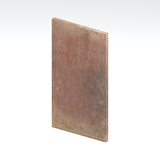
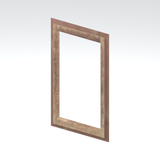
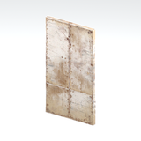
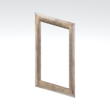
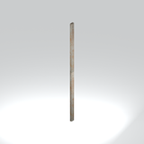
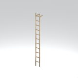
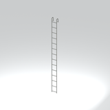

# Architecture &gt; Access and utility components - page 1

[Library](../README.md) | [Source / advanced data](../catalogue.json) | [Credits](../sources-and-credits.md)

Static thumbnails only. Open a name or preview for its full still and 360-degree camera reference.

| Preview | Name | Game filename | Description | Tags | Variant / LOD |
|---|---|---|---|---|---|
|  | [Door component](../assets/mgsv-tpp-afgh_door005_door001-2f6e23e02777f9f6.md) (path-derived) | afgh_door005_door001.fmdl | A native door model component. Its specific form and assembly have not been visually reviewed. | door, component | Variant: No explicit variant token; LOD0; 12 triangles |
|  | [Door component](../assets/mgsv-tpp-afgh_door005_drfr001-cfa0672d0e0f7566.md) (path-derived) | afgh_door005_drfr001.fmdl | A native door model component. Its specific form and assembly have not been visually reviewed. | door, component | Variant: No explicit variant token; LOD0; 36 triangles |
|  | [Door component](../assets/mgsv-tpp-afgh_door006_door001-0717949172c0975d.md) (path-derived) | afgh_door006_door001.fmdl | A native door model component. Its specific form and assembly have not been visually reviewed. | door, component | Variant: No explicit variant token; LOD0; 12 triangles |
|  | [Door component](../assets/mgsv-tpp-afgh_door006_drfr001-3ee016dda1937e06.md) (path-derived) | afgh_door006_drfr001.fmdl | A native door model component. Its specific form and assembly have not been visually reviewed. | door, component | Variant: No explicit variant token; LOD0; 36 triangles |
|  | [Door component](../assets/mgsv-tpp-mafr_door004-294d2f4e735c4787.md) (path-derived) | mafr_door004.fmdl | A native door model component. Its specific form and assembly have not been visually reviewed. | door, component | Variant: No explicit variant token; LOD0; 56 triangles |
|  | [Door component](../assets/mgsv-tpp-mgoa_door001_vrtn003-d751837cdcf67f4a.md) (path-derived) | mgoa_door001_vrtn003.fmdl | A native door model component. Its specific form and assembly have not been visually reviewed. | door, component | Variant: vrtn003; LOD0; 10 triangles |
|  | [Ladder component](../assets/mgsv-tpp-mgoa_lddr001-31e5dcda57cd44f1.md) (path-derived) | mgoa_lddr001.fmdl | A native ladder model component. Its specific form and assembly have not been visually reviewed. | ladder, component | Variant: No explicit variant token; LOD0; 200 triangles |
|  | [Ladder component](../assets/mgsv-tpp-mgoa_lddr002-d86eeb9840f1fb1a.md) (path-derived) | mgoa_lddr002.fmdl | A native ladder model component. Its specific form and assembly have not been visually reviewed. | ladder, component | Variant: No explicit variant token; LOD0; 260 triangles |

Pages: [1](access-and-utility-components-1.md)
