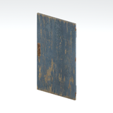

# Architecture &gt; Access and utility components - page 1

[Library](../README.md) | [Source / advanced data](../catalogue.json) | [Credits](../sources-and-credits.md)

Static thumbnails only. Open a name or preview for its full still and 360-degree camera reference.

| Preview | Name | Game filename | Description | Tags | Variant / LOD |
|---|---|---|---|---|---|
|  | [Door component](../assets/mgsv-tpp-mafr_door004-294d2f4e735c4787.md) (path-derived) | mafr_door004.fmdl | A native door model component. Its specific form and assembly have not been visually reviewed. | door, component | Variant: No explicit variant token; LOD0; 56 triangles |

Pages: [1](access-and-utility-components-1.md)
