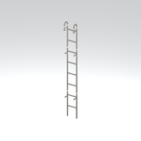
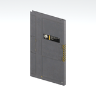
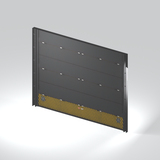

# Architecture references - imported batch page 1

Static thumbnails only (at most12/page). Open one entry for its full still/360GIF. Native LOD inventory is separate from rendered coverage.

[Library](../README.md) | [Credits](../sources-and-credits.md) | [Batch provenance](../batch-provenance.json)

| Preview | Asset | Category | Tags | Description | Quality / LOD | Base texture | Model location | Container location |
|---|---|---|---|---|---|---|---|---|
|  | [Ladder section](../assets/mgsv-tpp-mtbs_lddr001_vrtn002-ff0e0462d63a.md) | Architecture > Access components | ladder, access, metal, mother-base | A vertical metal ladder section. This reference is one native model variant; placement, climbing and complete assembly are untested. | LOD0; 236 triangles; 4 native levels inventoried; only selectedLOD rendered | 512 x 128; 8 native/DDS mips | `/Assets/tpp/environ/object/mother_base/ladder/mtbs_lddr001/scenes/mtbs_lddr001_vrtn002.fmdl` | `/Assets/tpp/pack/location/mtbs/pack_unique/mtbs_unique_0000.fpk` (retained occurrence) |
|  | [Door panel](../assets/mgsv-tpp-mtbs_door006_door004-cc763ccaf47a.md) | Architecture > Access components | door, panel, mother-base, metal | An individual industrial door panel with its surface fittings. This is the panel model, not a complete installed doorway or proven working door. | LOD0; 10 triangles; 4 native levels inventoried; only selectedLOD rendered | 512 x 512; 8 native/DDS mips; 256 x 128; 7 native/DDS mips | `/Assets/tpp/environ/object/mother_base/door/mtbs_door006/scenes/mtbs_door006_door004.fmdl` | `/Assets/tpp/pack/location/mtbs/pack_unique/mtbs_unique_0030.fpk` (retained occurrence) |
|  | [Gate / shutter panel](../assets/mgsv-tpp-mtbs_gate001_vrtn001-b30a73a378b2.md) | Architecture > Access components | gate, shutter, panel, mother-base | A large ribbed gate or shutter panel. The reference shows a native component; surrounding structure and opening behavior are not established. | LOD0; 118 triangles; 4 native levels inventoried; only selectedLOD rendered | 256 x 512; 8 native/DDS mips; 1024 x 1024; 9 native/DDS mips | `/Assets/tpp/environ/object/mother_base/gate/mtbs_gate001/scenes/mtbs_gate001_vrtn001.fmdl` | `/Assets/tpp/pack/location/mtbs/pack_common/mtbs_common.fpk` (retained occurrence) |
|  | [Duct section](../assets/mgsv-tpp-mtbs_duct002_vrtn001-729a38018dc0.md) | Architecture > Utility components | duct, ventilation, metal, mother-base | A metal duct section with bent connector geometry. This is a static native variant, not an assembled or functional ventilation system. | LOD0; 38 triangles; 4 native levels inventoried; only selectedLOD rendered | 512 x 1024; 9 native/DDS mips | `/Assets/tpp/environ/object/mother_base/duct/mtbs_duct002/scenes/mtbs_duct002_vrtn001.fmdl` | `/Assets/tpp/pack/location/mtbs/pack_common/mtbs_common.fpk` (retained occurrence) |

Pages: [1](architecture-batch-1.md)
