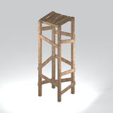

# Infrastructure &gt; Bridge components - page 1

[Library](../README.md) | [Source / advanced data](../catalogue.json) | [Credits](../sources-and-credits.md)

Static thumbnails only. Open a name or preview for its full still and 360-degree camera reference.

| Preview | Name | Game filename | Description | Tags | Variant / LOD |
|---|---|---|---|---|---|
|  | [Timber support frame](../assets/mgsv-tpp-mgom_brdg002_vrtn004-7850f0d9723d92b9.md) | mgom_brdg002_vrtn004.fmdl | A tall open timber frame with cross-bracing and a small plank cap; its native path is in the bridge family. | wood, timber, frame, support, cross-bracing, bridge-component, mgo | Variant: vrtn004; LOD0; 348 triangles |

Pages: [1](bridge-components-1.md)
