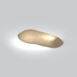
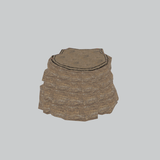
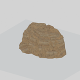
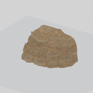
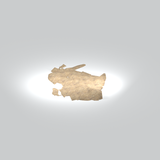
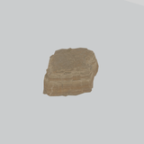
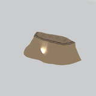
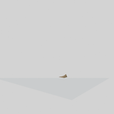
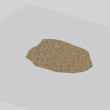

# Terrain &gt; Cliffs - page 1

[Library](../README.md) | [Source / advanced data](../catalogue.json) | [Credits](../sources-and-credits.md)

Static thumbnails only. Open a name or preview for its full still and 360-degree camera reference.

| Preview | Name | Game filename | Description | Tags | Variant / LOD |
|---|---|---|---|---|---|
|  | [Cliff component](../assets/mgsv-tpp-afgh_clff007-1c5dcb1bb2b666c1.md) (path-derived) | afgh_clff007.fmdl | A native cliff model component. Its specific form and assembly have not been visually reviewed. | cliff, component | Variant: No explicit variant token; LOD0; 294 triangles |
|  | [Cliff component](../assets/mgsv-tpp-afgh_clff022_vrtn008-31e09d2045a2d859.md) (path-derived) | afgh_clff022_vrtn008.fmdl | A native cliff model component. Its specific form and assembly have not been visually reviewed. | cliff, component | Variant: vrtn008; LOD0; 929 triangles |
|  | [Cliff component](../assets/mgsv-tpp-afgh_clff024-163482dfdb5782d2.md) (path-derived) | afgh_clff024.fmdl | A native cliff model component. Its specific form and assembly have not been visually reviewed. | cliff, component | Variant: No explicit variant token; LOD0; 650 triangles |
|  | [Cliff component](../assets/mgsv-tpp-afgh_clff024_vrtn001-dabe27d69cfb5258.md) (path-derived) | afgh_clff024_vrtn001.fmdl | A native cliff model component. Its specific form and assembly have not been visually reviewed. | cliff, component | Variant: vrtn001; LOD0; 699 triangles |
|  | [Cliff component](../assets/mgsv-tpp-afgh_clff030_vrtn007-65a74a7d39694917.md) (path-derived) | afgh_clff030_vrtn007.fmdl | A native cliff model component. Its specific form and assembly have not been visually reviewed. | cliff, component | Variant: vrtn007; LOD0; 456 triangles |
|  | [Cliff component](../assets/mgsv-tpp-afgh_clff030_vrtn011-667560e76570cdce.md) (path-derived) | afgh_clff030_vrtn011.fmdl | A native cliff model component. Its specific form and assembly have not been visually reviewed. | cliff, component | Variant: vrtn011; LOD0; 456 triangles |
|  | [Cliff component](../assets/mgsv-tpp-afgh_clff032-aaee583d7d928844.md) (path-derived) | afgh_clff032.fmdl | A native cliff model component. Its specific form and assembly have not been visually reviewed. | cliff, component | Variant: No explicit variant token; LOD0; 1420 triangles |
|  | [Cliff component](../assets/mgsv-tpp-afgh_clff035_vrtn003-9d59bafe6274b8bc.md) (path-derived) | afgh_clff035_vrtn003.fmdl | A native cliff model component. Its specific form and assembly have not been visually reviewed. | cliff, component | Variant: vrtn003; LOD0; 437 triangles |
|  | [Cliff component](../assets/mgsv-tpp-afgh_clff041_vrtn001-d68f54510f48acc7.md) (path-derived) | afgh_clff041_vrtn001.fmdl | A native cliff model component. Its specific form and assembly have not been visually reviewed. | cliff, component | Variant: vrtn001; LOD0; 247 triangles |
|  | [Cliff component](../assets/mgsv-tpp-afgh_clff041_vrtn002-12ddd64948183478.md) (path-derived) | afgh_clff041_vrtn002.fmdl | A native cliff model component. Its specific form and assembly have not been visually reviewed. | cliff, component | Variant: vrtn002; LOD0; 351 triangles |
|  | [Cliff component](../assets/mgsv-tpp-mafr_clff004_grnd001-7891521f973d3afe.md) (path-derived) | mafr_clff004_grnd001.fmdl | A native cliff model component. Its specific form and assembly have not been visually reviewed. | cliff, component | Variant: No explicit variant token; LOD0; 494 triangles |
|  | [Cliff component](../assets/mgsv-tpp-mafr_clff004_grnd003-1a917f10246db408.md) (path-derived) | mafr_clff004_grnd003.fmdl | A native cliff model component. Its specific form and assembly have not been visually reviewed. | cliff, component | Variant: No explicit variant token; LOD0; 300 triangles |

Pages: [1](cliffs-1.md) | [2](cliffs-2.md) | [3](cliffs-3.md)
