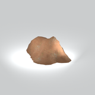
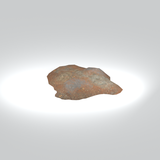
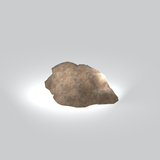
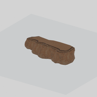
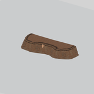
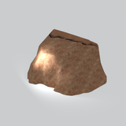
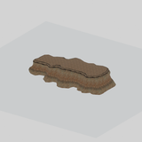

# Terrain &gt; Cliffs - page 1

[Library](../README.md) | [Source / advanced data](../catalogue.json) | [Credits](../sources-and-credits.md)

Static thumbnails only. Open a name or preview for its full still and 360-degree camera reference.

| Preview | Name | Game filename | Description | Tags | Variant / LOD |
|---|---|---|---|---|---|
|  | [Cliff component](../assets/mgsv-tpp-mafr_clff004_grnd001-7891521f973d3afe.md) (path-derived) | mafr_clff004_grnd001.fmdl | A native cliff model component. Its specific form and assembly have not been visually reviewed. | cliff, component | Variant: No explicit variant token; LOD0; 494 triangles |
|  | [Cliff component](../assets/mgsv-tpp-mafr_clff004_grnd003-1a917f10246db408.md) (path-derived) | mafr_clff004_grnd003.fmdl | A native cliff model component. Its specific form and assembly have not been visually reviewed. | cliff, component | Variant: No explicit variant token; LOD0; 300 triangles |
|  | [Cliff component](../assets/mgsv-tpp-mafr_clff004_rock002-b155ebfe4d90c57d.md) (path-derived) | mafr_clff004_rock002.fmdl | A native cliff model component. Its specific form and assembly have not been visually reviewed. | cliff, component | Variant: No explicit variant token; LOD0; 676 triangles |
|  | [Cliff component](../assets/mgsv-tpp-mafr_clff007_vrtn001-16a58b9c8aa3771a.md) (path-derived) | mafr_clff007_vrtn001.fmdl | A native cliff model component. Its specific form and assembly have not been visually reviewed. | cliff, component | Variant: vrtn001; LOD0; 968 triangles |
|  | [Cliff component](../assets/mgsv-tpp-mafr_clff007_vrtn002-4a58b67fea9e076e.md) (path-derived) | mafr_clff007_vrtn002.fmdl | A native cliff model component. Its specific form and assembly have not been visually reviewed. | cliff, component | Variant: vrtn002; LOD0; 875 triangles |
|  | [Cliff component](../assets/mgsv-tpp-mafr_clff008_wall004-48e9d166745badfc.md) (path-derived) | mafr_clff008_wall004.fmdl | A native cliff model component. Its specific form and assembly have not been visually reviewed. | cliff, component | Variant: No explicit variant token; LOD0; 521 triangles |
|  | [Cliff component](../assets/mgsv-tpp-mafr_clff015_wall002-16fd0d0468233411.md) (path-derived) | mafr_clff015_wall002.fmdl | A native cliff model component. Its specific form and assembly have not been visually reviewed. | cliff, component | Variant: No explicit variant token; LOD0; 1379 triangles |
|  | [Cliff section](../assets/mgsv-tpp-mgom_clff003_vrtn001-40ec5f006305113a.md) | mgom_clff003_vrtn001.fmdl | A tall rock-face section with an irregular upper ledge. | cliff, rock-face, ledge, terrain, mgo | Variant: vrtn001; LOD0; 733 triangles |
|  | [Low cliff section](../assets/mgsv-tpp-mgom_clff003_vrtn002-825030200fd1d701.md) | mgom_clff003_vrtn002.fmdl | An elongated low rock-face section with an uneven top ledge. | cliff, rock-face, ledge, terrain, low-section, mgo | Variant: vrtn002; LOD0; 666 triangles |

Pages: [1](cliffs-1.md)
