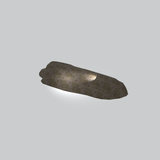
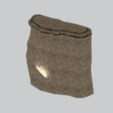
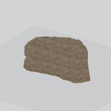
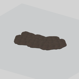
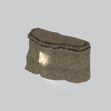
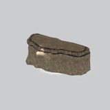

# Terrain &gt; Cliffs - page 2

[Library](../README.md) | [Source / advanced data](../catalogue.json) | [Credits](../sources-and-credits.md)

Static thumbnails only. Open a name or preview for its full still and 360-degree camera reference.

| Preview | Name | Game filename | Description | Tags | Variant / LOD |
|---|---|---|---|---|---|
|  | [Cliff component](../assets/mgsv-tpp-mafr_clff026_grnd001-a7062de690eb38bd.md) (path-derived) | mafr_clff026_grnd001.fmdl | A native cliff model component. Its specific form and assembly have not been visually reviewed. | cliff, component | Variant: No explicit variant token; LOD0; 479 triangles |
|  | [Cliff component](../assets/mgsv-tpp-mafr_clff026_wall001-d053622eaa1b9991.md) (path-derived) | mafr_clff026_wall001.fmdl | A native cliff model component. Its specific form and assembly have not been visually reviewed. | cliff, component | Variant: No explicit variant token; LOD0; 804 triangles |
|  | [Cliff component](../assets/mgsv-tpp-mafr_clff027_rock002-76fa1c7b3a28fa42.md) (path-derived) | mafr_clff027_rock002.fmdl | A native cliff model component. Its specific form and assembly have not been visually reviewed. | cliff, component | Variant: No explicit variant token; LOD0; 432 triangles |
|  | [Cliff component](../assets/mgsv-tpp-mgom_clff002-8507025696ae1264.md) (path-derived) | mgom_clff002.fmdl | A native cliff model component. Its specific form and assembly have not been visually reviewed. | cliff, component | Variant: No explicit variant token; LOD0; 882 triangles |
|  | [Cliff section](../assets/mgsv-tpp-mgom_clff003_vrtn001-40ec5f006305113a.md) | mgom_clff003_vrtn001.fmdl | A tall rock-face section with an irregular upper ledge. | cliff, rock-face, ledge, terrain, mgo | Variant: vrtn001; LOD0; 733 triangles |
|  | [Low cliff section](../assets/mgsv-tpp-mgom_clff003_vrtn002-825030200fd1d701.md) | mgom_clff003_vrtn002.fmdl | An elongated low rock-face section with an uneven top ledge. | cliff, rock-face, ledge, terrain, low-section, mgo | Variant: vrtn002; LOD0; 666 triangles |

Pages: [1](cliffs-1.md) | [2](cliffs-2.md)
