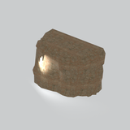
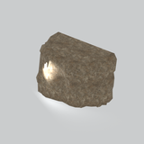
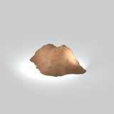
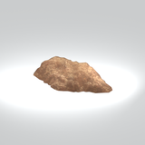
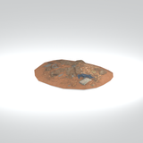

# Terrain &gt; Cliffs - page 2

[Library](../README.md) | [Source / advanced data](../catalogue.json) | [Credits](../sources-and-credits.md)

Static thumbnails only. Open a name or preview for its full still and 360-degree camera reference.

| Preview | Name | Game filename | Description | Tags | Variant / LOD |
|---|---|---|---|---|---|
|  | [Cliff component](../assets/mgsv-tpp-mafr_clff004_rock002-b155ebfe4d90c57d.md) (path-derived) | mafr_clff004_rock002.fmdl | A native cliff model component. Its specific form and assembly have not been visually reviewed. | cliff, component | Variant: No explicit variant token; LOD0; 676 triangles |
|  | [Cliff component](../assets/mgsv-tpp-mafr_clff007_vrtn001-16a58b9c8aa3771a.md) (path-derived) | mafr_clff007_vrtn001.fmdl | A native cliff model component. Its specific form and assembly have not been visually reviewed. | cliff, component | Variant: vrtn001; LOD0; 968 triangles |
|  | [Cliff component](../assets/mgsv-tpp-mafr_clff007_vrtn002-4a58b67fea9e076e.md) (path-derived) | mafr_clff007_vrtn002.fmdl | A native cliff model component. Its specific form and assembly have not been visually reviewed. | cliff, component | Variant: vrtn002; LOD0; 875 triangles |
|  | [Cliff component](../assets/mgsv-tpp-mafr_clff008_wall004-48e9d166745badfc.md) (path-derived) | mafr_clff008_wall004.fmdl | A native cliff model component. Its specific form and assembly have not been visually reviewed. | cliff, component | Variant: No explicit variant token; LOD0; 521 triangles |
|  | [Cliff component](../assets/mgsv-tpp-mafr_clff015_wall002-16fd0d0468233411.md) (path-derived) | mafr_clff015_wall002.fmdl | A native cliff model component. Its specific form and assembly have not been visually reviewed. | cliff, component | Variant: No explicit variant token; LOD0; 1379 triangles |
|  | [Cliff component](../assets/mgsv-tpp-mafr_clff016-cfcfb62b4f9c95ad.md) (path-derived) | mafr_clff016.fmdl | A native cliff model component. Its specific form and assembly have not been visually reviewed. | cliff, component | Variant: No explicit variant token; LOD0; 513 triangles |
|  | [Cliff component](../assets/mgsv-tpp-mafr_clff016_vrtn001-2cfe513633110c5f.md) (path-derived) | mafr_clff016_vrtn001.fmdl | A native cliff model component. Its specific form and assembly have not been visually reviewed. | cliff, component | Variant: vrtn001; LOD0; 513 triangles |
|  | [Cliff component](../assets/mgsv-tpp-mafr_clff018-94552e186d36bb68.md) (path-derived) | mafr_clff018.fmdl | A native cliff model component. Its specific form and assembly have not been visually reviewed. | cliff, component | Variant: No explicit variant token; LOD0; 580 triangles |
|  | [Cliff component](../assets/mgsv-tpp-mafr_clff018_vrtn002-e8c24b910fc72423.md) (path-derived) | mafr_clff018_vrtn002.fmdl | A native cliff model component. Its specific form and assembly have not been visually reviewed. | cliff, component | Variant: vrtn002; LOD0; 372 triangles |
|  | [Cliff component](../assets/mgsv-tpp-mafr_clff021_grnd003-5c9fb7f248752522.md) (path-derived) | mafr_clff021_grnd003.fmdl | A native cliff model component. Its specific form and assembly have not been visually reviewed. | cliff, component | Variant: No explicit variant token; LOD0; 280 triangles |
|  | [Cliff component](../assets/mgsv-tpp-mafr_clff026_grnd001-a7062de690eb38bd.md) (path-derived) | mafr_clff026_grnd001.fmdl | A native cliff model component. Its specific form and assembly have not been visually reviewed. | cliff, component | Variant: No explicit variant token; LOD0; 479 triangles |
|  | [Cliff component](../assets/mgsv-tpp-mafr_clff026_wall001-d053622eaa1b9991.md) (path-derived) | mafr_clff026_wall001.fmdl | A native cliff model component. Its specific form and assembly have not been visually reviewed. | cliff, component | Variant: No explicit variant token; LOD0; 804 triangles |

Pages: [1](cliffs-1.md) | [2](cliffs-2.md) | [3](cliffs-3.md)
