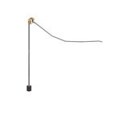
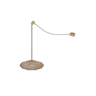
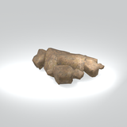
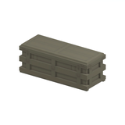
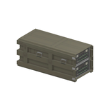
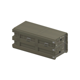
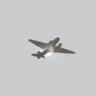

# Discovered static models references - imported batch page 1

Static thumbnails only (at most12/page). Open one entry for its full still/360GIF. Native LOD inventory is separate from rendered coverage.

[Library](../README.md) | [Credits](../sources-and-credits.md) | [Batch provenance](../batch-provenance.json)

| Preview | Asset | Category | Tags | Description | Quality / LOD | Base texture | Model location | Container location |
|---|---|---|---|---|---|---|---|---|
|  | [mgoa lght001](../assets/mgsv-tpp-mgoa_lght001-301caaa81e632bd6.md) | Discovered static models > Installed-source static components | static model, native model, mgoa_lght001 | Textured static native model reference; assembly and interactivity are not inferred. | LOD0; 86 triangles; 4 native levels inventoried; only selectedLOD rendered | 128 x 128; 6 native/DDS mips | `/Assets/mgo/environ/object/mgo_afgh/light/mgoa_lght001/scenes/mgoa_lght001.fmdl` | `/Assets/mgo/pack/location/afc0/pack_common/afc0_common.fpk` (captured source occurrence) |
|  | [mgoa lght001 vrtn002](../assets/mgsv-tpp-mgoa_lght001_vrtn002-ddd9ab7715b7ed2e.md) | Discovered static models > Installed-source static components | static model, native model, mgoa_lght001_vrtn002 | Textured static native model reference; assembly and interactivity are not inferred. | LOD0; 118 triangles; 4 native levels inventoried; only selectedLOD rendered | 256 x 256; 7 native/DDS mips; 128 x 128; 6 native/DDS mips | `/Assets/mgo/environ/object/mgo_afgh/light/mgoa_lght001/scenes/mgoa_lght001_vrtn002.fmdl` | `/Assets/mgo/pack/location/afc0/pack_common/afc0_common.fpk` (captured source occurrence) |
|  | [mgoa rock002 vrtn002](../assets/mgsv-tpp-mgoa_rock002_vrtn002-2168cd665e51d047.md) | Discovered static models > Installed-source static components | static model, native model, mgoa_rock002_vrtn002 | Textured static native model reference; assembly and interactivity are not inferred. | LOD0; 988 triangles; 4 native levels inventoried; only selectedLOD rendered | 1024 x 1024; 9 native/DDS mips | `/Assets/mgo/environ/object/mgo_afgh/rock/mgoa_rock002/scenes/mgoa_rock002_vrtn002.fmdl` | `/Assets/mgo/pack/location/afc0/pack_common/afc0_common.fpk` (captured source occurrence) |
|  | [mgoa tlbx001](../assets/mgsv-tpp-mgoa_tlbx001-182d0f4047008baa.md) | Discovered static models > Installed-source static components | static model, native model, mgoa_tlbx001 | Textured static native model reference; assembly and interactivity are not inferred. | LOD0; 210 triangles; 4 native levels inventoried; only selectedLOD rendered | 512 x 256; 8 native/DDS mips | `/Assets/mgo/environ/object/mgo_afgh/toolbox/mgoa_tlbx001/scenes/mgoa_tlbx001.fmdl` | `/Assets/mgo/pack/location/afc0/pack_common/afc0_common.fpk` (captured source occurrence) |
|  | [mgoa tlbx001 vrtn001](../assets/mgsv-tpp-mgoa_tlbx001_vrtn001-cda41f8220639e28.md) | Discovered static models > Installed-source static components | static model, native model, mgoa_tlbx001_vrtn001 | Textured static native model reference; assembly and interactivity are not inferred. | LOD0; 932 triangles; 4 native levels inventoried; only selectedLOD rendered | 1024 x 512; 9 native/DDS mips; 512 x 256; 8 native/DDS mips | `/Assets/mgo/environ/object/mgo_afgh/toolbox/mgoa_tlbx001/scenes/mgoa_tlbx001_vrtn001.fmdl` | `/Assets/mgo/pack/location/afc0/pack_common/afc0_common.fpk` (captured source occurrence) |
|  | [mgoa tlbx001 vrtn002](../assets/mgsv-tpp-mgoa_tlbx001_vrtn002-4241b9bf3571c2ef.md) | Discovered static models > Installed-source static components | static model, native model, mgoa_tlbx001_vrtn002 | Textured static native model reference; assembly and interactivity are not inferred. | LOD0; 928 triangles; 4 native levels inventoried; only selectedLOD rendered | 1024 x 512; 9 native/DDS mips; 512 x 256; 8 native/DDS mips; 1024 x 1024; 9 native/DDS mips; 128 x 128; 6 native/DDS mips | `/Assets/mgo/environ/object/mgo_afgh/toolbox/mgoa_tlbx001/scenes/mgoa_tlbx001_vrtn002.fmdl` | `/Assets/mgo/pack/location/afc0/pack_common/afc0_common.fpk` (captured source occurrence) |
|  | [mgom arpl001](../assets/mgsv-tpp-mgom_arpl001-655817d897e46fba.md) | Discovered static models > Installed-source static components | static model, native model, mgom_arpl001 | Textured static native model reference; assembly and interactivity are not inferred. | LOD0; 2217 triangles; 4 native levels inventoried; only selectedLOD rendered | 2048 x 2048; 10 native/DDS mips; 2048 x 2048; 10 native/DDS mips | `/Assets/mgo/environ/object/mgo_mafr/airplane/mgom_arpl001/scenes/mgom_arpl001.fmdl` | `/Assets/mgo/pack/location/afc0/pack_common/afc0_common.fpk` (captured source occurrence) |
|  | [mgom base001 vrtn001](../assets/mgsv-tpp-mgom_base001_vrtn001-3b02f7cb69db29a5.md) | Discovered static models > Installed-source static components | static model, native model, mgom_base001_vrtn001 | Textured static native model reference; assembly and interactivity are not inferred. | LOD0; 1460 triangles; 4 native levels inventoried; only selectedLOD rendered | 1024 x 1024; 9 native/DDS mips; 1024 x 1024; 9 native/DDS mips; 1024 x 1024; 9 native/DDS mips; 1024 x 1024; 9 native/DDS mips; 1024 x 1024; 9 native/DDS mips | `/Assets/mgo/environ/object/mgo_mafr/base/mgom_base001/scenes/mgom_base001_vrtn001.fmdl` | `/Assets/mgo/pack/location/afc0/pack_common/afc0_common.fpk` (captured source occurrence) |
|  | [mgom base001 vrtn002](../assets/mgsv-tpp-mgom_base001_vrtn002-93517b1b5460eb4e.md) | Discovered static models > Installed-source static components | static model, native model, mgom_base001_vrtn002 | Textured static native model reference; assembly and interactivity are not inferred. | LOD0; 3366 triangles; 4 native levels inventoried; only selectedLOD rendered | 1024 x 1024; 9 native/DDS mips; 1024 x 1024; 9 native/DDS mips; 1024 x 1024; 9 native/DDS mips; 1024 x 1024; 9 native/DDS mips | `/Assets/mgo/environ/object/mgo_mafr/base/mgom_base001/scenes/mgom_base001_vrtn002.fmdl` | `/Assets/mgo/pack/location/afc0/pack_common/afc0_common.fpk` (captured source occurrence) |
|  | [mgom base001 vrtn004](../assets/mgsv-tpp-mgom_base001_vrtn004-351e059ecdea78ba.md) | Discovered static models > Installed-source static components | static model, native model, mgom_base001_vrtn004 | Textured static native model reference; assembly and interactivity are not inferred. | LOD0; 980 triangles; 4 native levels inventoried; only selectedLOD rendered | 1024 x 1024; 9 native/DDS mips; 1024 x 1024; 9 native/DDS mips | `/Assets/mgo/environ/object/mgo_mafr/base/mgom_base001/scenes/mgom_base001_vrtn004.fmdl` | `/Assets/mgo/pack/location/afc0/pack_common/afc0_common.fpk` (captured source occurrence) |
|  | [mgom base001 vrtn006](../assets/mgsv-tpp-mgom_base001_vrtn006-273208faf22b7440.md) | Discovered static models > Installed-source static components | static model, native model, mgom_base001_vrtn006 | Textured static native model reference; assembly and interactivity are not inferred. | LOD0; 396 triangles; 4 native levels inventoried; only selectedLOD rendered | 1024 x 1024; 9 native/DDS mips; 1024 x 1024; 9 native/DDS mips | `/Assets/mgo/environ/object/mgo_mafr/base/mgom_base001/scenes/mgom_base001_vrtn006.fmdl` | `/Assets/mgo/pack/location/afc0/pack_common/afc0_common.fpk` (captured source occurrence) |
|  | [mgom base001 vrtn008](../assets/mgsv-tpp-mgom_base001_vrtn008-586318fa73b1c635.md) | Discovered static models > Installed-source static components | static model, native model, mgom_base001_vrtn008 | Textured static native model reference; assembly and interactivity are not inferred. | LOD0; 656 triangles; 4 native levels inventoried; only selectedLOD rendered | 1024 x 1024; 9 native/DDS mips; 1024 x 1024; 9 native/DDS mips; 512 x 512; 8 native/DDS mips | `/Assets/mgo/environ/object/mgo_mafr/base/mgom_base001/scenes/mgom_base001_vrtn008.fmdl` | `/Assets/mgo/pack/location/afc0/pack_common/afc0_common.fpk` (captured source occurrence) |

Pages: [1](discovered-static-models-4b29110f-batch-1.md) | [2](discovered-static-models-4b29110f-batch-2.md) | [3](discovered-static-models-4b29110f-batch-3.md)
