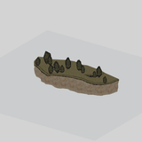
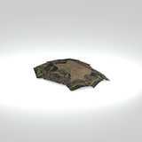
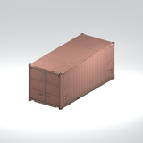
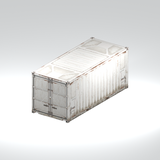
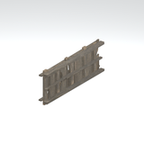
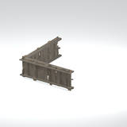

# Discovered static models references - imported batch page 3

Static thumbnails only (at most12/page). Open one entry for its full still/360GIF. Native LOD inventory is separate from rendered coverage.

[Library](../README.md) | [Credits](../sources-and-credits.md) | [Batch provenance](../batch-provenance.json)

| Preview | Asset | Category | Tags | Description | Quality / LOD | Base texture | Model location | Container location |
|---|---|---|---|---|---|---|---|---|
|  | [mgom clff007 rock001](../assets/mgsv-tpp-mgom_clff007_rock001-984ec2d37c6b72f6.md) | Discovered static models > Installed-source static components | static model, native model, mgom_clff007_rock001 | Textured static native model reference; assembly and interactivity are not inferred. | LOD0; 664 triangles; 4 native levels inventoried; only selectedLOD rendered | 512 x 1024; 9 native/DDS mips; 1024 x 1024; 9 native/DDS mips; 1024 x 1024; 9 native/DDS mips; 1024 x 512; 9 native/DDS mips | `/Assets/mgo/environ/object/mgo_mafr/cliff/mgom_clff007/scenes/mgom_clff007_rock001.fmdl` | `/Assets/mgo/pack/location/afc0/pack_common/afc0_common.fpk` (captured source occurrence) |
|  | [mgom clod001](../assets/mgsv-tpp-mgom_clod001-32f447f6cdc76e3b.md) | Discovered static models > Installed-source static components | static model, native model, mgom_clod001 | Textured static native model reference; assembly and interactivity are not inferred. | LOD0; 228 triangles; 4 native levels inventoried; only selectedLOD rendered | 1024 x 1024; 9 native/DDS mips; 512 x 512; 8 native/DDS mips | `/Assets/mgo/environ/object/mgo_mafr/clod/mgom_clod001/scenes/mgom_clod001.fmdl` | `/Assets/mgo/pack/location/afc0/pack_common/afc0_common.fpk` (captured source occurrence) |
|  | [mgom cntn001 vrtn 001](../assets/mgsv-tpp-mgom_cntn001_vrtn_001-6ea1a1783ed1e48c.md) | Discovered static models > Installed-source static components | static model, native model, mgom_cntn001_vrtn_001 | Textured static native model reference; assembly and interactivity are not inferred. | LOD0; 482 triangles; 4 native levels inventoried; only selectedLOD rendered | 128 x 128; 6 native/DDS mips; 1024 x 1024; 9 native/DDS mips | `/Assets/mgo/environ/object/mgo_mafr/container/mgom_cntn001/scenes/mgom_cntn001_vrtn_001.fmdl` | `/Assets/mgo/pack/location/afc0/pack_common/afc0_common.fpk` (captured source occurrence) |
|  | [mgom cntn001 vrtn 002](../assets/mgsv-tpp-mgom_cntn001_vrtn_002-c26f90c1e8a462c7.md) | Discovered static models > Installed-source static components | static model, native model, mgom_cntn001_vrtn_002 | Textured static native model reference; assembly and interactivity are not inferred. | LOD0; 482 triangles; 4 native levels inventoried; only selectedLOD rendered | 128 x 128; 6 native/DDS mips; 1024 x 1024; 9 native/DDS mips | `/Assets/mgo/environ/object/mgo_mafr/container/mgom_cntn001/scenes/mgom_cntn001_vrtn_002.fmdl` | `/Assets/mgo/pack/location/afc0/pack_common/afc0_common.fpk` (captured source occurrence) |
|  | [mgom fenc001 vrtn001](../assets/mgsv-tpp-mgom_fenc001_vrtn001-de17f122cd8013e4.md) | Discovered static models > Installed-source static components | static model, native model, mgom_fenc001_vrtn001 | Textured static native model reference; assembly and interactivity are not inferred. | LOD0; 384 triangles; 4 native levels inventoried; only selectedLOD rendered | 1024 x 1024; 9 native/DDS mips | `/Assets/mgo/environ/object/mgo_mafr/fence/mgom_fenc001/scenes/mgom_fenc001_vrtn001.fmdl` | `/Assets/mgo/pack/location/afc0/pack_common/afc0_common.fpk` (captured source occurrence) |
|  | [mgom fenc001 vrtn002](../assets/mgsv-tpp-mgom_fenc001_vrtn002-40b809f19715bf16.md) | Discovered static models > Installed-source static components | static model, native model, mgom_fenc001_vrtn002 | Textured static native model reference; assembly and interactivity are not inferred. | LOD0; 768 triangles; 4 native levels inventoried; only selectedLOD rendered | 1024 x 1024; 9 native/DDS mips | `/Assets/mgo/environ/object/mgo_mafr/fence/mgom_fenc001/scenes/mgom_fenc001_vrtn002.fmdl` | `/Assets/mgo/pack/location/afc0/pack_common/afc0_common.fpk` (captured source occurrence) |

Pages: [1](discovered-static-models-4b29110f-batch-1.md) | [2](discovered-static-models-4b29110f-batch-2.md) | [3](discovered-static-models-4b29110f-batch-3.md)
