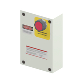

# Equipment references - imported batch page 1

Static thumbnails only (at most12/page). Open one entry for its full still/360GIF. Native LOD inventory is separate from rendered coverage.

[Library](../README.md) | [Credits](../sources-and-credits.md) | [Batch provenance](../batch-provenance.json)

| Preview | Asset | Category | Tags | Description | Quality / LOD | Base texture | Model location | Container location |
|---|---|---|---|---|---|---|---|---|
|  | [Emergency-stop / control switch panel](../assets/mgsv-tpp-gntn_swtc001_vrtn001-2254517a6e54.md) | Equipment > Controls and fixtures | switch, control-panel, emergency-stop, guantanamo-namespace | A small control panel with a red emergency-stop style switch. The model namespace is guantanamo; its retained occurrence is on Mother Base. No working interaction is claimed. | LOD0; 32 triangles; 4 native levels inventoried; only selectedLOD rendered | 512 x 256; 8 native/DDS mips | `/Assets/tpp/environ/object/guantanamo/switch/gntn_swtc001/scenes/gntn_swtc001_vrtn001.fmdl` | `/Assets/tpp/pack/location/mtbs/pack_area/mtbs_area_ly003_cl02.fpk` (retained occurrence) |

Pages: [1](equipment-batch-1.md)
