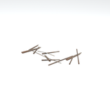
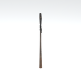
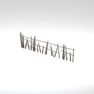
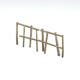
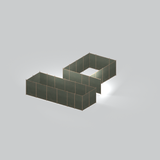
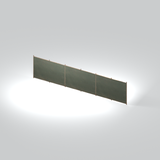
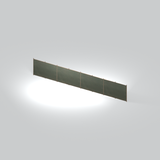
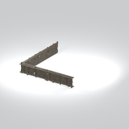
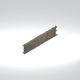
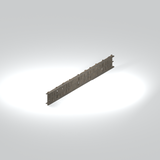

# Architecture &gt; Fences and barriers - page 1

[Library](../README.md) | [Source / advanced data](../catalogue.json) | [Credits](../sources-and-credits.md)

Static thumbnails only. Open a name or preview for its full still and 360-degree camera reference.

| Preview | Name | Game filename | Description | Tags | Variant / LOD |
|---|---|---|---|---|---|
|  | [Fence component](../assets/mgsv-tpp-mafr_fenc001_vrtn001-87200fccdea5b807.md) (path-derived) | mafr_fenc001_vrtn001.fmdl | A native fence model component. Its specific form and assembly have not been visually reviewed. | fence, component | Variant: vrtn001; LOD0; 164 triangles |
|  | [Fence component](../assets/mgsv-tpp-mafr_fenc001_vrtn002-0843bc59acd13501.md) (path-derived) | mafr_fenc001_vrtn002.fmdl | A native fence model component. Its specific form and assembly have not been visually reviewed. | fence, component | Variant: vrtn002; LOD0; 78 triangles |
|  | [Fence component](../assets/mgsv-tpp-mafr_fenc001_vrtn005-19c17cd8731e540b.md) (path-derived) | mafr_fenc001_vrtn005.fmdl | A native fence model component. Its specific form and assembly have not been visually reviewed. | fence, component | Variant: vrtn005; LOD0; 422 triangles |
|  | [Fence component](../assets/mgsv-tpp-mafr_fenc004-29dd781317fcde15.md) (path-derived) | mafr_fenc004.fmdl | A native fence model component. Its specific form and assembly have not been visually reviewed. | fence, component | Variant: No explicit variant token; LOD0; 152 triangles |
|  | [Fence component](../assets/mgsv-tpp-mgom_fenc003_vrtn005-d144b2f8222ee9da.md) (path-derived) | mgom_fenc003_vrtn005.fmdl | A native fence model component. Its specific form and assembly have not been visually reviewed. | fence, component | Variant: vrtn005; LOD0; 502 triangles |
|  | [Panel fence section](../assets/mgsv-tpp-mgom_fenc004_vrtn001-20533870403bda8c.md) | mgom_fenc004_vrtn001.fmdl | A straight row of flat fence panels with narrow upright posts. | panel fence, barrier, posts | Variant: vrtn001; LOD0; 574 triangles |
|  | [Panel fence section](../assets/mgsv-tpp-mgom_fenc004_vrtn002-174a403c8d528bff.md) | mgom_fenc004_vrtn002.fmdl | A straight row of flat fence panels with narrow upright posts, retained as its own native variant. | panel fence, barrier, posts | Variant: vrtn002; LOD0; 748 triangles |
|  | [Wooden fence corner section](../assets/mgsv-tpp-mgom_fenc001_vrtn002-40b809f19715bf16.md) | mgom_fenc001_vrtn002.fmdl | Two adjoining wooden fence sections forming a corner. | wood, fence, barrier, planks, rails, corner, mgo | Variant: vrtn002; LOD0; 768 triangles |
|  | [Wooden fence corner section](../assets/mgsv-tpp-mgom_fenc001_vrtn003-ebf344d4a60e32fc.md) | mgom_fenc001_vrtn003.fmdl | Two joined wooden fence panels form a corner, shown as a static construction component. | wooden fence, corner, panel | Variant: vrtn003; LOD0; 1248 triangles |
|  | [Wooden fence panel](../assets/mgsv-tpp-mgom_fenc001_vrtn004-03b6cbdc5a2aec18.md) | mgom_fenc001_vrtn004.fmdl | A straight wooden board fence panel with upright posts, shown as a separate component. | wooden fence, panel, barrier | Variant: vrtn004; LOD0; 656 triangles |
|  | [Wooden fence panel](../assets/mgsv-tpp-mgom_fenc001_vrtn005-f43755cff5150410.md) | mgom_fenc001_vrtn005.fmdl | A long straight wooden board fence panel with upright posts, shown as a separate component. | wooden fence, panel, barrier | Variant: vrtn005; LOD0; 984 triangles |
|  | [Wooden fence section](../assets/mgsv-tpp-mgom_fenc001_vrtn001-de17f122cd8013e4.md) | mgom_fenc001_vrtn001.fmdl | A straight plank fence section with horizontal rails and upright boards. | wood, fence, barrier, planks, rails, mgo | Variant: vrtn001; LOD0; 384 triangles |

Pages: [1](fences-and-barriers-1.md) | [2](fences-and-barriers-2.md)
