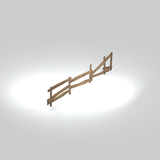

# Architecture &gt; Fences and barriers - page 2

[Library](../README.md) | [Source / advanced data](../catalogue.json) | [Credits](../sources-and-credits.md)

Static thumbnails only. Open a name or preview for its full still and 360-degree camera reference.

| Preview | Name | Game filename | Description | Tags | Variant / LOD |
|---|---|---|---|---|---|
|  | [Wooden rail fence section](../assets/mgsv-tpp-mgom_fenc005_vrtn002-d7f864821c05612d.md) | mgom_fenc005_vrtn002.fmdl | An open fence section built from horizontal wooden rails and upright supports, retained as its own native variant. | wooden fence, rails, posts | Variant: vrtn002; LOD0; 252 triangles |

Pages: [1](fences-and-barriers-1.md) | [2](fences-and-barriers-2.md)
