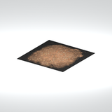
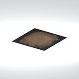

# Terrain &gt; Ground patches - page 1

[Library](../README.md) | [Source / advanced data](../catalogue.json) | [Credits](../sources-and-credits.md)

Static thumbnails only. Open a name or preview for its full still and 360-degree camera reference.

| Preview | Name | Game filename | Description | Tags | Variant / LOD |
|---|---|---|---|---|---|
|  | [Gravel ground patch](../assets/mgsv-tpp-mgom_fndt001_grvl001-50ed22e76a794a1c.md) | mgom_fndt001_grvl001.fmdl | A flat square ground patch with a gravel-like surface and a dark outer edge. | gravel, ground, terrain patch | Variant: No explicit variant token; LOD0; 2 triangles |
|  | [Gravel ground patch](../assets/mgsv-tpp-mgom_fndt001_grvl002-cc8fb28e005dfc1b.md) | mgom_fndt001_grvl002.fmdl | A flat square ground patch with a mottled gravel-like surface and a dark outer edge. | gravel, ground, terrain patch | Variant: No explicit variant token; LOD0; 2 triangles |

Pages: [1](ground-patches-1.md)
