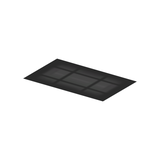
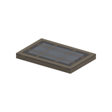
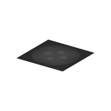
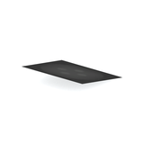

# Equipment &gt; Lighting - page 1

[Library](../README.md) | [Source / advanced data](../catalogue.json) | [Credits](../sources-and-credits.md)

Static thumbnails only. Open a name or preview for its full still and 360-degree camera reference.

| Preview | Name | Game filename | Description | Tags | Variant / LOD |
|---|---|---|---|---|---|
|  | [Light component](../assets/mgsv-tpp-mgob_lght005_emit002-b271fc63c0962014.md) (path-derived) | mgob_lght005_emit002.fmdl | A native light model component. Its specific form and assembly have not been visually reviewed. | lighting, component | Variant: No explicit variant token; LOD0; 2 triangles |
|  | [Light component](../assets/mgsv-tpp-mgob_lght005_vrtn003-bd03013a5d9265d7.md) (path-derived) | mgob_lght005_vrtn003.fmdl | A native light model component. Its specific form and assembly have not been visually reviewed. | lighting, component | Variant: vrtn003; LOD0; 24 triangles |
|  | [Light component](../assets/mgsv-tpp-mgob_lght008_emit001-b5a166d9eedc06ec.md) (path-derived) | mgob_lght008_emit001.fmdl | A native light model component. Its specific form and assembly have not been visually reviewed. | lighting, component | Variant: No explicit variant token; LOD0; 2 triangles |
|  | [Light component](../assets/mgsv-tpp-mgob_lght008_emit002-de41bda622d08f7c.md) (path-derived) | mgob_lght008_emit002.fmdl | A native light model component. Its specific form and assembly have not been visually reviewed. | lighting, component | Variant: No explicit variant token; LOD0; 2 triangles |
|  | [Light pole and cable component](../assets/mgsv-tpp-mgoa_lght001-301caaa81e632bd6.md) | mgoa_lght001.fmdl | A slender light-pole component with a cable extending to one side. | light, light-pole, cable, fixture, mgo | Variant: No explicit variant token; LOD0; 86 triangles |
|  | [Light pole with cable-end fixture](../assets/mgsv-tpp-mgoa_lght001_vrtn002-ddd9ab7715b7ed2e.md) | mgoa_lght001_vrtn002.fmdl | A slender pole and cable with a separate box-like end fixture and a base patch. | light, light-pole, cable, fixture, base, mgo | Variant: vrtn002; LOD0; 118 triangles |

Pages: [1](lighting-1.md)
