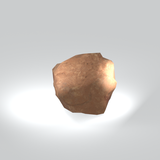
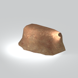
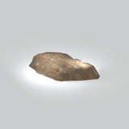
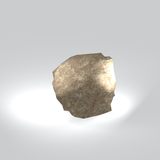
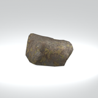
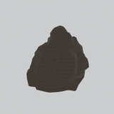
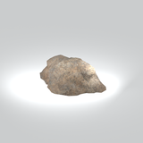

# Terrain &gt; Rocks - page 1

[Library](../README.md) | [Source / advanced data](../catalogue.json) | [Credits](../sources-and-credits.md)

Static thumbnails only. Open a name or preview for its full still and 360-degree camera reference.

| Preview | Name | Game filename | Description | Tags | Variant / LOD |
|---|---|---|---|---|---|
|  | [Rock cluster](../assets/mgsv-tpp-mgoa_rock002_vrtn002-2168cd665e51d047.md) | mgoa_rock002_vrtn002.fmdl | A cluster of irregular boulders with a rough rock surface. | rock, boulder, rock-cluster, terrain, mgo | Variant: vrtn002; LOD0; 988 triangles |
|  | [Rock component](../assets/mgsv-tpp-mafr_rock001_vrtn001-d73dff0f7851a8ab.md) (path-derived) | mafr_rock001_vrtn001.fmdl | A native rock model component. Its specific form and assembly have not been visually reviewed. | rock, component | Variant: vrtn001; LOD0; 383 triangles |
|  | [Rock component](../assets/mgsv-tpp-mafr_rock001_vrtn002-ad263e403e1a52ec.md) (path-derived) | mafr_rock001_vrtn002.fmdl | A native rock model component. Its specific form and assembly have not been visually reviewed. | rock, component | Variant: vrtn002; LOD0; 166 triangles |
|  | [Rock component](../assets/mgsv-tpp-mafr_rock002-c7f714c3981dca19.md) (path-derived) | mafr_rock002.fmdl | A native rock model component. Its specific form and assembly have not been visually reviewed. | rock, component | Variant: No explicit variant token; LOD0; 379 triangles |
|  | [Rock component](../assets/mgsv-tpp-mafr_rock007_vrtn002-f0ff37cb614b1afb.md) (path-derived) | mafr_rock007_vrtn002.fmdl | A native rock model component. Its specific form and assembly have not been visually reviewed. | rock, component | Variant: vrtn002; LOD0; 341 triangles |
|  | [Rock component](../assets/mgsv-tpp-mafr_rock007_vrtn003-3e63898300b9e757.md) (path-derived) | mafr_rock007_vrtn003.fmdl | A native rock model component. Its specific form and assembly have not been visually reviewed. | rock, component | Variant: vrtn003; LOD0; 264 triangles |
|  | [Rock component](../assets/mgsv-tpp-mafr_rock009_vrtn001-f52455085ec2f244.md) (path-derived) | mafr_rock009_vrtn001.fmdl | A native rock model component. Its specific form and assembly have not been visually reviewed. | rock, component | Variant: vrtn001; LOD0; 959 triangles |
|  | [Rock component](../assets/mgsv-tpp-mafr_rock010-bed66c4f4f7f3ba1.md) (path-derived) | mafr_rock010.fmdl | A native rock model component. Its specific form and assembly have not been visually reviewed. | rock, component | Variant: No explicit variant token; LOD0; 670 triangles |

Pages: [1](rocks-1.md)
