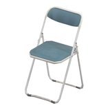
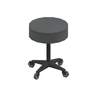
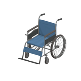

# Seating references - page1

Three original asset identities with twelve native LOD views in the retained scope. Static thumbnails only; open an asset for its LOD comparisons and individually linked larger previews.

[Library index](../README.md) | [Plan](../RESEARCH-PLAN.md) | [JSON](../catalogue.json) | [Parent CSV](../catalogue.csv) | [LOD CSV](../quality-variants.csv)

| Preview | Asset | Category | Tags | Description | Quality / LOD | Base texture | Model location | Container location |
|---|---|---|---|---|---|---|---|---|
|  | [Folding chair](../assets/mgsv-tpp-mtbs_char002-5f80c9bdacda.md) | Furniture > Seating | chair, folding-chair, seating, furniture, metal-frame, blue-upholstery, hangar, mother-base | A weathered blue folding chair with a white metal frame, suitable as a visual reference for hangar, office or rest-area seating. | LOD0; 358 triangles; highest retained ([all 4](../assets/mgsv-tpp-mtbs_char002-5f80c9bdacda.md#native-lod-comparison)) | 512x256 pixels; 8 native mips | `/Assets/tpp/environ/object/mother_base/chair/mtbs_char002/scenes/mtbs_char002.fmdl` | `/Assets/tpp/pack/mission2/free/f30050/f30050_hanger_btg00.fpk` (retained bytes verified) |
|  | [Rolling stool](../assets/mgsv-tpp-cypr_char001-af15e4cfc6f2.md) | Furniture > Seating | stool, rolling-stool, seating, furniture, medical, casters, paz-room, cyprus | A round padded stool on a five-caster base, shown as a static reference for medical or workshop seating. | LOD0; 196 triangles; highest retained ([all 4](../assets/mgsv-tpp-cypr_char001-af15e4cfc6f2.md#native-lod-comparison)) | 256x128 pixels; 7 native mips | `/Assets/tpp/environ/object/cyprus/chair/cypr_char001/scenes/cypr_char001.fmdl` | `/Assets/tpp/pack/location/mtbs/pack_unique/mtbs_unique_0040.fpk` (retained bytes verified) |
|  | [Wheelchair](../assets/mgsv-tpp-cypr_whch001-68d6a4c0c875.md) | Furniture > Seating | wheelchair, medical, seating, mobility, blue-upholstery, paz-room, cyprus | A blue wheelchair with large rear wheels, push handles and front footrests, shown as a static medical-furniture reference. | LOD0; 1588 triangles; highest retained ([all 4](../assets/mgsv-tpp-cypr_whch001-68d6a4c0c875.md#native-lod-comparison)) | 1024x1024 pixels; 9 native mips | `/Assets/tpp/environ/object/cyprus/wheelchair/cypr_whch001/scenes/cypr_whch001.fmdl` | `/Assets/tpp/pack/location/mtbs/pack_unique/mtbs_unique_0040.fpk` (retained bytes verified) |
