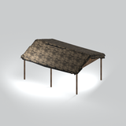
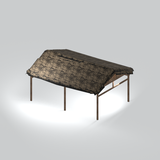
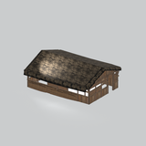

# Architecture &gt; Shelters - page 1

[Library](../README.md) | [Source / advanced data](../catalogue.json) | [Credits](../sources-and-credits.md)

Static thumbnails only. Open a name or preview for its full still and 360-degree camera reference.

| Preview | Name | Game filename | Description | Tags | Variant / LOD |
|---|---|---|---|---|---|
|  | [Open-sided thatched shelter](../assets/mgsv-tpp-mgom_hous004_vrtn002-1d5bb3a1f1be9939.md) | mgom_hous004_vrtn002.fmdl | A thatched roof held above upright wooden supports, shown without a fully enclosed set of walls. | thatched roof, shelter, posts | Variant: vrtn002; LOD0; 622 triangles |
|  | [Open-sided thatched shelter](../assets/mgsv-tpp-mgom_hous004_vrtn003-4be2f5136018956a.md) | mgom_hous004_vrtn003.fmdl | A thatched roof and upright wooden supports, shown as an open-sided shelter variant. | thatched roof, shelter, posts | Variant: vrtn003; LOD0; 686 triangles |
|  | [Thatched shelter with partial walls](../assets/mgsv-tpp-mgom_hous004_vrtn001-a91d44227f3b916e.md) | mgom_hous004_vrtn001.fmdl | A thatched roof over wooden supports and partial low walls. This reference does not establish a complete enclosed house. | thatched roof, shelter, partial walls | Variant: vrtn001; LOD0; 1562 triangles |

Pages: [1](shelters-1.md)
