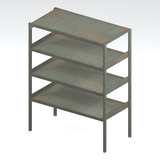
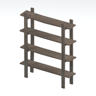
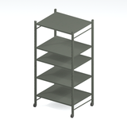
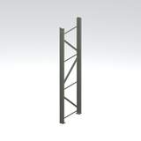

# Furniture &gt; Storage components - page 1

[Library](../README.md) | [Source / advanced data](../catalogue.json) | [Credits](../sources-and-credits.md)

Static thumbnails only. Open a name or preview for its full still and 360-degree camera reference.

| Preview | Name | Game filename | Description | Tags | Variant / LOD |
|---|---|---|---|---|---|
|  | [Shelf component](../assets/mgsv-tpp-gntn_shlf001_vrtn001-169fdea969dc1e98.md) (path-derived) | gntn_shlf001_vrtn001.fmdl | A native shelf model component. Its specific form and assembly have not been visually reviewed. | shelf, component | Variant: vrtn001; LOD0; 144 triangles |
|  | [Shelf component](../assets/mgsv-tpp-mafr_shlf001-e113b947bf604afa.md) (path-derived) | mafr_shlf001.fmdl | A native shelf model component. Its specific form and assembly have not been visually reviewed. | shelf, component | Variant: No explicit variant token; LOD0; 212 triangles |
|  | [Shelf component / variant 002](../assets/mgsv-tpp-mtbs_shlf007_vrtn002-f2cf2c909150.md) | mtbs_shlf007_vrtn002.fmdl | A native metal shelf component or variant. The full assembled storage unit and interaction are not established. | shelf, storage, component, mother-base | Variant: vrtn002; LOD0; 240 triangles |
|  | [Shelf upright / frame component](../assets/mgsv-tpp-mtbs_shlf007_vrtn001-026dfb56725c.md) | mtbs_shlf007_vrtn001.fmdl | An individual shelf upright or frame component, rather than a complete assembled shelf. | shelf, upright, frame, storage, mother-base | Variant: vrtn001; LOD0; 36 triangles |

Pages: [1](storage-components-1.md)
