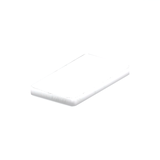
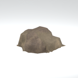
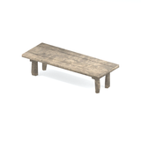
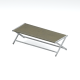
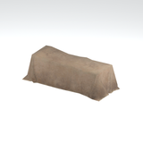

# Unclassified &gt; Unclassified components - page 1

[Library](../README.md) | [Source / advanced data](../catalogue.json) | [Credits](../sources-and-credits.md)

Static thumbnails only. Open a name or preview for its full still and 360-degree camera reference.

| Preview | Name | Game filename | Description | Tags | Variant / LOD |
|---|---|---|---|---|---|
|  | [Unidentified model (afgh_antn001_dbri001)](../assets/mgsv-tpp-afgh_antn001_dbri001-89a7c1ddcbc63bb9.md) (unidentified) | afgh_antn001_dbri001.fmdl | Native model reference; a readable object identification has not been reviewed. |  | Variant: No explicit variant token; LOD0; 44 triangles |
|  | [Unidentified model (afgh_antn001_dbri002)](../assets/mgsv-tpp-afgh_antn001_dbri002-093697cbda8dff81.md) (unidentified) | afgh_antn001_dbri002.fmdl | Native model reference; a readable object identification has not been reviewed. |  | Variant: No explicit variant token; LOD0; 64 triangles |
|  | [Unidentified model (afgh_antn001_dbri003)](../assets/mgsv-tpp-afgh_antn001_dbri003-3d9886745cd5e3c5.md) (unidentified) | afgh_antn001_dbri003.fmdl | Native model reference; a readable object identification has not been reviewed. |  | Variant: No explicit variant token; LOD0; 136 triangles |
|  | [Unidentified model (afgh_antn001_dbri004)](../assets/mgsv-tpp-afgh_antn001_dbri004-041c39a5bc21825c.md) (unidentified) | afgh_antn001_dbri004.fmdl | Native model reference; a readable object identification has not been reviewed. |  | Variant: No explicit variant token; LOD0; 108 triangles |
|  | [Unidentified model (afgh_antn001_fndt001)](../assets/mgsv-tpp-afgh_antn001_fndt001-0aae2c4629f42b41.md) (unidentified) | afgh_antn001_fndt001.fmdl | Native model reference; a readable object identification has not been reviewed. |  | Variant: No explicit variant token; LOD0; 190 triangles |
|  | [Unidentified model (afgh_antn004)](../assets/mgsv-tpp-afgh_antn004-7e0b11ad6c10be80.md) (unidentified) | afgh_antn004.fmdl | Native model reference; a readable object identification has not been reviewed. |  | Variant: No explicit variant token; LOD0; 300 triangles |
|  | [Unidentified model (afgh_asht001)](../assets/mgsv-tpp-afgh_asht001-57fba903de9911bf.md) (unidentified) | afgh_asht001.fmdl | Native model reference; a readable object identification has not been reviewed. |  | Variant: No explicit variant token; LOD0; 30 triangles |
|  | [Unidentified model (afgh_bedd006_mttr005)](../assets/mgsv-tpp-afgh_bedd006_mttr005-3fa1ff1facecd9e9.md) (unidentified) | afgh_bedd006_mttr005.fmdl | Native model reference; a readable object identification has not been reviewed. |  | Variant: No explicit variant token; LOD0; 44 triangles |
|  | [Unidentified model (afgh_blmt001)](../assets/mgsv-tpp-afgh_blmt001-728284d685140e5b.md) (unidentified) | afgh_blmt001.fmdl | Native model reference; a readable object identification has not been reviewed. |  | Variant: No explicit variant token; LOD0; 338 triangles |
|  | [Unidentified model (afgh_bnch001)](../assets/mgsv-tpp-afgh_bnch001-16993bf297417661.md) (unidentified) | afgh_bnch001.fmdl | Native model reference; a readable object identification has not been reviewed. |  | Variant: No explicit variant token; LOD0; 92 triangles |
|  | [Unidentified model (afgh_bnch002)](../assets/mgsv-tpp-afgh_bnch002-998954f98ab4ae1c.md) (unidentified) | afgh_bnch002.fmdl | Native model reference; a readable object identification has not been reviewed. |  | Variant: No explicit variant token; LOD0; 102 triangles |
|  | [Unidentified model (afgh_boxx003)](../assets/mgsv-tpp-afgh_boxx003-f54d72a33d30e220.md) (unidentified) | afgh_boxx003.fmdl | Native model reference; a readable object identification has not been reviewed. |  | Variant: No explicit variant token; LOD0; 105 triangles |

Pages: [1](unclassified-components-1.md) | [2](unclassified-components-2.md) | [3](unclassified-components-3.md) | [4](unclassified-components-4.md) | [5](unclassified-components-5.md) | [6](unclassified-components-6.md) | [7](unclassified-components-7.md) | [8](unclassified-components-8.md) | [9](unclassified-components-9.md) | [10](unclassified-components-10.md) | [11](unclassified-components-11.md) | [12](unclassified-components-12.md) | [13](unclassified-components-13.md) | [14](unclassified-components-14.md) | [15](unclassified-components-15.md) | [16](unclassified-components-16.md) | [17](unclassified-components-17.md) | [18](unclassified-components-18.md) | [19](unclassified-components-19.md) | [20](unclassified-components-20.md) | [21](unclassified-components-21.md) | [22](unclassified-components-22.md) | [23](unclassified-components-23.md) | [24](unclassified-components-24.md) | [25](unclassified-components-25.md) | [26](unclassified-components-26.md) | [27](unclassified-components-27.md) | [28](unclassified-components-28.md) | [29](unclassified-components-29.md) | [30](unclassified-components-30.md) | [31](unclassified-components-31.md) | [32](unclassified-components-32.md)
