# Unclassified &gt; Unclassified components - page 1

[Library](../README.md) | [Source / advanced data](../catalogue.json) | [Credits](../sources-and-credits.md)

Static thumbnails only. Open a name or preview for its full still and 360-degree camera reference.

| Preview | Name | Game filename | Description | Tags | Variant / LOD |
|---|---|---|---|---|---|
| [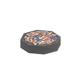](../assets/mgsv-tpp-afgh_asht001-57fba903de9911bf.md) | [Unidentified model (afgh_asht001)](../assets/mgsv-tpp-afgh_asht001-57fba903de9911bf.md) (unidentified) | afgh_asht001.fmdl | Native model reference; a readable object identification has not been reviewed. |  | Variant: No explicit variant token; LOD0; 30 triangles |
| [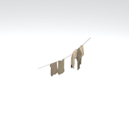](../assets/mgsv-tpp-afgh_clth005_fl-55c86a008e45dfe2.md) | [Unidentified model (afgh_clth005_fl)](../assets/mgsv-tpp-afgh_clth005_fl-55c86a008e45dfe2.md) (unidentified) | afgh_clth005_fl.fmdl | Native model reference; a readable object identification has not been reviewed. |  | Variant: No explicit variant token; LOD0; 319 triangles |
| [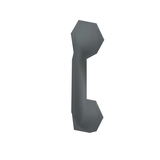](../assets/mgsv-tpp-afgh_cmmn002_dbri001-b68faa58225d9efd.md) | [Unidentified model (afgh_cmmn002_dbri001)](../assets/mgsv-tpp-afgh_cmmn002_dbri001-b68faa58225d9efd.md) (unidentified) | afgh_cmmn002_dbri001.fmdl | Native model reference; a readable object identification has not been reviewed. |  | Variant: No explicit variant token; LOD0; 52 triangles |
| [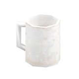](../assets/mgsv-tpp-afgh_cupp001_br-9a08f9747efd311a.md) | [Unidentified model (afgh_cupp001_br)](../assets/mgsv-tpp-afgh_cupp001_br-9a08f9747efd311a.md) (unidentified) | afgh_cupp001_br.fmdl | Native model reference; a readable object identification has not been reviewed. |  | Variant: No explicit variant token; LOD0; 84 triangles |
| [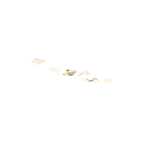](../assets/mgsv-tpp-afgh_dcmt001-93df5d27a4c48eea.md) | [Unidentified model (afgh_dcmt001)](../assets/mgsv-tpp-afgh_dcmt001-93df5d27a4c48eea.md) (unidentified) | afgh_dcmt001.fmdl | Native model reference; a readable object identification has not been reviewed. |  | Variant: No explicit variant token; LOD0; 12 triangles |
| [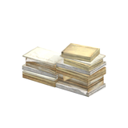](../assets/mgsv-tpp-afgh_dcmt002-37a8a70e33807788.md) | [Unidentified model (afgh_dcmt002)](../assets/mgsv-tpp-afgh_dcmt002-37a8a70e33807788.md) (unidentified) | afgh_dcmt002.fmdl | Native model reference; a readable object identification has not been reviewed. |  | Variant: No explicit variant token; LOD0; 178 triangles |
| [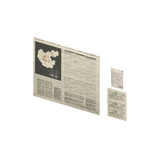](../assets/mgsv-tpp-afgh_pstr001_vrtn002-884df9f5ecdee5c4.md) | [Unidentified model (afgh_pstr001_vrtn002)](../assets/mgsv-tpp-afgh_pstr001_vrtn002-884df9f5ecdee5c4.md) (unidentified) | afgh_pstr001_vrtn002.fmdl | Native model reference; a readable object identification has not been reviewed. |  | Variant: vrtn002; LOD0; 6 triangles |
| [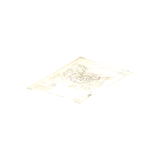](../assets/mgsv-tpp-afgh_pstr002_vrtn001-7fab5351c3f06482.md) | [Unidentified model (afgh_pstr002_vrtn001)](../assets/mgsv-tpp-afgh_pstr002_vrtn001-7fab5351c3f06482.md) (unidentified) | afgh_pstr002_vrtn001.fmdl | Native model reference; a readable object identification has not been reviewed. |  | Variant: vrtn001; LOD0; 2 triangles |
| [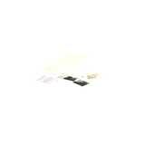](../assets/mgsv-tpp-afgh_pstr002_vrtn005-803ed3396043ad65.md) | [Unidentified model (afgh_pstr002_vrtn005)](../assets/mgsv-tpp-afgh_pstr002_vrtn005-803ed3396043ad65.md) (unidentified) | afgh_pstr002_vrtn005.fmdl | Native model reference; a readable object identification has not been reviewed. |  | Variant: vrtn005; LOD0; 16 triangles |
| [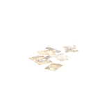](../assets/mgsv-tpp-afgh_pstr002_vrtn006-dad41af632877891.md) | [Unidentified model (afgh_pstr002_vrtn006)](../assets/mgsv-tpp-afgh_pstr002_vrtn006-dad41af632877891.md) (unidentified) | afgh_pstr002_vrtn006.fmdl | Native model reference; a readable object identification has not been reviewed. |  | Variant: vrtn006; LOD0; 14 triangles |
| [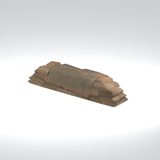](../assets/mgsv-tpp-afgh_sndb003_vrtn001-7b0c71e3412a9a4a.md) | [Unidentified model (afgh_sndb003_vrtn001)](../assets/mgsv-tpp-afgh_sndb003_vrtn001-7b0c71e3412a9a4a.md) (unidentified) | afgh_sndb003_vrtn001.fmdl | Native model reference; a readable object identification has not been reviewed. |  | Variant: vrtn001; LOD0; 509 triangles |
| [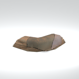](../assets/mgsv-tpp-afgh_sndb004_vrtn001-bdc22555283c2141.md) | [Unidentified model (afgh_sndb004_vrtn001)](../assets/mgsv-tpp-afgh_sndb004_vrtn001-bdc22555283c2141.md) (unidentified) | afgh_sndb004_vrtn001.fmdl | Native model reference; a readable object identification has not been reviewed. |  | Variant: vrtn001; LOD0; 871 triangles |

Pages: [1](unclassified-components-1.md) | [2](unclassified-components-2.md) | [3](unclassified-components-3.md) | [4](unclassified-components-4.md) | [5](unclassified-components-5.md) | [6](unclassified-components-6.md) | [7](unclassified-components-7.md) | [8](unclassified-components-8.md) | [9](unclassified-components-9.md) | [10](unclassified-components-10.md) | [11](unclassified-components-11.md) | [12](unclassified-components-12.md) | [13](unclassified-components-13.md) | [14](unclassified-components-14.md) | [15](unclassified-components-15.md) | [16](unclassified-components-16.md) | [17](unclassified-components-17.md) | [18](unclassified-components-18.md) | [19](unclassified-components-19.md)
