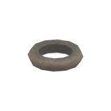
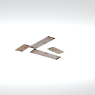
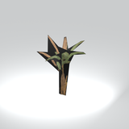

# Unclassified &gt; Unclassified components - page 10

[Library](../README.md) | [Source / advanced data](../catalogue.json) | [Credits](../sources-and-credits.md)

Static thumbnails only. Open a name or preview for its full still and 360-degree camera reference.

| Preview | Name | Game filename | Description | Tags | Variant / LOD |
|---|---|---|---|---|---|
|  | [Unidentified model (mafr_pddl001_vrtn001)](../assets/mgsv-tpp-mafr_pddl001_vrtn001-67f2f5aff0ffb21a.md) (unidentified) | mafr_pddl001_vrtn001.fmdl | Native model reference; a readable object identification has not been reviewed. |  | Variant: vrtn001; LOD0; 2 triangles |
|  | [Unidentified model (mafr_pstr003)](../assets/mgsv-tpp-mafr_pstr003-0e2f347f6f9a1fe3.md) (unidentified) | mafr_pstr003.fmdl | Native model reference; a readable object identification has not been reviewed. |  | Variant: No explicit variant token; LOD0; 2 triangles |
|  | [Unidentified model (mafr_sgbd001_vrtn001)](../assets/mgsv-tpp-mafr_sgbd001_vrtn001-025294d6ae80dc16.md) (unidentified) | mafr_sgbd001_vrtn001.fmdl | Native model reference; a readable object identification has not been reviewed. |  | Variant: vrtn001; LOD0; 60 triangles |
|  | [Unidentified model (mafr_sgbd002)](../assets/mgsv-tpp-mafr_sgbd002-17f31cefd9481eba.md) (unidentified) | mafr_sgbd002.fmdl | Native model reference; a readable object identification has not been reviewed. |  | Variant: No explicit variant token; LOD0; 134 triangles |
|  | [Unidentified model (mafr_star001)](../assets/mgsv-tpp-mafr_star001-0f0130f4088afe73.md) (unidentified) | mafr_star001.fmdl | Native model reference; a readable object identification has not been reviewed. |  | Variant: No explicit variant token; LOD0; 242 triangles |
|  | [Unidentified model (mafr_star001_vrtn001)](../assets/mgsv-tpp-mafr_star001_vrtn001-5df3cce8af37d094.md) (unidentified) | mafr_star001_vrtn001.fmdl | Native model reference; a readable object identification has not been reviewed. |  | Variant: vrtn001; LOD0; 62 triangles |
|  | [Unidentified model (mafr_ston002_rock001)](../assets/mgsv-tpp-mafr_ston002_rock001-5f3c143161fb6168.md) (unidentified) | mafr_ston002_rock001.fmdl | Native model reference; a readable object identification has not been reviewed. |  | Variant: No explicit variant token; LOD0; 218 triangles |
|  | [Unidentified model (mafr_ston002_rock002)](../assets/mgsv-tpp-mafr_ston002_rock002-a8b236d00b1e54d5.md) (unidentified) | mafr_ston002_rock002.fmdl | Native model reference; a readable object identification has not been reviewed. |  | Variant: No explicit variant token; LOD0; 218 triangles |
|  | [Unidentified model (mafr_tent002_door001_gm)](../assets/mgsv-tpp-mafr_tent002_door001_gm-e95f75d3b7e14ffe.md) (unidentified) | mafr_tent002_door001_gm.fmdl | Native model reference; a readable object identification has not been reviewed. |  | Variant: No explicit variant token; LOD0; 4 triangles |
|  | [Unidentified model (mafr_tire001)](../assets/mgsv-tpp-mafr_tire001-bfcd33127983d23b.md) (unidentified) | mafr_tire001.fmdl | Native model reference; a readable object identification has not been reviewed. |  | Variant: No explicit variant token; LOD0; 120 triangles |
|  | [Unidentified model (mafr_tnwl003_vrtn001)](../assets/mgsv-tpp-mafr_tnwl003_vrtn001-1a71a8ff705f3bd2.md) (unidentified) | mafr_tnwl003_vrtn001.fmdl | Native model reference; a readable object identification has not been reviewed. |  | Variant: vrtn001; LOD0; 16 triangles |
|  | [Unidentified model (mafr_tree005_dsvw004)](../assets/mgsv-tpp-mafr_tree005_dsvw004-be223beb64535229.md) (unidentified) | mafr_tree005_dsvw004.fmdl | Native model reference; a readable object identification has not been reviewed. |  | Variant: No explicit variant token; LOD0; 22 triangles |

Pages: [1](unclassified-components-1.md) | [2](unclassified-components-2.md) | [3](unclassified-components-3.md) | [4](unclassified-components-4.md) | [5](unclassified-components-5.md) | [6](unclassified-components-6.md) | [7](unclassified-components-7.md) | [8](unclassified-components-8.md) | [9](unclassified-components-9.md) | [10](unclassified-components-10.md) | [11](unclassified-components-11.md) | [12](unclassified-components-12.md) | [13](unclassified-components-13.md) | [14](unclassified-components-14.md) | [15](unclassified-components-15.md) | [16](unclassified-components-16.md) | [17](unclassified-components-17.md) | [18](unclassified-components-18.md) | [19](unclassified-components-19.md) | [20](unclassified-components-20.md) | [21](unclassified-components-21.md) | [22](unclassified-components-22.md) | [23](unclassified-components-23.md) | [24](unclassified-components-24.md) | [25](unclassified-components-25.md) | [26](unclassified-components-26.md) | [27](unclassified-components-27.md) | [28](unclassified-components-28.md)
