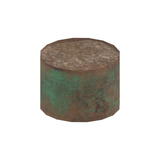
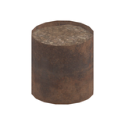
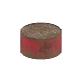
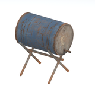
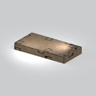
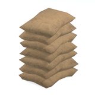
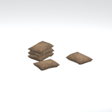
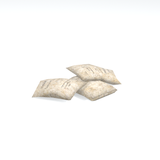
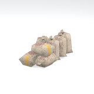
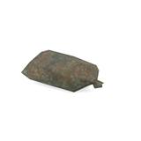

# Unclassified &gt; Unclassified components - page 12

[Library](../README.md) | [Source / advanced data](../catalogue.json) | [Credits](../sources-and-credits.md)

Static thumbnails only. Open a name or preview for its full still and 360-degree camera reference.

| Preview | Name | Game filename | Description | Tags | Variant / LOD |
|---|---|---|---|---|---|
|  | [Unidentified model (mafr_drum001_vrtn001)](../assets/mgsv-tpp-mafr_drum001_vrtn001-c0c7b2b398dc9a52.md) (unidentified) | mafr_drum001_vrtn001.fmdl | Native model reference; a readable object identification has not been reviewed. |  | Variant: vrtn001; LOD0; 60 triangles |
|  | [Unidentified model (mafr_drum001_vrtn002)](../assets/mgsv-tpp-mafr_drum001_vrtn002-e79aed1aaa446069.md) (unidentified) | mafr_drum001_vrtn002.fmdl | Native model reference; a readable object identification has not been reviewed. |  | Variant: vrtn002; LOD0; 60 triangles |
|  | [Unidentified model (mafr_drum002_vrtn001)](../assets/mgsv-tpp-mafr_drum002_vrtn001-ef567e9dc7b7c47c.md) (unidentified) | mafr_drum002_vrtn001.fmdl | Native model reference; a readable object identification has not been reviewed. |  | Variant: vrtn001; LOD0; 80 triangles |
|  | [Unidentified model (mafr_drum002_vrtn002)](../assets/mgsv-tpp-mafr_drum002_vrtn002-50aea5377fc46ae1.md) (unidentified) | mafr_drum002_vrtn002.fmdl | Native model reference; a readable object identification has not been reviewed. |  | Variant: vrtn002; LOD0; 80 triangles |
|  | [Unidentified model (mafr_drum002_vrtn003)](../assets/mgsv-tpp-mafr_drum002_vrtn003-64e1095346b0dbf9.md) (unidentified) | mafr_drum002_vrtn003.fmdl | Native model reference; a readable object identification has not been reviewed. |  | Variant: vrtn003; LOD0; 80 triangles |
|  | [Unidentified model (mafr_drum004)](../assets/mgsv-tpp-mafr_drum004-8998d1992cf7f425.md) (unidentified) | mafr_drum004.fmdl | Native model reference; a readable object identification has not been reviewed. |  | Variant: No explicit variant token; LOD0; 176 triangles |
|  | [Unidentified model (mafr_fndt001)](../assets/mgsv-tpp-mafr_fndt001-9a3cf2069fe0e56e.md) (unidentified) | mafr_fndt001.fmdl | Native model reference; a readable object identification has not been reviewed. |  | Variant: No explicit variant token; LOD0; 180 triangles |
|  | [Unidentified model (mafr_gnsc001)](../assets/mgsv-tpp-mafr_gnsc001-21d82a83dace1c57.md) (unidentified) | mafr_gnsc001.fmdl | Native model reference; a readable object identification has not been reviewed. |  | Variant: No explicit variant token; LOD0; 365 triangles |
|  | [Unidentified model (mafr_gnsc001_vrtn001)](../assets/mgsv-tpp-mafr_gnsc001_vrtn001-d3cf2869e4dbd254.md) (unidentified) | mafr_gnsc001_vrtn001.fmdl | Native model reference; a readable object identification has not been reviewed. |  | Variant: vrtn001; LOD0; 263 triangles |
|  | [Unidentified model (mafr_gnsc002)](../assets/mgsv-tpp-mafr_gnsc002-4fe036db75cec85c.md) (unidentified) | mafr_gnsc002.fmdl | Native model reference; a readable object identification has not been reviewed. |  | Variant: No explicit variant token; LOD0; 134 triangles |
|  | [Unidentified model (mafr_gnsc002_vrtn003)](../assets/mgsv-tpp-mafr_gnsc002_vrtn003-7880c8c615bd1e26.md) (unidentified) | mafr_gnsc002_vrtn003.fmdl | Native model reference; a readable object identification has not been reviewed. |  | Variant: vrtn003; LOD0; 560 triangles |
|  | [Unidentified model (mafr_gnsc002_vrtn004)](../assets/mgsv-tpp-mafr_gnsc002_vrtn004-b8807103c3e04d76.md) (unidentified) | mafr_gnsc002_vrtn004.fmdl | Native model reference; a readable object identification has not been reviewed. |  | Variant: vrtn004; LOD0; 80 triangles |

Pages: [1](unclassified-components-1.md) | [2](unclassified-components-2.md) | [3](unclassified-components-3.md) | [4](unclassified-components-4.md) | [5](unclassified-components-5.md) | [6](unclassified-components-6.md) | [7](unclassified-components-7.md) | [8](unclassified-components-8.md) | [9](unclassified-components-9.md) | [10](unclassified-components-10.md) | [11](unclassified-components-11.md) | [12](unclassified-components-12.md) | [13](unclassified-components-13.md) | [14](unclassified-components-14.md) | [15](unclassified-components-15.md) | [16](unclassified-components-16.md) | [17](unclassified-components-17.md) | [18](unclassified-components-18.md) | [19](unclassified-components-19.md) | [20](unclassified-components-20.md) | [21](unclassified-components-21.md) | [22](unclassified-components-22.md) | [23](unclassified-components-23.md) | [24](unclassified-components-24.md) | [25](unclassified-components-25.md) | [26](unclassified-components-26.md) | [27](unclassified-components-27.md) | [28](unclassified-components-28.md) | [29](unclassified-components-29.md) | [30](unclassified-components-30.md) | [31](unclassified-components-31.md) | [32](unclassified-components-32.md) | [33](unclassified-components-33.md)
