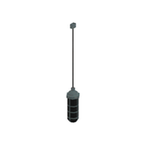
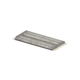
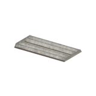
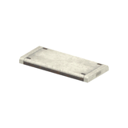

# Unclassified &gt; Unclassified components - page 13

[Library](../README.md) | [Source / advanced data](../catalogue.json) | [Credits](../sources-and-credits.md)

Static thumbnails only. Open a name or preview for its full still and 360-degree camera reference.

| Preview | Name | Game filename | Description | Tags | Variant / LOD |
|---|---|---|---|---|---|
|  | [Unidentified model (mgoa_hutt008_door001)](../assets/mgsv-tpp-mgoa_hutt008_door001-17e7ffe1098ae8f3.md) (unidentified) | mgoa_hutt008_door001.fmdl | Native model reference; a readable object identification has not been reviewed. |  | Variant: No explicit variant token; LOD0; 66 triangles |
|  | [Unidentified model (mgoa_lamp001_emit001)](../assets/mgsv-tpp-mgoa_lamp001_emit001-2320b3a4eead4309.md) (unidentified) | mgoa_lamp001_emit001.fmdl | Native model reference; a readable object identification has not been reviewed. |  | Variant: No explicit variant token; LOD0; 94 triangles |
|  | [Unidentified model (mgoa_lamp002)](../assets/mgsv-tpp-mgoa_lamp002-ffc1f725178edcff.md) (unidentified) | mgoa_lamp002.fmdl | Native model reference; a readable object identification has not been reviewed. |  | Variant: No explicit variant token; LOD0; 116 triangles |
|  | [Unidentified model (mgoa_lamp003)](../assets/mgsv-tpp-mgoa_lamp003-27aa9431c3fb00dd.md) (unidentified) | mgoa_lamp003.fmdl | Native model reference; a readable object identification has not been reviewed. |  | Variant: No explicit variant token; LOD0; 124 triangles |
|  | [Unidentified model (mgoa_lamp003_emit001)](../assets/mgsv-tpp-mgoa_lamp003_emit001-355ab2e012ef449c.md) (unidentified) | mgoa_lamp003_emit001.fmdl | Native model reference; a readable object identification has not been reviewed. |  | Variant: No explicit variant token; LOD0; 98 triangles |
|  | [Unidentified model (mgoa_lamp003_emit002)](../assets/mgsv-tpp-mgoa_lamp003_emit002-7f53b5a07777a679.md) (unidentified) | mgoa_lamp003_emit002.fmdl | Native model reference; a readable object identification has not been reviewed. |  | Variant: No explicit variant token; LOD0; 94 triangles |
|  | [Unidentified model (mgoa_lamp003_vrtn001)](../assets/mgsv-tpp-mgoa_lamp003_vrtn001-3774d265661789f4.md) (unidentified) | mgoa_lamp003_vrtn001.fmdl | Native model reference; a readable object identification has not been reviewed. |  | Variant: vrtn001; LOD0; 52 triangles |
|  | [Unidentified model (mgoa_lamp004)](../assets/mgsv-tpp-mgoa_lamp004-51608ace98e895a1.md) (unidentified) | mgoa_lamp004.fmdl | Native model reference; a readable object identification has not been reviewed. |  | Variant: No explicit variant token; LOD0; 388 triangles |
|  | [Unidentified model (mgom_hutt003_vrtn001)](../assets/mgsv-tpp-mgom_hutt003_vrtn001-2a1ffc6882b7ee80.md) (unidentified) | mgom_hutt003_vrtn001.fmdl | Native model reference; a readable object identification has not been reviewed. |  | Variant: vrtn001; LOD0; 194 triangles |
|  | [Unidentified model (mgom_pstr003_vrtn006)](../assets/mgsv-tpp-mgom_pstr003_vrtn006-2a6645d2bd73c641.md) (unidentified) | mgom_pstr003_vrtn006.fmdl | Native model reference; a readable object identification has not been reviewed. |  | Variant: vrtn006; LOD0; 20 triangles |
|  | [Unidentified model (mgom_tnwl003)](../assets/mgsv-tpp-mgom_tnwl003-01a9f19ba23b860f.md) (unidentified) | mgom_tnwl003.fmdl | Native model reference; a readable object identification has not been reviewed. |  | Variant: No explicit variant token; LOD0; 240 triangles |
|  | [Unidentified model (mgom_wdbx001_vrtn001)](../assets/mgsv-tpp-mgom_wdbx001_vrtn001-a7081a751f6e35cc.md) (unidentified) | mgom_wdbx001_vrtn001.fmdl | Native model reference; a readable object identification has not been reviewed. |  | Variant: vrtn001; LOD0; 772 triangles |

Pages: [1](unclassified-components-1.md) | [2](unclassified-components-2.md) | [3](unclassified-components-3.md) | [4](unclassified-components-4.md) | [5](unclassified-components-5.md) | [6](unclassified-components-6.md) | [7](unclassified-components-7.md) | [8](unclassified-components-8.md) | [9](unclassified-components-9.md) | [10](unclassified-components-10.md) | [11](unclassified-components-11.md) | [12](unclassified-components-12.md) | [13](unclassified-components-13.md) | [14](unclassified-components-14.md)
