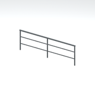
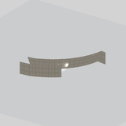
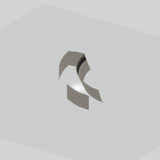
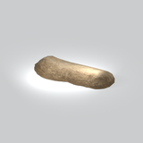

# Unclassified &gt; Unclassified components - page 13

[Library](../README.md) | [Source / advanced data](../catalogue.json) | [Credits](../sources-and-credits.md)

Static thumbnails only. Open a name or preview for its full still and 360-degree camera reference.

| Preview | Name | Game filename | Description | Tags | Variant / LOD |
|---|---|---|---|---|---|
|  | [Unidentified model (mgoa_cran001)](../assets/mgsv-tpp-mgoa_cran001-4fd359c82f12d9bd.md) (unidentified) | mgoa_cran001.fmdl | Native model reference; a readable object identification has not been reviewed. |  | Variant: No explicit variant token; LOD0; 1270 triangles |
|  | [Unidentified model (mgoa_cran001_vrtn001)](../assets/mgsv-tpp-mgoa_cran001_vrtn001-e506f07717d86059.md) (unidentified) | mgoa_cran001_vrtn001.fmdl | Native model reference; a readable object identification has not been reviewed. |  | Variant: vrtn001; LOD0; 886 triangles |
|  | [Unidentified model (mgoa_cran001_vrtn002)](../assets/mgsv-tpp-mgoa_cran001_vrtn002-ef759e58bccda3c3.md) (unidentified) | mgoa_cran001_vrtn002.fmdl | Native model reference; a readable object identification has not been reviewed. |  | Variant: vrtn002; LOD0; 132 triangles |
|  | [Unidentified model (mgoa_cran001_vrtn003)](../assets/mgsv-tpp-mgoa_cran001_vrtn003-b2590af8deebf97f.md) (unidentified) | mgoa_cran001_vrtn003.fmdl | Native model reference; a readable object identification has not been reviewed. |  | Variant: vrtn003; LOD0; 122 triangles |
|  | [Unidentified model (mgoa_cran001_vrtn004)](../assets/mgsv-tpp-mgoa_cran001_vrtn004-9eed078424da1285.md) (unidentified) | mgoa_cran001_vrtn004.fmdl | Native model reference; a readable object identification has not been reviewed. |  | Variant: vrtn004; LOD0; 1270 triangles |
|  | [Unidentified model (mgoa_ctwk001_vrtn002)](../assets/mgsv-tpp-mgoa_ctwk001_vrtn002-3be688930be61937.md) (unidentified) | mgoa_ctwk001_vrtn002.fmdl | Native model reference; a readable object identification has not been reviewed. |  | Variant: vrtn002; LOD0; 172 triangles |
|  | [Unidentified model (mgoa_ctwk001_vrtn003)](../assets/mgsv-tpp-mgoa_ctwk001_vrtn003-7dccd67d5da00b22.md) (unidentified) | mgoa_ctwk001_vrtn003.fmdl | Native model reference; a readable object identification has not been reviewed. |  | Variant: vrtn003; LOD0; 120 triangles |
|  | [Unidentified model (mgoa_ctwk001_vrtn005)](../assets/mgsv-tpp-mgoa_ctwk001_vrtn005-bd96195106f37482.md) (unidentified) | mgoa_ctwk001_vrtn005.fmdl | Native model reference; a readable object identification has not been reviewed. |  | Variant: vrtn005; LOD0; 44 triangles |
|  | [Unidentified model (mgoa_dams001_vrtn005)](../assets/mgsv-tpp-mgoa_dams001_vrtn005-2361413bf8c37528.md) (unidentified) | mgoa_dams001_vrtn005.fmdl | Native model reference; a readable object identification has not been reviewed. |  | Variant: vrtn005; LOD0; 431 triangles |
|  | [Unidentified model (mgoa_dams001_vrtn006)](../assets/mgsv-tpp-mgoa_dams001_vrtn006-ab766fb966de5307.md) (unidentified) | mgoa_dams001_vrtn006.fmdl | Native model reference; a readable object identification has not been reviewed. |  | Variant: vrtn006; LOD0; 453 triangles |
|  | [Unidentified model (mgoa_dtch001_vrtn001)](../assets/mgsv-tpp-mgoa_dtch001_vrtn001-83a5f38b284e8730.md) (unidentified) | mgoa_dtch001_vrtn001.fmdl | Native model reference; a readable object identification has not been reviewed. |  | Variant: vrtn001; LOD0; 334 triangles |
|  | [Unidentified model (mgoa_dtch001_vrtn002)](../assets/mgsv-tpp-mgoa_dtch001_vrtn002-c178dbd3fe2ccc0e.md) (unidentified) | mgoa_dtch001_vrtn002.fmdl | Native model reference; a readable object identification has not been reviewed. |  | Variant: vrtn002; LOD0; 334 triangles |

Pages: [1](unclassified-components-1.md) | [2](unclassified-components-2.md) | [3](unclassified-components-3.md) | [4](unclassified-components-4.md) | [5](unclassified-components-5.md) | [6](unclassified-components-6.md) | [7](unclassified-components-7.md) | [8](unclassified-components-8.md) | [9](unclassified-components-9.md) | [10](unclassified-components-10.md) | [11](unclassified-components-11.md) | [12](unclassified-components-12.md) | [13](unclassified-components-13.md) | [14](unclassified-components-14.md) | [15](unclassified-components-15.md) | [16](unclassified-components-16.md) | [17](unclassified-components-17.md) | [18](unclassified-components-18.md) | [19](unclassified-components-19.md) | [20](unclassified-components-20.md) | [21](unclassified-components-21.md) | [22](unclassified-components-22.md) | [23](unclassified-components-23.md) | [24](unclassified-components-24.md) | [25](unclassified-components-25.md) | [26](unclassified-components-26.md) | [27](unclassified-components-27.md) | [28](unclassified-components-28.md)
