# Unclassified &gt; Unclassified components - page 15

[Library](../README.md) | [Source / advanced data](../catalogue.json) | [Credits](../sources-and-credits.md)

Static thumbnails only. Open a name or preview for its full still and 360-degree camera reference.

| Preview | Name | Game filename | Description | Tags | Variant / LOD |
|---|---|---|---|---|---|
| [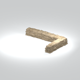](../assets/mgsv-tpp-mgoa_sndb002_vtrn007-ee84143042c51a7a.md) | [Unidentified model (mgoa_sndb002_vtrn007)](../assets/mgsv-tpp-mgoa_sndb002_vtrn007-ee84143042c51a7a.md) (unidentified) | mgoa_sndb002_vtrn007.fmdl | Native model reference; a readable object identification has not been reviewed. |  | Variant: No explicit variant token; LOD0; 2388 triangles |
| [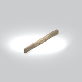](../assets/mgsv-tpp-mgoa_sndb002_vtrn008-fc8e6a791633b6df.md) | [Unidentified model (mgoa_sndb002_vtrn008)](../assets/mgsv-tpp-mgoa_sndb002_vtrn008-fc8e6a791633b6df.md) (unidentified) | mgoa_sndb002_vtrn008.fmdl | Native model reference; a readable object identification has not been reviewed. |  | Variant: No explicit variant token; LOD0; 1680 triangles |
| [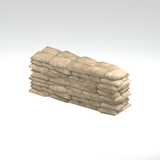](../assets/mgsv-tpp-mgoa_sndb002_vtrn009-5d194ec549b58316.md) | [Unidentified model (mgoa_sndb002_vtrn009)](../assets/mgsv-tpp-mgoa_sndb002_vtrn009-5d194ec549b58316.md) (unidentified) | mgoa_sndb002_vtrn009.fmdl | Native model reference; a readable object identification has not been reviewed. |  | Variant: No explicit variant token; LOD0; 1194 triangles |
| [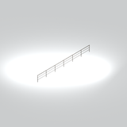](../assets/mgsv-tpp-mgoa_stfr003_vrtn001-f78e6f50c2554799.md) | [Unidentified model (mgoa_stfr003_vrtn001)](../assets/mgsv-tpp-mgoa_stfr003_vrtn001-f78e6f50c2554799.md) (unidentified) | mgoa_stfr003_vrtn001.fmdl | Native model reference; a readable object identification has not been reviewed. |  | Variant: vrtn001; LOD0; 116 triangles |
| [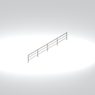](../assets/mgsv-tpp-mgoa_stfr003_vrtn002-e0a1215b65448177.md) | [Unidentified model (mgoa_stfr003_vrtn002)](../assets/mgsv-tpp-mgoa_stfr003_vrtn002-e0a1215b65448177.md) (unidentified) | mgoa_stfr003_vrtn002.fmdl | Native model reference; a readable object identification has not been reviewed. |  | Variant: vrtn002; LOD0; 76 triangles |
| [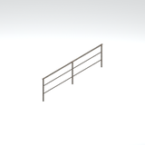](../assets/mgsv-tpp-mgoa_stfr003_vrtn003-611ddb23ef059bb4.md) | [Unidentified model (mgoa_stfr003_vrtn003)](../assets/mgsv-tpp-mgoa_stfr003_vrtn003-611ddb23ef059bb4.md) (unidentified) | mgoa_stfr003_vrtn003.fmdl | Native model reference; a readable object identification has not been reviewed. |  | Variant: vrtn003; LOD0; 44 triangles |
| [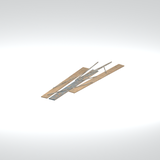](../assets/mgsv-tpp-mgoa_stfr004_scfd003-5d88bcb1d8b63853.md) | [Unidentified model (mgoa_stfr004_scfd003)](../assets/mgsv-tpp-mgoa_stfr004_scfd003-5d88bcb1d8b63853.md) (unidentified) | mgoa_stfr004_scfd003.fmdl | Native model reference; a readable object identification has not been reviewed. |  | Variant: No explicit variant token; LOD0; 176 triangles |
| [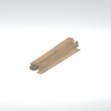](../assets/mgsv-tpp-mgoa_stfr004_scfd004-fb8b32db65f75c7c.md) | [Unidentified model (mgoa_stfr004_scfd004)](../assets/mgsv-tpp-mgoa_stfr004_scfd004-fb8b32db65f75c7c.md) (unidentified) | mgoa_stfr004_scfd004.fmdl | Native model reference; a readable object identification has not been reviewed. |  | Variant: No explicit variant token; LOD0; 168 triangles |
| [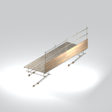](../assets/mgsv-tpp-mgoa_stfr004_vrtn001-e9f378d4acac0bb6.md) | [Unidentified model (mgoa_stfr004_vrtn001)](../assets/mgsv-tpp-mgoa_stfr004_vrtn001-e9f378d4acac0bb6.md) (unidentified) | mgoa_stfr004_vrtn001.fmdl | Native model reference; a readable object identification has not been reviewed. |  | Variant: vrtn001; LOD0; 1036 triangles |
| [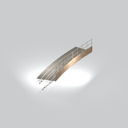](../assets/mgsv-tpp-mgoa_stfr004_vrtn002-7f98261ecb62be26.md) | [Unidentified model (mgoa_stfr004_vrtn002)](../assets/mgsv-tpp-mgoa_stfr004_vrtn002-7f98261ecb62be26.md) (unidentified) | mgoa_stfr004_vrtn002.fmdl | Native model reference; a readable object identification has not been reviewed. |  | Variant: vrtn002; LOD0; 2178 triangles |
| [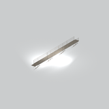](../assets/mgsv-tpp-mgoa_stfr004_vrtn003-6a6c117b8c38b1d9.md) | [Unidentified model (mgoa_stfr004_vrtn003)](../assets/mgsv-tpp-mgoa_stfr004_vrtn003-6a6c117b8c38b1d9.md) (unidentified) | mgoa_stfr004_vrtn003.fmdl | Native model reference; a readable object identification has not been reviewed. |  | Variant: vrtn003; LOD0; 2388 triangles |
| [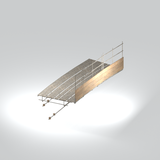](../assets/mgsv-tpp-mgoa_stfr004_vrtn004-441cea4580f14cef.md) | [Unidentified model (mgoa_stfr004_vrtn004)](../assets/mgsv-tpp-mgoa_stfr004_vrtn004-441cea4580f14cef.md) (unidentified) | mgoa_stfr004_vrtn004.fmdl | Native model reference; a readable object identification has not been reviewed. |  | Variant: vrtn004; LOD0; 1460 triangles |

Pages: [1](unclassified-components-1.md) | [2](unclassified-components-2.md) | [3](unclassified-components-3.md) | [4](unclassified-components-4.md) | [5](unclassified-components-5.md) | [6](unclassified-components-6.md) | [7](unclassified-components-7.md) | [8](unclassified-components-8.md) | [9](unclassified-components-9.md) | [10](unclassified-components-10.md) | [11](unclassified-components-11.md) | [12](unclassified-components-12.md) | [13](unclassified-components-13.md) | [14](unclassified-components-14.md) | [15](unclassified-components-15.md) | [16](unclassified-components-16.md) | [17](unclassified-components-17.md)
