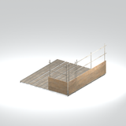
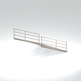
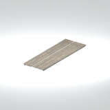
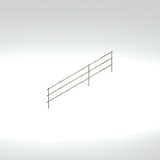
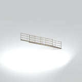
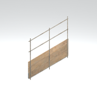

# Unclassified &gt; Unclassified components - page 16

[Library](../README.md) | [Source / advanced data](../catalogue.json) | [Credits](../sources-and-credits.md)

Static thumbnails only. Open a name or preview for its full still and 360-degree camera reference.

| Preview | Name | Game filename | Description | Tags | Variant / LOD |
|---|---|---|---|---|---|
|  | [Unidentified model (mgoa_stfr004_vrtn003)](../assets/mgsv-tpp-mgoa_stfr004_vrtn003-6a6c117b8c38b1d9.md) (unidentified) | mgoa_stfr004_vrtn003.fmdl | Native model reference; a readable object identification has not been reviewed. |  | Variant: vrtn003; LOD0; 2388 triangles |
|  | [Unidentified model (mgoa_stfr004_vrtn004)](../assets/mgsv-tpp-mgoa_stfr004_vrtn004-441cea4580f14cef.md) (unidentified) | mgoa_stfr004_vrtn004.fmdl | Native model reference; a readable object identification has not been reviewed. |  | Variant: vrtn004; LOD0; 1460 triangles |
|  | [Unidentified model (mgoa_stfr004_vrtn005)](../assets/mgsv-tpp-mgoa_stfr004_vrtn005-513851873eb45fb5.md) (unidentified) | mgoa_stfr004_vrtn005.fmdl | Native model reference; a readable object identification has not been reviewed. |  | Variant: vrtn005; LOD0; 776 triangles |
|  | [Unidentified model (mgoa_stfr004_vrtn006)](../assets/mgsv-tpp-mgoa_stfr004_vrtn006-5aa2b8f9e46b656c.md) (unidentified) | mgoa_stfr004_vrtn006.fmdl | Native model reference; a readable object identification has not been reviewed. |  | Variant: vrtn006; LOD0; 632 triangles |
|  | [Unidentified model (mgoa_stfr004_vrtn007)](../assets/mgsv-tpp-mgoa_stfr004_vrtn007-126375f236052e6d.md) (unidentified) | mgoa_stfr004_vrtn007.fmdl | Native model reference; a readable object identification has not been reviewed. |  | Variant: vrtn007; LOD0; 264 triangles |
|  | [Unidentified model (mgoa_stfr004_vrtn008)](../assets/mgsv-tpp-mgoa_stfr004_vrtn008-4a3b10b49c0e35df.md) (unidentified) | mgoa_stfr004_vrtn008.fmdl | Native model reference; a readable object identification has not been reviewed. |  | Variant: vrtn008; LOD0; 120 triangles |
|  | [Unidentified model (mgoa_stfr004_vrtn009)](../assets/mgsv-tpp-mgoa_stfr004_vrtn009-ed8ea520fab838dc.md) (unidentified) | mgoa_stfr004_vrtn009.fmdl | Native model reference; a readable object identification has not been reviewed. |  | Variant: vrtn009; LOD0; 620 triangles |
|  | [Unidentified model (mgoa_stfr004_vrtn010)](../assets/mgsv-tpp-mgoa_stfr004_vrtn010-5e2f36585203fab6.md) (unidentified) | mgoa_stfr004_vrtn010.fmdl | Native model reference; a readable object identification has not been reviewed. |  | Variant: vrtn010; LOD0; 156 triangles |
|  | [Unidentified model (mgoa_stfr004_vrtn011)](../assets/mgsv-tpp-mgoa_stfr004_vrtn011-7b5120490464e520.md) (unidentified) | mgoa_stfr004_vrtn011.fmdl | Native model reference; a readable object identification has not been reviewed. |  | Variant: vrtn011; LOD0; 136 triangles |
|  | [Unidentified model (mgoa_stfr004_vrtn012)](../assets/mgsv-tpp-mgoa_stfr004_vrtn012-d646211bbc7928b2.md) (unidentified) | mgoa_stfr004_vrtn012.fmdl | Native model reference; a readable object identification has not been reviewed. |  | Variant: vrtn012; LOD0; 136 triangles |
|  | [Unidentified model (mgoa_stfr004_vrtn013)](../assets/mgsv-tpp-mgoa_stfr004_vrtn013-8db87fe9a52c51ac.md) (unidentified) | mgoa_stfr004_vrtn013.fmdl | Native model reference; a readable object identification has not been reviewed. |  | Variant: vrtn013; LOD0; 584 triangles |
|  | [Unidentified model (mgoa_stfr004_vrtn015)](../assets/mgsv-tpp-mgoa_stfr004_vrtn015-ece985c350b3e780.md) (unidentified) | mgoa_stfr004_vrtn015.fmdl | Native model reference; a readable object identification has not been reviewed. |  | Variant: vrtn015; LOD0; 312 triangles |

Pages: [1](unclassified-components-1.md) | [2](unclassified-components-2.md) | [3](unclassified-components-3.md) | [4](unclassified-components-4.md) | [5](unclassified-components-5.md) | [6](unclassified-components-6.md) | [7](unclassified-components-7.md) | [8](unclassified-components-8.md) | [9](unclassified-components-9.md) | [10](unclassified-components-10.md) | [11](unclassified-components-11.md) | [12](unclassified-components-12.md) | [13](unclassified-components-13.md) | [14](unclassified-components-14.md) | [15](unclassified-components-15.md) | [16](unclassified-components-16.md) | [17](unclassified-components-17.md) | [18](unclassified-components-18.md)
