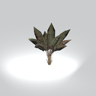
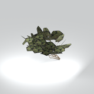
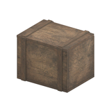
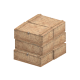
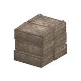
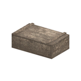
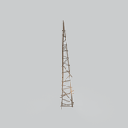

# Unclassified &gt; Unclassified components - page 16

[Library](../README.md) | [Source / advanced data](../catalogue.json) | [Credits](../sources-and-credits.md)

Static thumbnails only. Open a name or preview for its full still and 360-degree camera reference.

| Preview | Name | Game filename | Description | Tags | Variant / LOD |
|---|---|---|---|---|---|
|  | [Unidentified model (mafr_tree031_vrtn003)](../assets/mgsv-tpp-mafr_tree031_vrtn003-522c89c96ecef584.md) (unidentified) | mafr_tree031_vrtn003.fmdl | Native model reference; a readable object identification has not been reviewed. |  | Variant: vrtn003; LOD0; 8 triangles |
|  | [Unidentified model (mafr_tree031_vrtn005)](../assets/mgsv-tpp-mafr_tree031_vrtn005-eaa9a48b67cecf41.md) (unidentified) | mafr_tree031_vrtn005.fmdl | Native model reference; a readable object identification has not been reviewed. |  | Variant: vrtn005; LOD0; 2 triangles |
|  | [Unidentified model (mafr_tree034_dsvw002)](../assets/mgsv-tpp-mafr_tree034_dsvw002-18488aacee22be0f.md) (unidentified) | mafr_tree034_dsvw002.fmdl | Native model reference; a readable object identification has not been reviewed. |  | Variant: No explicit variant token; LOD0; 85 triangles |
|  | [Unidentified model (mafr_tree038)](../assets/mgsv-tpp-mafr_tree038-c63d07ba8abcff33.md) (unidentified) | mafr_tree038.fmdl | Native model reference; a readable object identification has not been reviewed. |  | Variant: No explicit variant token; LOD0; 850 triangles |
|  | [Unidentified model (mafr_tree038_dsvw001_gen8)](../assets/mgsv-tpp-mafr_tree038_dsvw001_gen8-b767168f3b4d7964.md) (unidentified) | mafr_tree038_dsvw001_gen8.fmdl | Native model reference; a readable object identification has not been reviewed. |  | Variant: No explicit variant token; LOD0; 595 triangles |
|  | [Unidentified model (mafr_tree040_gen8)](../assets/mgsv-tpp-mafr_tree040_gen8-44d14a14e60c84fd.md) (unidentified) | mafr_tree040_gen8.fmdl | Native model reference; a readable object identification has not been reviewed. |  | Variant: No explicit variant token; LOD0; 610 triangles |
|  | [Unidentified model (mafr_wdbx001_vrtn006)](../assets/mgsv-tpp-mafr_wdbx001_vrtn006-da5da1d2d1ce5da8.md) (unidentified) | mafr_wdbx001_vrtn006.fmdl | Native model reference; a readable object identification has not been reviewed. |  | Variant: vrtn006; LOD0; 92 triangles |
|  | [Unidentified model (mafr_wdbx002_wdbx001)](../assets/mgsv-tpp-mafr_wdbx002_wdbx001-598491cede347512.md) (unidentified) | mafr_wdbx002_wdbx001.fmdl | Native model reference; a readable object identification has not been reviewed. |  | Variant: No explicit variant token; LOD0; 192 triangles |
|  | [Unidentified model (mafr_wdbx002_wdbx003)](../assets/mgsv-tpp-mafr_wdbx002_wdbx003-4b2625152bf2da3b.md) (unidentified) | mafr_wdbx002_wdbx003.fmdl | Native model reference; a readable object identification has not been reviewed. |  | Variant: No explicit variant token; LOD0; 192 triangles |
|  | [Unidentified model (mafr_wdbx002_wdbx004)](../assets/mgsv-tpp-mafr_wdbx002_wdbx004-a4096d29bc4b5822.md) (unidentified) | mafr_wdbx002_wdbx004.fmdl | Native model reference; a readable object identification has not been reviewed. |  | Variant: No explicit variant token; LOD0; 32 triangles |
|  | [Unidentified model (mafr_wndm001)](../assets/mgsv-tpp-mafr_wndm001-e7379a7937e0da2d.md) (unidentified) | mafr_wndm001.fmdl | Native model reference; a readable object identification has not been reviewed. |  | Variant: No explicit variant token; LOD0; 516 triangles |
|  | [Unidentified model (mafr_wrhs001_dirt001)](../assets/mgsv-tpp-mafr_wrhs001_dirt001-51783920ff564cd3.md) (unidentified) | mafr_wrhs001_dirt001.fmdl | Native model reference; a readable object identification has not been reviewed. |  | Variant: No explicit variant token; LOD0; 2 triangles |

Pages: [1](unclassified-components-1.md) | [2](unclassified-components-2.md) | [3](unclassified-components-3.md) | [4](unclassified-components-4.md) | [5](unclassified-components-5.md) | [6](unclassified-components-6.md) | [7](unclassified-components-7.md) | [8](unclassified-components-8.md) | [9](unclassified-components-9.md) | [10](unclassified-components-10.md) | [11](unclassified-components-11.md) | [12](unclassified-components-12.md) | [13](unclassified-components-13.md) | [14](unclassified-components-14.md) | [15](unclassified-components-15.md) | [16](unclassified-components-16.md) | [17](unclassified-components-17.md) | [18](unclassified-components-18.md) | [19](unclassified-components-19.md) | [20](unclassified-components-20.md) | [21](unclassified-components-21.md) | [22](unclassified-components-22.md) | [23](unclassified-components-23.md) | [24](unclassified-components-24.md) | [25](unclassified-components-25.md) | [26](unclassified-components-26.md) | [27](unclassified-components-27.md) | [28](unclassified-components-28.md) | [29](unclassified-components-29.md) | [30](unclassified-components-30.md) | [31](unclassified-components-31.md) | [32](unclassified-components-32.md)
