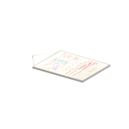
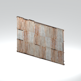

# Unclassified &gt; Unclassified components - page 17

[Library](../README.md) | [Source / advanced data](../catalogue.json) | [Credits](../sources-and-credits.md)

Static thumbnails only. Open a name or preview for its full still and 360-degree camera reference.

| Preview | Name | Game filename | Description | Tags | Variant / LOD |
|---|---|---|---|---|---|
|  | [Unidentified model (mgoa_stfr004_vrtn016)](../assets/mgsv-tpp-mgoa_stfr004_vrtn016-aed4372abf8edf36.md) (unidentified) | mgoa_stfr004_vrtn016.fmdl | Native model reference; a readable object identification has not been reviewed. |  | Variant: vrtn016; LOD0; 292 triangles |
|  | [Unidentified model (mgoa_stfr004_vrtn017)](../assets/mgsv-tpp-mgoa_stfr004_vrtn017-72873e8a8db98061.md) (unidentified) | mgoa_stfr004_vrtn017.fmdl | Native model reference; a readable object identification has not been reviewed. |  | Variant: vrtn017; LOD0; 1842 triangles |
|  | [Unidentified model (mgoa_stfr005_vrtn001)](../assets/mgsv-tpp-mgoa_stfr005_vrtn001-258b330f2b39aef5.md) (unidentified) | mgoa_stfr005_vrtn001.fmdl | Native model reference; a readable object identification has not been reviewed. |  | Variant: vrtn001; LOD0; 304 triangles |
|  | [Unidentified model (mgoa_stfr006)](../assets/mgsv-tpp-mgoa_stfr006-b2d3faef42b6f2c0.md) (unidentified) | mgoa_stfr006.fmdl | Native model reference; a readable object identification has not been reviewed. |  | Variant: No explicit variant token; LOD0; 1060 triangles |
|  | [Unidentified model (mgoa_trck001)](../assets/mgsv-tpp-mgoa_trck001-2dcaea1e457e0805.md) (unidentified) | mgoa_trck001.fmdl | Native model reference; a readable object identification has not been reviewed. |  | Variant: No explicit variant token; LOD0; 2090 triangles |
|  | [Unidentified model (mgoa_trsf001)](../assets/mgsv-tpp-mgoa_trsf001-99dd903c0d2f0020.md) (unidentified) | mgoa_trsf001.fmdl | Native model reference; a readable object identification has not been reviewed. |  | Variant: No explicit variant token; LOD0; 884 triangles |
|  | [Unidentified model (mgom_hutt003_vrtn001)](../assets/mgsv-tpp-mgom_hutt003_vrtn001-2a1ffc6882b7ee80.md) (unidentified) | mgom_hutt003_vrtn001.fmdl | Native model reference; a readable object identification has not been reviewed. |  | Variant: vrtn001; LOD0; 194 triangles |
|  | [Unidentified model (mgom_pstr003_vrtn006)](../assets/mgsv-tpp-mgom_pstr003_vrtn006-2a6645d2bd73c641.md) (unidentified) | mgom_pstr003_vrtn006.fmdl | Native model reference; a readable object identification has not been reviewed. |  | Variant: vrtn006; LOD0; 20 triangles |
|  | [Unidentified model (mgom_tnwl003)](../assets/mgsv-tpp-mgom_tnwl003-01a9f19ba23b860f.md) (unidentified) | mgom_tnwl003.fmdl | Native model reference; a readable object identification has not been reviewed. |  | Variant: No explicit variant token; LOD0; 240 triangles |
|  | [Unidentified model (mgom_wdbx001_vrtn001)](../assets/mgsv-tpp-mgom_wdbx001_vrtn001-a7081a751f6e35cc.md) (unidentified) | mgom_wdbx001_vrtn001.fmdl | Native model reference; a readable object identification has not been reviewed. |  | Variant: vrtn001; LOD0; 772 triangles |
|  | [Unidentified model (mgom_wdbx001_vrtn002)](../assets/mgsv-tpp-mgom_wdbx001_vrtn002-8fa1ac3bcc6e1df5.md) (unidentified) | mgom_wdbx001_vrtn002.fmdl | Native model reference; a readable object identification has not been reviewed. |  | Variant: vrtn002; LOD0; 184 triangles |
|  | [Unidentified model (mgom_wdbx001_vrtn003)](../assets/mgsv-tpp-mgom_wdbx001_vrtn003-9257d4b1769e5385.md) (unidentified) | mgom_wdbx001_vrtn003.fmdl | Native model reference; a readable object identification has not been reviewed. |  | Variant: vrtn003; LOD0; 184 triangles |

Pages: [1](unclassified-components-1.md) | [2](unclassified-components-2.md) | [3](unclassified-components-3.md) | [4](unclassified-components-4.md) | [5](unclassified-components-5.md) | [6](unclassified-components-6.md) | [7](unclassified-components-7.md) | [8](unclassified-components-8.md) | [9](unclassified-components-9.md) | [10](unclassified-components-10.md) | [11](unclassified-components-11.md) | [12](unclassified-components-12.md) | [13](unclassified-components-13.md) | [14](unclassified-components-14.md) | [15](unclassified-components-15.md) | [16](unclassified-components-16.md) | [17](unclassified-components-17.md) | [18](unclassified-components-18.md)
