# Unclassified &gt; Unclassified components - page 18

[Library](../README.md) | [Source / advanced data](../catalogue.json) | [Credits](../sources-and-credits.md)

Static thumbnails only. Open a name or preview for its full still and 360-degree camera reference.

| Preview | Name | Game filename | Description | Tags | Variant / LOD |
|---|---|---|---|---|---|
| [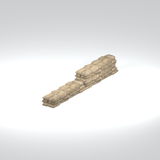](../assets/mgsv-tpp-mgoa_fndt004_vrtn012-6eeef35f994f9038.md) | [Unidentified model (mgoa_fndt004_vrtn012)](../assets/mgsv-tpp-mgoa_fndt004_vrtn012-6eeef35f994f9038.md) (unidentified) | mgoa_fndt004_vrtn012.fmdl | Native model reference; a readable object identification has not been reviewed. |  | Variant: vrtn012; LOD0; 1194 triangles |
| [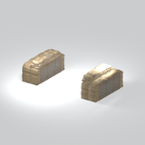](../assets/mgsv-tpp-mgoa_fndt004_vrtn013-cacff5a31bd5feeb.md) | [Unidentified model (mgoa_fndt004_vrtn013)](../assets/mgsv-tpp-mgoa_fndt004_vrtn013-cacff5a31bd5feeb.md) (unidentified) | mgoa_fndt004_vrtn013.fmdl | Native model reference; a readable object identification has not been reviewed. |  | Variant: vrtn013; LOD0; 2612 triangles |
| [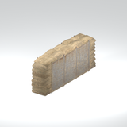](../assets/mgsv-tpp-mgoa_fndt004_vrtn014-ee6860bda266417a.md) | [Unidentified model (mgoa_fndt004_vrtn014)](../assets/mgsv-tpp-mgoa_fndt004_vrtn014-ee6860bda266417a.md) (unidentified) | mgoa_fndt004_vrtn014.fmdl | Native model reference; a readable object identification has not been reviewed. |  | Variant: vrtn014; LOD0; 473 triangles |
| [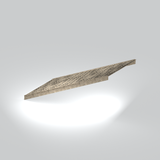](../assets/mgsv-tpp-mgoa_fndt004_vrtn015-69367a01387941e1.md) | [Unidentified model (mgoa_fndt004_vrtn015)](../assets/mgsv-tpp-mgoa_fndt004_vrtn015-69367a01387941e1.md) (unidentified) | mgoa_fndt004_vrtn015.fmdl | Native model reference; a readable object identification has not been reviewed. |  | Variant: vrtn015; LOD0; 382 triangles |
| [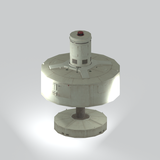](../assets/mgsv-tpp-mgoa_gnrt001-7fb489cf31d67e42.md) | [Unidentified model (mgoa_gnrt001)](../assets/mgsv-tpp-mgoa_gnrt001-7fb489cf31d67e42.md) (unidentified) | mgoa_gnrt001.fmdl | Native model reference; a readable object identification has not been reviewed. |  | Variant: No explicit variant token; LOD0; 734 triangles |
| [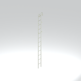](../assets/mgsv-tpp-mgoa_gnrt001_lddr001-d193b1aa6964a7a5.md) | [Unidentified model (mgoa_gnrt001_lddr001)](../assets/mgsv-tpp-mgoa_gnrt001_lddr001-d193b1aa6964a7a5.md) (unidentified) | mgoa_gnrt001_lddr001.fmdl | Native model reference; a readable object identification has not been reviewed. |  | Variant: No explicit variant token; LOD0; 268 triangles |
| [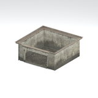](../assets/mgsv-tpp-mgoa_hole001-de26a31ad671c063.md) | [Unidentified model (mgoa_hole001)](../assets/mgsv-tpp-mgoa_hole001-de26a31ad671c063.md) (unidentified) | mgoa_hole001.fmdl | Native model reference; a readable object identification has not been reviewed. |  | Variant: No explicit variant token; LOD0; 62 triangles |
| [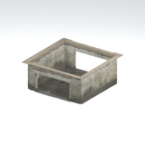](../assets/mgsv-tpp-mgoa_hole001_vrtn001-7cf31a52e5853927.md) | [Unidentified model (mgoa_hole001_vrtn001)](../assets/mgsv-tpp-mgoa_hole001_vrtn001-7cf31a52e5853927.md) (unidentified) | mgoa_hole001_vrtn001.fmdl | Native model reference; a readable object identification has not been reviewed. |  | Variant: vrtn001; LOD0; 78 triangles |
| [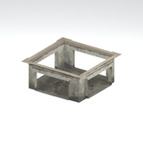](../assets/mgsv-tpp-mgoa_hole001_vrtn002-c0a4e6618eade309.md) | [Unidentified model (mgoa_hole001_vrtn002)](../assets/mgsv-tpp-mgoa_hole001_vrtn002-c0a4e6618eade309.md) (unidentified) | mgoa_hole001_vrtn002.fmdl | Native model reference; a readable object identification has not been reviewed. |  | Variant: vrtn002; LOD0; 106 triangles |
| [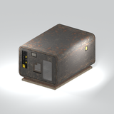](../assets/mgsv-tpp-mgoa_hutt008-1b1da7b40c373530.md) | [Unidentified model (mgoa_hutt008)](../assets/mgsv-tpp-mgoa_hutt008-1b1da7b40c373530.md) (unidentified) | mgoa_hutt008.fmdl | Native model reference; a readable object identification has not been reviewed. |  | Variant: No explicit variant token; LOD0; 785 triangles |
|  | [Unidentified model (mgoa_hutt008_door001)](../assets/mgsv-tpp-mgoa_hutt008_door001-17e7ffe1098ae8f3.md) (unidentified) | mgoa_hutt008_door001.fmdl | Native model reference; a readable object identification has not been reviewed. |  | Variant: No explicit variant token; LOD0; 66 triangles |
| [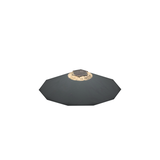](../assets/mgsv-tpp-mgoa_lamp001_emit001-2320b3a4eead4309.md) | [Unidentified model (mgoa_lamp001_emit001)](../assets/mgsv-tpp-mgoa_lamp001_emit001-2320b3a4eead4309.md) (unidentified) | mgoa_lamp001_emit001.fmdl | Native model reference; a readable object identification has not been reviewed. |  | Variant: No explicit variant token; LOD0; 94 triangles |

Pages: [1](unclassified-components-1.md) | [2](unclassified-components-2.md) | [3](unclassified-components-3.md) | [4](unclassified-components-4.md) | [5](unclassified-components-5.md) | [6](unclassified-components-6.md) | [7](unclassified-components-7.md) | [8](unclassified-components-8.md) | [9](unclassified-components-9.md) | [10](unclassified-components-10.md) | [11](unclassified-components-11.md) | [12](unclassified-components-12.md) | [13](unclassified-components-13.md) | [14](unclassified-components-14.md) | [15](unclassified-components-15.md) | [16](unclassified-components-16.md) | [17](unclassified-components-17.md) | [18](unclassified-components-18.md) | [19](unclassified-components-19.md) | [20](unclassified-components-20.md) | [21](unclassified-components-21.md) | [22](unclassified-components-22.md) | [23](unclassified-components-23.md) | [24](unclassified-components-24.md) | [25](unclassified-components-25.md) | [26](unclassified-components-26.md) | [27](unclassified-components-27.md) | [28](unclassified-components-28.md) | [29](unclassified-components-29.md) | [30](unclassified-components-30.md) | [31](unclassified-components-31.md)
