# Unclassified &gt; Unclassified components - page 19

[Library](../README.md) | [Source / advanced data](../catalogue.json) | [Credits](../sources-and-credits.md)

Static thumbnails only. Open a name or preview for its full still and 360-degree camera reference.

| Preview | Name | Game filename | Description | Tags | Variant / LOD |
|---|---|---|---|---|---|
|  | [Unidentified model (mgoa_dtch001_vrtn002)](../assets/mgsv-tpp-mgoa_dtch001_vrtn002-c178dbd3fe2ccc0e.md) (unidentified) | mgoa_dtch001_vrtn002.fmdl | Native model reference; a readable object identification has not been reviewed. |  | Variant: vrtn002; LOD0; 334 triangles |
| [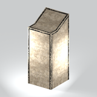](../assets/mgsv-tpp-mgoa_fndt001-fb218037db4ac1a5.md) | [Unidentified model (mgoa_fndt001)](../assets/mgsv-tpp-mgoa_fndt001-fb218037db4ac1a5.md) (unidentified) | mgoa_fndt001.fmdl | Native model reference; a readable object identification has not been reviewed. |  | Variant: No explicit variant token; LOD0; 48 triangles |
| [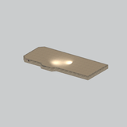](../assets/mgsv-tpp-mgoa_fndt003_vrtn001-78d7f801b1f922a3.md) | [Unidentified model (mgoa_fndt003_vrtn001)](../assets/mgsv-tpp-mgoa_fndt003_vrtn001-78d7f801b1f922a3.md) (unidentified) | mgoa_fndt003_vrtn001.fmdl | Native model reference; a readable object identification has not been reviewed. |  | Variant: vrtn001; LOD0; 202 triangles |
| [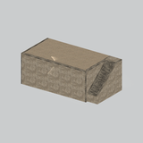](../assets/mgsv-tpp-mgoa_fndt003_vrtn002-c2fcb658f53b35da.md) | [Unidentified model (mgoa_fndt003_vrtn002)](../assets/mgsv-tpp-mgoa_fndt003_vrtn002-c2fcb658f53b35da.md) (unidentified) | mgoa_fndt003_vrtn002.fmdl | Native model reference; a readable object identification has not been reviewed. |  | Variant: vrtn002; LOD0; 397 triangles |
| [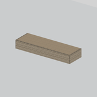](../assets/mgsv-tpp-mgoa_fndt003_vrtn003-cb949422167ccd99.md) | [Unidentified model (mgoa_fndt003_vrtn003)](../assets/mgsv-tpp-mgoa_fndt003_vrtn003-cb949422167ccd99.md) (unidentified) | mgoa_fndt003_vrtn003.fmdl | Native model reference; a readable object identification has not been reviewed. |  | Variant: vrtn003; LOD0; 40 triangles |
| [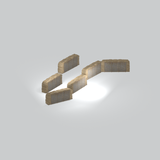](../assets/mgsv-tpp-mgoa_fndt004_vrtn001-8c6b96ecefef29a1.md) | [Unidentified model (mgoa_fndt004_vrtn001)](../assets/mgsv-tpp-mgoa_fndt004_vrtn001-8c6b96ecefef29a1.md) (unidentified) | mgoa_fndt004_vrtn001.fmdl | Native model reference; a readable object identification has not been reviewed. |  | Variant: vrtn001; LOD0; 2838 triangles |
| [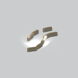](../assets/mgsv-tpp-mgoa_fndt004_vrtn002-b6f946590b335fe6.md) | [Unidentified model (mgoa_fndt004_vrtn002)](../assets/mgsv-tpp-mgoa_fndt004_vrtn002-b6f946590b335fe6.md) (unidentified) | mgoa_fndt004_vrtn002.fmdl | Native model reference; a readable object identification has not been reviewed. |  | Variant: vrtn002; LOD0; 3784 triangles |
| [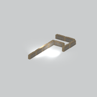](../assets/mgsv-tpp-mgoa_fndt004_vrtn004-87bfdb8be53f7371.md) | [Unidentified model (mgoa_fndt004_vrtn004)](../assets/mgsv-tpp-mgoa_fndt004_vrtn004-87bfdb8be53f7371.md) (unidentified) | mgoa_fndt004_vrtn004.fmdl | Native model reference; a readable object identification has not been reviewed. |  | Variant: vrtn004; LOD0; 3183 triangles |
| [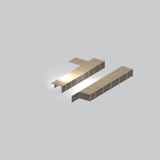](../assets/mgsv-tpp-mgoa_fndt004_vrtn005-94ea5d8b2312b35b.md) | [Unidentified model (mgoa_fndt004_vrtn005)](../assets/mgsv-tpp-mgoa_fndt004_vrtn005-94ea5d8b2312b35b.md) (unidentified) | mgoa_fndt004_vrtn005.fmdl | Native model reference; a readable object identification has not been reviewed. |  | Variant: vrtn005; LOD0; 1660 triangles |
| [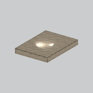](../assets/mgsv-tpp-mgoa_fndt004_vrtn006-3381c57bed87606d.md) | [Unidentified model (mgoa_fndt004_vrtn006)](../assets/mgsv-tpp-mgoa_fndt004_vrtn006-3381c57bed87606d.md) (unidentified) | mgoa_fndt004_vrtn006.fmdl | Native model reference; a readable object identification has not been reviewed. |  | Variant: vrtn006; LOD0; 42 triangles |
| [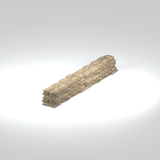](../assets/mgsv-tpp-mgoa_fndt004_vrtn007-82b5ee029a093462.md) | [Unidentified model (mgoa_fndt004_vrtn007)](../assets/mgsv-tpp-mgoa_fndt004_vrtn007-82b5ee029a093462.md) (unidentified) | mgoa_fndt004_vrtn007.fmdl | Native model reference; a readable object identification has not been reviewed. |  | Variant: vrtn007; LOD0; 1590 triangles |
| [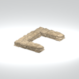](../assets/mgsv-tpp-mgoa_fndt004_vrtn008-bccba4477a9cc335.md) | [Unidentified model (mgoa_fndt004_vrtn008)](../assets/mgsv-tpp-mgoa_fndt004_vrtn008-bccba4477a9cc335.md) (unidentified) | mgoa_fndt004_vrtn008.fmdl | Native model reference; a readable object identification has not been reviewed. |  | Variant: vrtn008; LOD0; 1194 triangles |

Pages: [1](unclassified-components-1.md) | [2](unclassified-components-2.md) | [3](unclassified-components-3.md) | [4](unclassified-components-4.md) | [5](unclassified-components-5.md) | [6](unclassified-components-6.md) | [7](unclassified-components-7.md) | [8](unclassified-components-8.md) | [9](unclassified-components-9.md) | [10](unclassified-components-10.md) | [11](unclassified-components-11.md) | [12](unclassified-components-12.md) | [13](unclassified-components-13.md) | [14](unclassified-components-14.md) | [15](unclassified-components-15.md) | [16](unclassified-components-16.md) | [17](unclassified-components-17.md) | [18](unclassified-components-18.md) | [19](unclassified-components-19.md) | [20](unclassified-components-20.md) | [21](unclassified-components-21.md) | [22](unclassified-components-22.md) | [23](unclassified-components-23.md) | [24](unclassified-components-24.md) | [25](unclassified-components-25.md) | [26](unclassified-components-26.md) | [27](unclassified-components-27.md) | [28](unclassified-components-28.md) | [29](unclassified-components-29.md) | [30](unclassified-components-30.md) | [31](unclassified-components-31.md) | [32](unclassified-components-32.md) | [33](unclassified-components-33.md)
