# Unclassified &gt; Unclassified components - page 2

[Library](../README.md) | [Source / advanced data](../catalogue.json) | [Credits](../sources-and-credits.md)

Static thumbnails only. Open a name or preview for its full still and 360-degree camera reference.

| Preview | Name | Game filename | Description | Tags | Variant / LOD |
|---|---|---|---|---|---|
| [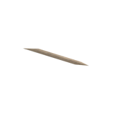](../assets/mgsv-tpp-afgh_brbw001_dbri001-46d6ff1653bba8b0.md) | [Unidentified model (afgh_brbw001_dbri001)](../assets/mgsv-tpp-afgh_brbw001_dbri001-46d6ff1653bba8b0.md) (unidentified) | afgh_brbw001_dbri001.fmdl | Native model reference; a readable object identification has not been reviewed. |  | Variant: No explicit variant token; LOD0; 14 triangles |
| [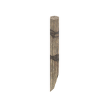](../assets/mgsv-tpp-afgh_brbw001_dbri002-857ca95e05eace33.md) | [Unidentified model (afgh_brbw001_dbri002)](../assets/mgsv-tpp-afgh_brbw001_dbri002-857ca95e05eace33.md) (unidentified) | afgh_brbw001_dbri002.fmdl | Native model reference; a readable object identification has not been reviewed. |  | Variant: No explicit variant token; LOD0; 20 triangles |
| [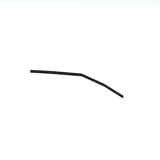](../assets/mgsv-tpp-afgh_brbw001_dbri003-3bc1beaa3d9eb17d.md) | [Unidentified model (afgh_brbw001_dbri003)](../assets/mgsv-tpp-afgh_brbw001_dbri003-3bc1beaa3d9eb17d.md) (unidentified) | afgh_brbw001_dbri003.fmdl | Native model reference; a readable object identification has not been reviewed. |  | Variant: No explicit variant token; LOD0; 8 triangles |
|  | [Unidentified model (afgh_brbw001_vrtn001)](../assets/mgsv-tpp-afgh_brbw001_vrtn001-ea83bd3cee0e9c9d.md) (unidentified) | afgh_brbw001_vrtn001.fmdl | Native model reference; a readable object identification has not been reviewed. |  | Variant: vrtn001; LOD0; 18 triangles |
| [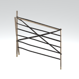](../assets/mgsv-tpp-afgh_brbw001_vrtn002-296b8829d5b03a7b.md) | [Unidentified model (afgh_brbw001_vrtn002)](../assets/mgsv-tpp-afgh_brbw001_vrtn002-296b8829d5b03a7b.md) (unidentified) | afgh_brbw001_vrtn002.fmdl | Native model reference; a readable object identification has not been reviewed. |  | Variant: vrtn002; LOD0; 162 triangles |
| [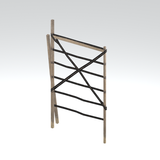](../assets/mgsv-tpp-afgh_brbw001_vrtn003-8b598fa75aebbb60.md) | [Unidentified model (afgh_brbw001_vrtn003)](../assets/mgsv-tpp-afgh_brbw001_vrtn003-8b598fa75aebbb60.md) (unidentified) | afgh_brbw001_vrtn003.fmdl | Native model reference; a readable object identification has not been reviewed. |  | Variant: vrtn003; LOD0; 172 triangles |
| [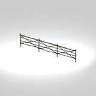](../assets/mgsv-tpp-afgh_brbw001_vrtn004-074f29d539525436.md) | [Unidentified model (afgh_brbw001_vrtn004)](../assets/mgsv-tpp-afgh_brbw001_vrtn004-074f29d539525436.md) (unidentified) | afgh_brbw001_vrtn004.fmdl | Native model reference; a readable object identification has not been reviewed. |  | Variant: vrtn004; LOD0; 374 triangles |
| [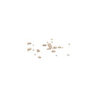](../assets/mgsv-tpp-afgh_brck001-4cdd1565d7accbd8.md) | [Unidentified model (afgh_brck001)](../assets/mgsv-tpp-afgh_brck001-4cdd1565d7accbd8.md) (unidentified) | afgh_brck001.fmdl | Native model reference; a readable object identification has not been reviewed. |  | Variant: No explicit variant token; LOD0; 269 triangles |
| [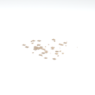](../assets/mgsv-tpp-afgh_brck001_vrtn001-31d1eb031355393f.md) | [Unidentified model (afgh_brck001_vrtn001)](../assets/mgsv-tpp-afgh_brck001_vrtn001-31d1eb031355393f.md) (unidentified) | afgh_brck001_vrtn001.fmdl | Native model reference; a readable object identification has not been reviewed. |  | Variant: vrtn001; LOD0; 280 triangles |
| [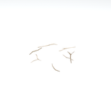](../assets/mgsv-tpp-afgh_brnc001-2f1668aae6de50f4.md) | [Unidentified model (afgh_brnc001)](../assets/mgsv-tpp-afgh_brnc001-2f1668aae6de50f4.md) (unidentified) | afgh_brnc001.fmdl | Native model reference; a readable object identification has not been reviewed. |  | Variant: No explicit variant token; LOD0; 300 triangles |
| [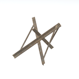](../assets/mgsv-tpp-afgh_brrc001-488bb44fccc7adc5.md) | [Unidentified model (afgh_brrc001)](../assets/mgsv-tpp-afgh_brrc001-488bb44fccc7adc5.md) (unidentified) | afgh_brrc001.fmdl | Native model reference; a readable object identification has not been reviewed. |  | Variant: No explicit variant token; LOD0; 108 triangles |
| [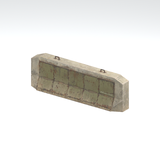](../assets/mgsv-tpp-afgh_brrc002_brrc003_fl-ecc9ff1a8d462a3d.md) | [Unidentified model (afgh_brrc002_brrc003_fl)](../assets/mgsv-tpp-afgh_brrc002_brrc003_fl-ecc9ff1a8d462a3d.md) (unidentified) | afgh_brrc002_brrc003_fl.fmdl | Native model reference; a readable object identification has not been reviewed. |  | Variant: No explicit variant token; LOD0; 164 triangles |

Pages: [1](unclassified-components-1.md) | [2](unclassified-components-2.md) | [3](unclassified-components-3.md) | [4](unclassified-components-4.md) | [5](unclassified-components-5.md) | [6](unclassified-components-6.md) | [7](unclassified-components-7.md) | [8](unclassified-components-8.md) | [9](unclassified-components-9.md) | [10](unclassified-components-10.md) | [11](unclassified-components-11.md) | [12](unclassified-components-12.md) | [13](unclassified-components-13.md) | [14](unclassified-components-14.md) | [15](unclassified-components-15.md) | [16](unclassified-components-16.md) | [17](unclassified-components-17.md) | [18](unclassified-components-18.md) | [19](unclassified-components-19.md) | [20](unclassified-components-20.md) | [21](unclassified-components-21.md) | [22](unclassified-components-22.md) | [23](unclassified-components-23.md) | [24](unclassified-components-24.md) | [25](unclassified-components-25.md) | [26](unclassified-components-26.md) | [27](unclassified-components-27.md) | [28](unclassified-components-28.md) | [29](unclassified-components-29.md)
