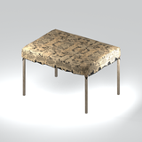
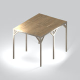

# Unclassified &gt; Unclassified components - page 20

[Library](../README.md) | [Source / advanced data](../catalogue.json) | [Credits](../sources-and-credits.md)

Static thumbnails only. Open a name or preview for its full still and 360-degree camera reference.

| Preview | Name | Game filename | Description | Tags | Variant / LOD |
|---|---|---|---|---|---|
|  | [Unidentified model (mgoa_sndb002_vtrn004)](../assets/mgsv-tpp-mgoa_sndb002_vtrn004-bb28c8b2ae05a307.md) (unidentified) | mgoa_sndb002_vtrn004.fmdl | Native model reference; a readable object identification has not been reviewed. |  | Variant: No explicit variant token; LOD0; 4590 triangles |
|  | [Unidentified model (mgoa_sndb002_vtrn005)](../assets/mgsv-tpp-mgoa_sndb002_vtrn005-b7651e64ba27318c.md) (unidentified) | mgoa_sndb002_vtrn005.fmdl | Native model reference; a readable object identification has not been reviewed. |  | Variant: No explicit variant token; LOD0; 1008 triangles |
|  | [Unidentified model (mgoa_sndb002_vtrn006)](../assets/mgsv-tpp-mgoa_sndb002_vtrn006-0a54a22f46974d9c.md) (unidentified) | mgoa_sndb002_vtrn006.fmdl | Native model reference; a readable object identification has not been reviewed. |  | Variant: No explicit variant token; LOD0; 3360 triangles |
|  | [Unidentified model (mgoa_sndb002_vtrn007)](../assets/mgsv-tpp-mgoa_sndb002_vtrn007-ee84143042c51a7a.md) (unidentified) | mgoa_sndb002_vtrn007.fmdl | Native model reference; a readable object identification has not been reviewed. |  | Variant: No explicit variant token; LOD0; 2388 triangles |
|  | [Unidentified model (mgoa_sndb002_vtrn008)](../assets/mgsv-tpp-mgoa_sndb002_vtrn008-fc8e6a791633b6df.md) (unidentified) | mgoa_sndb002_vtrn008.fmdl | Native model reference; a readable object identification has not been reviewed. |  | Variant: No explicit variant token; LOD0; 1680 triangles |
|  | [Unidentified model (mgoa_sndb002_vtrn009)](../assets/mgsv-tpp-mgoa_sndb002_vtrn009-5d194ec549b58316.md) (unidentified) | mgoa_sndb002_vtrn009.fmdl | Native model reference; a readable object identification has not been reviewed. |  | Variant: No explicit variant token; LOD0; 1194 triangles |
|  | [Unidentified model (mgoa_snsh001)](../assets/mgsv-tpp-mgoa_snsh001-df076e27024bd96b.md) (unidentified) | mgoa_snsh001.fmdl | Native model reference; a readable object identification has not been reviewed. |  | Variant: No explicit variant token; LOD0; 566 triangles |
|  | [Unidentified model (mgoa_snsh002_vtrn001)](../assets/mgsv-tpp-mgoa_snsh002_vtrn001-ecaeb31db480b6e3.md) (unidentified) | mgoa_snsh002_vtrn001.fmdl | Native model reference; a readable object identification has not been reviewed. |  | Variant: No explicit variant token; LOD0; 264 triangles |
|  | [Unidentified model (mgoa_stfr003_vrtn001)](../assets/mgsv-tpp-mgoa_stfr003_vrtn001-f78e6f50c2554799.md) (unidentified) | mgoa_stfr003_vrtn001.fmdl | Native model reference; a readable object identification has not been reviewed. |  | Variant: vrtn001; LOD0; 116 triangles |
|  | [Unidentified model (mgoa_stfr003_vrtn002)](../assets/mgsv-tpp-mgoa_stfr003_vrtn002-e0a1215b65448177.md) (unidentified) | mgoa_stfr003_vrtn002.fmdl | Native model reference; a readable object identification has not been reviewed. |  | Variant: vrtn002; LOD0; 76 triangles |
|  | [Unidentified model (mgoa_stfr003_vrtn003)](../assets/mgsv-tpp-mgoa_stfr003_vrtn003-611ddb23ef059bb4.md) (unidentified) | mgoa_stfr003_vrtn003.fmdl | Native model reference; a readable object identification has not been reviewed. |  | Variant: vrtn003; LOD0; 44 triangles |
|  | [Unidentified model (mgoa_stfr004_scfd003)](../assets/mgsv-tpp-mgoa_stfr004_scfd003-5d88bcb1d8b63853.md) (unidentified) | mgoa_stfr004_scfd003.fmdl | Native model reference; a readable object identification has not been reviewed. |  | Variant: No explicit variant token; LOD0; 176 triangles |

Pages: [1](unclassified-components-1.md) | [2](unclassified-components-2.md) | [3](unclassified-components-3.md) | [4](unclassified-components-4.md) | [5](unclassified-components-5.md) | [6](unclassified-components-6.md) | [7](unclassified-components-7.md) | [8](unclassified-components-8.md) | [9](unclassified-components-9.md) | [10](unclassified-components-10.md) | [11](unclassified-components-11.md) | [12](unclassified-components-12.md) | [13](unclassified-components-13.md) | [14](unclassified-components-14.md) | [15](unclassified-components-15.md) | [16](unclassified-components-16.md) | [17](unclassified-components-17.md) | [18](unclassified-components-18.md) | [19](unclassified-components-19.md) | [20](unclassified-components-20.md) | [21](unclassified-components-21.md) | [22](unclassified-components-22.md) | [23](unclassified-components-23.md) | [24](unclassified-components-24.md) | [25](unclassified-components-25.md) | [26](unclassified-components-26.md) | [27](unclassified-components-27.md) | [28](unclassified-components-28.md) | [29](unclassified-components-29.md) | [30](unclassified-components-30.md)
