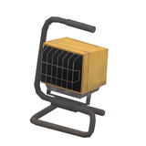
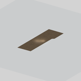
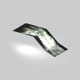
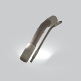

# Unclassified &gt; Unclassified components - page 20

[Library](../README.md) | [Source / advanced data](../catalogue.json) | [Credits](../sources-and-credits.md)

Static thumbnails only. Open a name or preview for its full still and 360-degree camera reference.

| Preview | Name | Game filename | Description | Tags | Variant / LOD |
|---|---|---|---|---|---|
|  | [Unidentified model (mgoa_lamp004)](../assets/mgsv-tpp-mgoa_lamp004-51608ace98e895a1.md) (unidentified) | mgoa_lamp004.fmdl | Native model reference; a readable object identification has not been reviewed. |  | Variant: No explicit variant token; LOD0; 388 triangles |
|  | [Unidentified model (mgoa_pddl003_vrtn003)](../assets/mgsv-tpp-mgoa_pddl003_vrtn003-5f1748fe1de7c1b5.md) (unidentified) | mgoa_pddl003_vrtn003.fmdl | Native model reference; a readable object identification has not been reviewed. |  | Variant: vrtn003; LOD0; 6 triangles |
|  | [Unidentified model (mgoa_pddl003_vrtn004)](../assets/mgsv-tpp-mgoa_pddl003_vrtn004-e53b62ca0e7f9824.md) (unidentified) | mgoa_pddl003_vrtn004.fmdl | Native model reference; a readable object identification has not been reviewed. |  | Variant: vrtn004; LOD0; 20 triangles |
|  | [Unidentified model (mgoa_pddl003_vrtn006)](../assets/mgsv-tpp-mgoa_pddl003_vrtn006-25466e144fb58408.md) (unidentified) | mgoa_pddl003_vrtn006.fmdl | Native model reference; a readable object identification has not been reviewed. |  | Variant: vrtn006; LOD0; 6 triangles |
|  | [Unidentified model (mgoa_pipe004_vrtn001)](../assets/mgsv-tpp-mgoa_pipe004_vrtn001-766d9dfbbfa083c2.md) (unidentified) | mgoa_pipe004_vrtn001.fmdl | Native model reference; a readable object identification has not been reviewed. |  | Variant: vrtn001; LOD0; 568 triangles |
|  | [Unidentified model (mgoa_rbbl001)](../assets/mgsv-tpp-mgoa_rbbl001-c5770d59506b0e11.md) (unidentified) | mgoa_rbbl001.fmdl | Native model reference; a readable object identification has not been reviewed. |  | Variant: No explicit variant token; LOD0; 116 triangles |
|  | [Unidentified model (mgoa_road001_vrtn001)](../assets/mgsv-tpp-mgoa_road001_vrtn001-9010de23e36b4e42.md) (unidentified) | mgoa_road001_vrtn001.fmdl | Native model reference; a readable object identification has not been reviewed. |  | Variant: vrtn001; LOD0; 216 triangles |
|  | [Unidentified model (mgoa_road001_vrtn002)](../assets/mgsv-tpp-mgoa_road001_vrtn002-0cb204cf882353ea.md) (unidentified) | mgoa_road001_vrtn002.fmdl | Native model reference; a readable object identification has not been reviewed. |  | Variant: vrtn002; LOD0; 260 triangles |
|  | [Unidentified model (mgoa_road001_vrtn003)](../assets/mgsv-tpp-mgoa_road001_vrtn003-f563e3d543107124.md) (unidentified) | mgoa_road001_vrtn003.fmdl | Native model reference; a readable object identification has not been reviewed. |  | Variant: vrtn003; LOD0; 100 triangles |
|  | [Unidentified model (mgoa_road002_brdg001)](../assets/mgsv-tpp-mgoa_road002_brdg001-e214ffa3cfc80799.md) (unidentified) | mgoa_road002_brdg001.fmdl | Native model reference; a readable object identification has not been reviewed. |  | Variant: No explicit variant token; LOD0; 601 triangles |
|  | [Unidentified model (mgoa_slop001)](../assets/mgsv-tpp-mgoa_slop001-c6e610b096d3cf65.md) (unidentified) | mgoa_slop001.fmdl | Native model reference; a readable object identification has not been reviewed. |  | Variant: No explicit variant token; LOD0; 244 triangles |
|  | [Unidentified model (mgoa_sndb002_vtrn001)](../assets/mgsv-tpp-mgoa_sndb002_vtrn001-51c4b9cc434066d1.md) (unidentified) | mgoa_sndb002_vtrn001.fmdl | Native model reference; a readable object identification has not been reviewed. |  | Variant: No explicit variant token; LOD0; 3918 triangles |

Pages: [1](unclassified-components-1.md) | [2](unclassified-components-2.md) | [3](unclassified-components-3.md) | [4](unclassified-components-4.md) | [5](unclassified-components-5.md) | [6](unclassified-components-6.md) | [7](unclassified-components-7.md) | [8](unclassified-components-8.md) | [9](unclassified-components-9.md) | [10](unclassified-components-10.md) | [11](unclassified-components-11.md) | [12](unclassified-components-12.md) | [13](unclassified-components-13.md) | [14](unclassified-components-14.md) | [15](unclassified-components-15.md) | [16](unclassified-components-16.md) | [17](unclassified-components-17.md) | [18](unclassified-components-18.md) | [19](unclassified-components-19.md) | [20](unclassified-components-20.md) | [21](unclassified-components-21.md) | [22](unclassified-components-22.md) | [23](unclassified-components-23.md) | [24](unclassified-components-24.md) | [25](unclassified-components-25.md) | [26](unclassified-components-26.md) | [27](unclassified-components-27.md) | [28](unclassified-components-28.md) | [29](unclassified-components-29.md) | [30](unclassified-components-30.md) | [31](unclassified-components-31.md)
