# Unclassified &gt; Unclassified components - page 20

[Library](../README.md) | [Source / advanced data](../catalogue.json) | [Credits](../sources-and-credits.md)

Static thumbnails only. Open a name or preview for its full still and 360-degree camera reference.

| Preview | Name | Game filename | Description | Tags | Variant / LOD |
|---|---|---|---|---|---|
| [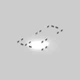](../assets/mgsv-tpp-mgog_buld001_wndw001-0859ff40d75734e8.md) | [Unidentified model (mgog_buld001_wndw001)](../assets/mgsv-tpp-mgog_buld001_wndw001-0859ff40d75734e8.md) (unidentified) | mgog_buld001_wndw001.fmdl | Native model reference; a readable object identification has not been reviewed. |  | Variant: No explicit variant token; LOD0; 34 triangles |
| [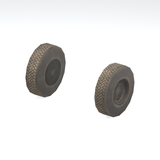](../assets/mgsv-tpp-mgog_trck001_vrtn001-998ba41ce473db9d.md) | [Unidentified model (mgog_trck001_vrtn001)](../assets/mgsv-tpp-mgog_trck001_vrtn001-998ba41ce473db9d.md) (unidentified) | mgog_trck001_vrtn001.fmdl | Native model reference; a readable object identification has not been reviewed. |  | Variant: vrtn001; LOD0; 268 triangles |
| [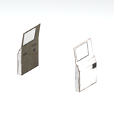](../assets/mgsv-tpp-mgog_trck001_vrtn002-851fcec5ec709c2c.md) | [Unidentified model (mgog_trck001_vrtn002)](../assets/mgsv-tpp-mgog_trck001_vrtn002-851fcec5ec709c2c.md) (unidentified) | mgog_trck001_vrtn002.fmdl | Native model reference; a readable object identification has not been reviewed. |  | Variant: vrtn002; LOD0; 100 triangles |
|  | [Unidentified model (mgog_trck001_vrtn003)](../assets/mgsv-tpp-mgog_trck001_vrtn003-0ca255c41197fbac.md) (unidentified) | mgog_trck001_vrtn003.fmdl | Native model reference; a readable object identification has not been reviewed. |  | Variant: vrtn003; LOD0; 536 triangles |
| [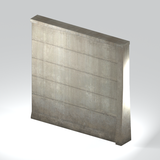](../assets/mgsv-tpp-mgog_wall001_vrtn003-2b0774d54328e224.md) | [Unidentified model (mgog_wall001_vrtn003)](../assets/mgsv-tpp-mgog_wall001_vrtn003-2b0774d54328e224.md) (unidentified) | mgog_wall001_vrtn003.fmdl | Native model reference; a readable object identification has not been reviewed. |  | Variant: vrtn003; LOD0; 40 triangles |
| [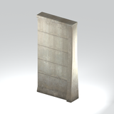](../assets/mgsv-tpp-mgog_wall001_vrtn004-13de822556a0ade9.md) | [Unidentified model (mgog_wall001_vrtn004)](../assets/mgsv-tpp-mgog_wall001_vrtn004-13de822556a0ade9.md) (unidentified) | mgog_wall001_vrtn004.fmdl | Native model reference; a readable object identification has not been reviewed. |  | Variant: vrtn004; LOD0; 40 triangles |
| [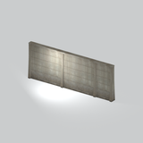](../assets/mgsv-tpp-mgog_wall001_vrtn005-97fa3d1351aaaed7.md) | [Unidentified model (mgog_wall001_vrtn005)](../assets/mgsv-tpp-mgog_wall001_vrtn005-97fa3d1351aaaed7.md) (unidentified) | mgog_wall001_vrtn005.fmdl | Native model reference; a readable object identification has not been reviewed. |  | Variant: vrtn005; LOD0; 136 triangles |
| [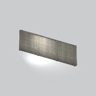](../assets/mgsv-tpp-mgog_wall001_vrtn006-c0cce960c0b37621.md) | [Unidentified model (mgog_wall001_vrtn006)](../assets/mgsv-tpp-mgog_wall001_vrtn006-c0cce960c0b37621.md) (unidentified) | mgog_wall001_vrtn006.fmdl | Native model reference; a readable object identification has not been reviewed. |  | Variant: vrtn006; LOD0; 136 triangles |
| [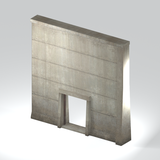](../assets/mgsv-tpp-mgog_wall001_vrtn007-4561e141da07fcbd.md) | [Unidentified model (mgog_wall001_vrtn007)](../assets/mgsv-tpp-mgog_wall001_vrtn007-4561e141da07fcbd.md) (unidentified) | mgog_wall001_vrtn007.fmdl | Native model reference; a readable object identification has not been reviewed. |  | Variant: vrtn007; LOD0; 108 triangles |
| [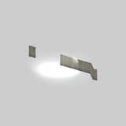](../assets/mgsv-tpp-mgog_wall001_vrtn008-8937fd13961b003f.md) | [Unidentified model (mgog_wall001_vrtn008)](../assets/mgsv-tpp-mgog_wall001_vrtn008-8937fd13961b003f.md) (unidentified) | mgog_wall001_vrtn008.fmdl | Native model reference; a readable object identification has not been reviewed. |  | Variant: vrtn008; LOD0; 264 triangles |
| [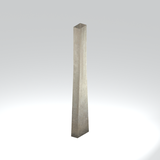](../assets/mgsv-tpp-mgog_wall001_vrtn009-571e55a1cb9c86ca.md) | [Unidentified model (mgog_wall001_vrtn009)](../assets/mgsv-tpp-mgog_wall001_vrtn009-571e55a1cb9c86ca.md) (unidentified) | mgog_wall001_vrtn009.fmdl | Native model reference; a readable object identification has not been reviewed. |  | Variant: vrtn009; LOD0; 16 triangles |
| [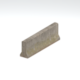](../assets/mgsv-tpp-mgom_brrc001_vrtn003-bf6b91d4dc7a0ebf.md) | [Unidentified model (mgom_brrc001_vrtn003)](../assets/mgsv-tpp-mgom_brrc001_vrtn003-bf6b91d4dc7a0ebf.md) (unidentified) | mgom_brrc001_vrtn003.fmdl | Native model reference; a readable object identification has not been reviewed. |  | Variant: vrtn003; LOD0; 34 triangles |

Pages: [1](unclassified-components-1.md) | [2](unclassified-components-2.md) | [3](unclassified-components-3.md) | [4](unclassified-components-4.md) | [5](unclassified-components-5.md) | [6](unclassified-components-6.md) | [7](unclassified-components-7.md) | [8](unclassified-components-8.md) | [9](unclassified-components-9.md) | [10](unclassified-components-10.md) | [11](unclassified-components-11.md) | [12](unclassified-components-12.md) | [13](unclassified-components-13.md) | [14](unclassified-components-14.md) | [15](unclassified-components-15.md) | [16](unclassified-components-16.md) | [17](unclassified-components-17.md) | [18](unclassified-components-18.md) | [19](unclassified-components-19.md) | [20](unclassified-components-20.md) | [21](unclassified-components-21.md) | [22](unclassified-components-22.md) | [23](unclassified-components-23.md) | [24](unclassified-components-24.md) | [25](unclassified-components-25.md) | [26](unclassified-components-26.md)
