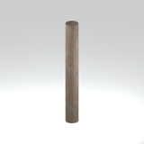
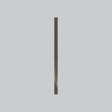
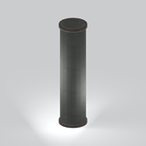
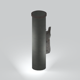
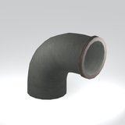
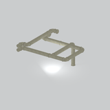
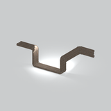

# Unclassified &gt; Unclassified components - page 21

[Library](../README.md) | [Source / advanced data](../catalogue.json) | [Credits](../sources-and-credits.md)

Static thumbnails only. Open a name or preview for its full still and 360-degree camera reference.

| Preview | Name | Game filename | Description | Tags | Variant / LOD |
|---|---|---|---|---|---|
|  | [Unidentified model (mgom_pipe001_pipe001)](../assets/mgsv-tpp-mgom_pipe001_pipe001-94bab233c671882e.md) (unidentified) | mgom_pipe001_pipe001.fmdl | Native model reference; a readable object identification has not been reviewed. |  | Variant: No explicit variant token; LOD0; 68 triangles |
|  | [Unidentified model (mgom_pipe001_pipe002)](../assets/mgsv-tpp-mgom_pipe001_pipe002-96e66142dbf06f25.md) (unidentified) | mgom_pipe001_pipe002.fmdl | Native model reference; a readable object identification has not been reviewed. |  | Variant: No explicit variant token; LOD0; 214 triangles |
|  | [Unidentified model (mgom_pipe001_pipe003)](../assets/mgsv-tpp-mgom_pipe001_pipe003-6cf124a2c5e91a04.md) (unidentified) | mgom_pipe001_pipe003.fmdl | Native model reference; a readable object identification has not been reviewed. |  | Variant: No explicit variant token; LOD0; 68 triangles |
|  | [Unidentified model (mgom_pipe001_pipe004)](../assets/mgsv-tpp-mgom_pipe001_pipe004-35ad36d6cd7aaec8.md) (unidentified) | mgom_pipe001_pipe004.fmdl | Native model reference; a readable object identification has not been reviewed. |  | Variant: No explicit variant token; LOD0; 24 triangles |
|  | [Unidentified model (mgom_pipe001_pipe005)](../assets/mgsv-tpp-mgom_pipe001_pipe005-87def46499c9c043.md) (unidentified) | mgom_pipe001_pipe005.fmdl | Native model reference; a readable object identification has not been reviewed. |  | Variant: No explicit variant token; LOD0; 174 triangles |
|  | [Unidentified model (mgom_pipe001_pipe006)](../assets/mgsv-tpp-mgom_pipe001_pipe006-e40f5c4470f7cb9e.md) (unidentified) | mgom_pipe001_pipe006.fmdl | Native model reference; a readable object identification has not been reviewed. |  | Variant: No explicit variant token; LOD0; 24 triangles |
|  | [Unidentified model (mgom_pipe001_pipe007)](../assets/mgsv-tpp-mgom_pipe001_pipe007-b747b4573230c5fa.md) (unidentified) | mgom_pipe001_pipe007.fmdl | Native model reference; a readable object identification has not been reviewed. |  | Variant: No explicit variant token; LOD0; 112 triangles |
|  | [Unidentified model (mgom_pipe001_vrtn001)](../assets/mgsv-tpp-mgom_pipe001_vrtn001-8d3d46f9cd7e7416.md) (unidentified) | mgom_pipe001_vrtn001.fmdl | Native model reference; a readable object identification has not been reviewed. |  | Variant: vrtn001; LOD0; 512 triangles |
|  | [Unidentified model (mgom_pipe001_vrtn002)](../assets/mgsv-tpp-mgom_pipe001_vrtn002-0f668f09df37c592.md) (unidentified) | mgom_pipe001_vrtn002.fmdl | Native model reference; a readable object identification has not been reviewed. |  | Variant: vrtn002; LOD0; 940 triangles |
|  | [Unidentified model (mgom_pipe001_vrtn003)](../assets/mgsv-tpp-mgom_pipe001_vrtn003-386e96d3fe94d8f5.md) (unidentified) | mgom_pipe001_vrtn003.fmdl | Native model reference; a readable object identification has not been reviewed. |  | Variant: vrtn003; LOD0; 720 triangles |
|  | [Unidentified model (mgom_pipe001_vrtn005)](../assets/mgsv-tpp-mgom_pipe001_vrtn005-21f48db6ea9fc50d.md) (unidentified) | mgom_pipe001_vrtn005.fmdl | Native model reference; a readable object identification has not been reviewed. |  | Variant: vrtn005; LOD0; 2644 triangles |
|  | [Unidentified model (mgom_pipe001_vrtn006)](../assets/mgsv-tpp-mgom_pipe001_vrtn006-d0e3ff5b6a0d3818.md) (unidentified) | mgom_pipe001_vrtn006.fmdl | Native model reference; a readable object identification has not been reviewed. |  | Variant: vrtn006; LOD0; 2996 triangles |

Pages: [1](unclassified-components-1.md) | [2](unclassified-components-2.md) | [3](unclassified-components-3.md) | [4](unclassified-components-4.md) | [5](unclassified-components-5.md) | [6](unclassified-components-6.md) | [7](unclassified-components-7.md) | [8](unclassified-components-8.md) | [9](unclassified-components-9.md) | [10](unclassified-components-10.md) | [11](unclassified-components-11.md) | [12](unclassified-components-12.md) | [13](unclassified-components-13.md) | [14](unclassified-components-14.md) | [15](unclassified-components-15.md) | [16](unclassified-components-16.md) | [17](unclassified-components-17.md) | [18](unclassified-components-18.md) | [19](unclassified-components-19.md) | [20](unclassified-components-20.md) | [21](unclassified-components-21.md) | [22](unclassified-components-22.md) | [23](unclassified-components-23.md)
