# Unclassified &gt; Unclassified components - page 23

[Library](../README.md) | [Source / advanced data](../catalogue.json) | [Credits](../sources-and-credits.md)

Static thumbnails only. Open a name or preview for its full still and 360-degree camera reference.

| Preview | Name | Game filename | Description | Tags | Variant / LOD |
|---|---|---|---|---|---|
| [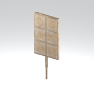](../assets/mgsv-tpp-mgoa_wdbr008_vrtn003-ebf3cc8f2d6890b4.md) | [Unidentified model (mgoa_wdbr008_vrtn003)](../assets/mgsv-tpp-mgoa_wdbr008_vrtn003-ebf3cc8f2d6890b4.md) (unidentified) | mgoa_wdbr008_vrtn003.fmdl | Native model reference; a readable object identification has not been reviewed. |  | Variant: vrtn003; LOD0; 146 triangles |
| [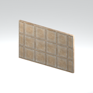](../assets/mgsv-tpp-mgoa_wdbr008_vrtn004-6db45a4ed95b2482.md) | [Unidentified model (mgoa_wdbr008_vrtn004)](../assets/mgsv-tpp-mgoa_wdbr008_vrtn004-6db45a4ed95b2482.md) (unidentified) | mgoa_wdbr008_vrtn004.fmdl | Native model reference; a readable object identification has not been reviewed. |  | Variant: vrtn004; LOD0; 94 triangles |
| [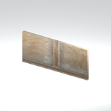](../assets/mgsv-tpp-mgoa_wdbr008_vrtn005-c8dea096e10af3fa.md) | [Unidentified model (mgoa_wdbr008_vrtn005)](../assets/mgsv-tpp-mgoa_wdbr008_vrtn005-c8dea096e10af3fa.md) (unidentified) | mgoa_wdbr008_vrtn005.fmdl | Native model reference; a readable object identification has not been reviewed. |  | Variant: vrtn005; LOD0; 100 triangles |
| [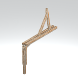](../assets/mgsv-tpp-mgoa_wdbr008_vrtn006-ae5214c65af20207.md) | [Unidentified model (mgoa_wdbr008_vrtn006)](../assets/mgsv-tpp-mgoa_wdbr008_vrtn006-ae5214c65af20207.md) (unidentified) | mgoa_wdbr008_vrtn006.fmdl | Native model reference; a readable object identification has not been reviewed. |  | Variant: vrtn006; LOD0; 98 triangles |
| [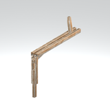](../assets/mgsv-tpp-mgoa_wdbr008_vrtn007-1019f9da7f0796f8.md) | [Unidentified model (mgoa_wdbr008_vrtn007)](../assets/mgsv-tpp-mgoa_wdbr008_vrtn007-1019f9da7f0796f8.md) (unidentified) | mgoa_wdbr008_vrtn007.fmdl | Native model reference; a readable object identification has not been reviewed. |  | Variant: vrtn007; LOD0; 88 triangles |
| [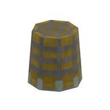](../assets/mgsv-tpp-mgob_allm001_emitR-e054760192795f53.md) | [Unidentified model (mgob_allm001_emitR)](../assets/mgsv-tpp-mgob_allm001_emitR-e054760192795f53.md) (unidentified) | mgob_allm001_emitR.fmdl | Native model reference; a readable object identification has not been reviewed. |  | Variant: No explicit variant token; LOD0; 44 triangles |
| [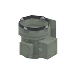](../assets/mgsv-tpp-mgob_allm002-15b0c8fd8a4dacb8.md) | [Unidentified model (mgob_allm002)](../assets/mgsv-tpp-mgob_allm002-15b0c8fd8a4dacb8.md) (unidentified) | mgob_allm002.fmdl | Native model reference; a readable object identification has not been reviewed. |  | Variant: No explicit variant token; LOD0; 74 triangles |
| [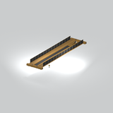](../assets/mgsv-tpp-mgob_cran001_vrtn001-6f6e2a5af0e30469.md) | [Unidentified model (mgob_cran001_vrtn001)](../assets/mgsv-tpp-mgob_cran001_vrtn001-6f6e2a5af0e30469.md) (unidentified) | mgob_cran001_vrtn001.fmdl | Native model reference; a readable object identification has not been reviewed. |  | Variant: vrtn001; LOD0; 918 triangles |
| [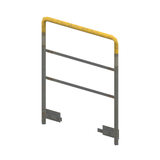](../assets/mgsv-tpp-mgob_hndr001_vrtn001-8a6009d64887d071.md) | [Unidentified model (mgob_hndr001_vrtn001)](../assets/mgsv-tpp-mgob_hndr001_vrtn001-8a6009d64887d071.md) (unidentified) | mgob_hndr001_vrtn001.fmdl | Native model reference; a readable object identification has not been reviewed. |  | Variant: vrtn001; LOD0; 96 triangles |
| [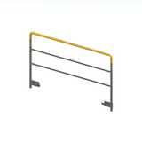](../assets/mgsv-tpp-mgob_hndr001_vrtn002-944a309a90d20e90.md) | [Unidentified model (mgob_hndr001_vrtn002)](../assets/mgsv-tpp-mgob_hndr001_vrtn002-944a309a90d20e90.md) (unidentified) | mgob_hndr001_vrtn002.fmdl | Native model reference; a readable object identification has not been reviewed. |  | Variant: vrtn002; LOD0; 88 triangles |
| [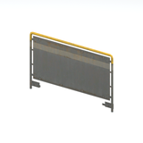](../assets/mgsv-tpp-mgob_hndr001_vrtn003-57a62b261c81d2c6.md) | [Unidentified model (mgob_hndr001_vrtn003)](../assets/mgsv-tpp-mgob_hndr001_vrtn003-57a62b261c81d2c6.md) (unidentified) | mgob_hndr001_vrtn003.fmdl | Native model reference; a readable object identification has not been reviewed. |  | Variant: vrtn003; LOD0; 104 triangles |
| [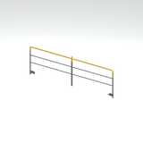](../assets/mgsv-tpp-mgob_hndr001_vrtn004-7cb293b88ae4339d.md) | [Unidentified model (mgob_hndr001_vrtn004)](../assets/mgsv-tpp-mgob_hndr001_vrtn004-7cb293b88ae4339d.md) (unidentified) | mgob_hndr001_vrtn004.fmdl | Native model reference; a readable object identification has not been reviewed. |  | Variant: vrtn004; LOD0; 112 triangles |

Pages: [1](unclassified-components-1.md) | [2](unclassified-components-2.md) | [3](unclassified-components-3.md) | [4](unclassified-components-4.md) | [5](unclassified-components-5.md) | [6](unclassified-components-6.md) | [7](unclassified-components-7.md) | [8](unclassified-components-8.md) | [9](unclassified-components-9.md) | [10](unclassified-components-10.md) | [11](unclassified-components-11.md) | [12](unclassified-components-12.md) | [13](unclassified-components-13.md) | [14](unclassified-components-14.md) | [15](unclassified-components-15.md) | [16](unclassified-components-16.md) | [17](unclassified-components-17.md) | [18](unclassified-components-18.md) | [19](unclassified-components-19.md) | [20](unclassified-components-20.md) | [21](unclassified-components-21.md) | [22](unclassified-components-22.md) | [23](unclassified-components-23.md) | [24](unclassified-components-24.md) | [25](unclassified-components-25.md) | [26](unclassified-components-26.md) | [27](unclassified-components-27.md) | [28](unclassified-components-28.md) | [29](unclassified-components-29.md) | [30](unclassified-components-30.md)
