# Unclassified &gt; Unclassified components - page 23

[Library](../README.md) | [Source / advanced data](../catalogue.json) | [Credits](../sources-and-credits.md)

Static thumbnails only. Open a name or preview for its full still and 360-degree camera reference.

| Preview | Name | Game filename | Description | Tags | Variant / LOD |
|---|---|---|---|---|---|
| [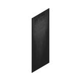](../assets/mgsv-tpp-mgom_buld001_vrtn001-3b1744f440d9dcea.md) | [Unidentified model (mgom_buld001_vrtn001)](../assets/mgsv-tpp-mgom_buld001_vrtn001-3b1744f440d9dcea.md) (unidentified) | mgom_buld001_vrtn001.fmdl | Native model reference; a readable object identification has not been reviewed. |  | Variant: vrtn001; LOD0; 2 triangles |
| [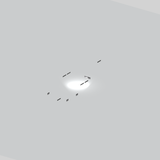](../assets/mgsv-tpp-mgom_buld001_wndw001-fef80a98a064b711.md) | [Unidentified model (mgom_buld001_wndw001)](../assets/mgsv-tpp-mgom_buld001_wndw001-fef80a98a064b711.md) (unidentified) | mgom_buld001_wndw001.fmdl | Native model reference; a readable object identification has not been reviewed. |  | Variant: No explicit variant token; LOD0; 22 triangles |
| [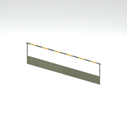](../assets/mgsv-tpp-mgom_ctwk001_hndr001-06c46d93b0eeea51.md) | [Unidentified model (mgom_ctwk001_hndr001)](../assets/mgsv-tpp-mgom_ctwk001_hndr001-06c46d93b0eeea51.md) (unidentified) | mgom_ctwk001_hndr001.fmdl | Native model reference; a readable object identification has not been reviewed. |  | Variant: No explicit variant token; LOD0; 36 triangles |
| [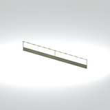](../assets/mgsv-tpp-mgom_ctwk001_hndr002-130b55193222dfa2.md) | [Unidentified model (mgom_ctwk001_hndr002)](../assets/mgsv-tpp-mgom_ctwk001_hndr002-130b55193222dfa2.md) (unidentified) | mgom_ctwk001_hndr002.fmdl | Native model reference; a readable object identification has not been reviewed. |  | Variant: No explicit variant token; LOD0; 53 triangles |
| [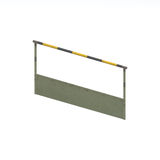](../assets/mgsv-tpp-mgom_ctwk001_hndr003-288eb87febeb92ea.md) | [Unidentified model (mgom_ctwk001_hndr003)](../assets/mgsv-tpp-mgom_ctwk001_hndr003-288eb87febeb92ea.md) (unidentified) | mgom_ctwk001_hndr003.fmdl | Native model reference; a readable object identification has not been reviewed. |  | Variant: No explicit variant token; LOD0; 32 triangles |
| [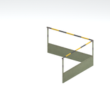](../assets/mgsv-tpp-mgom_ctwk001_hndr004-aa907f395245d3a9.md) | [Unidentified model (mgom_ctwk001_hndr004)](../assets/mgsv-tpp-mgom_ctwk001_hndr004-aa907f395245d3a9.md) (unidentified) | mgom_ctwk001_hndr004.fmdl | Native model reference; a readable object identification has not been reviewed. |  | Variant: No explicit variant token; LOD0; 52 triangles |
| [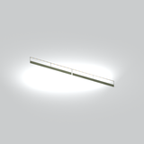](../assets/mgsv-tpp-mgom_ctwk001_hndr005-9b5d2100ce938aa5.md) | [Unidentified model (mgom_ctwk001_hndr005)](../assets/mgsv-tpp-mgom_ctwk001_hndr005-9b5d2100ce938aa5.md) (unidentified) | mgom_ctwk001_hndr005.fmdl | Native model reference; a readable object identification has not been reviewed. |  | Variant: No explicit variant token; LOD0; 104 triangles |
| [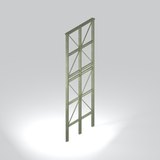](../assets/mgsv-tpp-mgom_ctwk001_pllr002-b2957aaea56082be.md) | [Unidentified model (mgom_ctwk001_pllr002)](../assets/mgsv-tpp-mgom_ctwk001_pllr002-b2957aaea56082be.md) (unidentified) | mgom_ctwk001_pllr002.fmdl | Native model reference; a readable object identification has not been reviewed. |  | Variant: No explicit variant token; LOD0; 178 triangles |
| [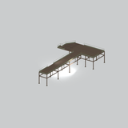](../assets/mgsv-tpp-mgom_ctwk001_vrtn001-b536169e5527a8d7.md) | [Unidentified model (mgom_ctwk001_vrtn001)](../assets/mgsv-tpp-mgom_ctwk001_vrtn001-b536169e5527a8d7.md) (unidentified) | mgom_ctwk001_vrtn001.fmdl | Native model reference; a readable object identification has not been reviewed. |  | Variant: vrtn001; LOD0; 1691 triangles |
| [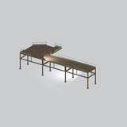](../assets/mgsv-tpp-mgom_ctwk001_vrtn002-7d43d3545f53a6bc.md) | [Unidentified model (mgom_ctwk001_vrtn002)](../assets/mgsv-tpp-mgom_ctwk001_vrtn002-7d43d3545f53a6bc.md) (unidentified) | mgom_ctwk001_vrtn002.fmdl | Native model reference; a readable object identification has not been reviewed. |  | Variant: vrtn002; LOD0; 1074 triangles |
| [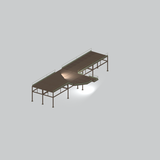](../assets/mgsv-tpp-mgom_ctwk001_vrtn003-ef4d501f2f77e357.md) | [Unidentified model (mgom_ctwk001_vrtn003)](../assets/mgsv-tpp-mgom_ctwk001_vrtn003-ef4d501f2f77e357.md) (unidentified) | mgom_ctwk001_vrtn003.fmdl | Native model reference; a readable object identification has not been reviewed. |  | Variant: vrtn003; LOD0; 1850 triangles |
| [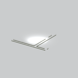](../assets/mgsv-tpp-mgom_ctwk001_vrtn007-c54deb9322a2d2cd.md) | [Unidentified model (mgom_ctwk001_vrtn007)](../assets/mgsv-tpp-mgom_ctwk001_vrtn007-c54deb9322a2d2cd.md) (unidentified) | mgom_ctwk001_vrtn007.fmdl | Native model reference; a readable object identification has not been reviewed. |  | Variant: vrtn007; LOD0; 436 triangles |

Pages: [1](unclassified-components-1.md) | [2](unclassified-components-2.md) | [3](unclassified-components-3.md) | [4](unclassified-components-4.md) | [5](unclassified-components-5.md) | [6](unclassified-components-6.md) | [7](unclassified-components-7.md) | [8](unclassified-components-8.md) | [9](unclassified-components-9.md) | [10](unclassified-components-10.md) | [11](unclassified-components-11.md) | [12](unclassified-components-12.md) | [13](unclassified-components-13.md) | [14](unclassified-components-14.md) | [15](unclassified-components-15.md) | [16](unclassified-components-16.md) | [17](unclassified-components-17.md) | [18](unclassified-components-18.md) | [19](unclassified-components-19.md) | [20](unclassified-components-20.md) | [21](unclassified-components-21.md) | [22](unclassified-components-22.md) | [23](unclassified-components-23.md) | [24](unclassified-components-24.md) | [25](unclassified-components-25.md) | [26](unclassified-components-26.md) | [27](unclassified-components-27.md) | [28](unclassified-components-28.md)
