# Unclassified &gt; Unclassified components - page 25

[Library](../README.md) | [Source / advanced data](../catalogue.json) | [Credits](../sources-and-credits.md)

Static thumbnails only. Open a name or preview for its full still and 360-degree camera reference.

| Preview | Name | Game filename | Description | Tags | Variant / LOD |
|---|---|---|---|---|---|
| [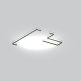](../assets/mgsv-tpp-mgom_ctwk001_vrtn021-142e53b190100c63.md) | [Unidentified model (mgom_ctwk001_vrtn021)](../assets/mgsv-tpp-mgom_ctwk001_vrtn021-142e53b190100c63.md) (unidentified) | mgom_ctwk001_vrtn021.fmdl | Native model reference; a readable object identification has not been reviewed. |  | Variant: vrtn021; LOD0; 276 triangles |
| [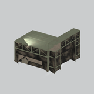](../assets/mgsv-tpp-mgom_ctwk001_vrtn022-b654e83fba93a183.md) | [Unidentified model (mgom_ctwk001_vrtn022)](../assets/mgsv-tpp-mgom_ctwk001_vrtn022-b654e83fba93a183.md) (unidentified) | mgom_ctwk001_vrtn022.fmdl | Native model reference; a readable object identification has not been reviewed. |  | Variant: vrtn022; LOD0; 1336 triangles |
| [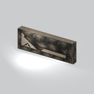](../assets/mgsv-tpp-mgom_ctwk001_vrtn023-778fe5bce6e4dfed.md) | [Unidentified model (mgom_ctwk001_vrtn023)](../assets/mgsv-tpp-mgom_ctwk001_vrtn023-778fe5bce6e4dfed.md) (unidentified) | mgom_ctwk001_vrtn023.fmdl | Native model reference; a readable object identification has not been reviewed. |  | Variant: vrtn023; LOD0; 42 triangles |
| [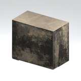](../assets/mgsv-tpp-mgom_ctwk001_vrtn024-9fe3f9483c2ccd2e.md) | [Unidentified model (mgom_ctwk001_vrtn024)](../assets/mgsv-tpp-mgom_ctwk001_vrtn024-9fe3f9483c2ccd2e.md) (unidentified) | mgom_ctwk001_vrtn024.fmdl | Native model reference; a readable object identification has not been reviewed. |  | Variant: vrtn024; LOD0; 38 triangles |
| [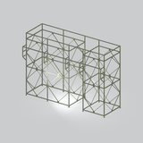](../assets/mgsv-tpp-mgom_ctwk001_vrtn025-de643f4fe9e398d7.md) | [Unidentified model (mgom_ctwk001_vrtn025)](../assets/mgsv-tpp-mgom_ctwk001_vrtn025-de643f4fe9e398d7.md) (unidentified) | mgom_ctwk001_vrtn025.fmdl | Native model reference; a readable object identification has not been reviewed. |  | Variant: vrtn025; LOD0; 1480 triangles |
| [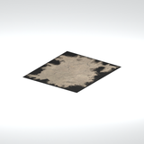](../assets/mgsv-tpp-mgom_fndt001_mrkn003-5c0ab1387f541eb2.md) | [Unidentified model (mgom_fndt001_mrkn003)](../assets/mgsv-tpp-mgom_fndt001_mrkn003-5c0ab1387f541eb2.md) (unidentified) | mgom_fndt001_mrkn003.fmdl | Native model reference; a readable object identification has not been reviewed. |  | Variant: No explicit variant token; LOD0; 2 triangles |
| [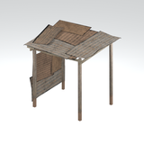](../assets/mgsv-tpp-mgom_hutt003_vrtn001-2a1ffc6882b7ee80.md) | [Unidentified model (mgom_hutt003_vrtn001)](../assets/mgsv-tpp-mgom_hutt003_vrtn001-2a1ffc6882b7ee80.md) (unidentified) | mgom_hutt003_vrtn001.fmdl | Native model reference; a readable object identification has not been reviewed. |  | Variant: vrtn001; LOD0; 194 triangles |
| [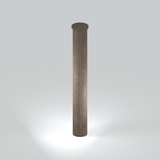](../assets/mgsv-tpp-mgom_pipe001_pipe001-94bab233c671882e.md) | [Unidentified model (mgom_pipe001_pipe001)](../assets/mgsv-tpp-mgom_pipe001_pipe001-94bab233c671882e.md) (unidentified) | mgom_pipe001_pipe001.fmdl | Native model reference; a readable object identification has not been reviewed. |  | Variant: No explicit variant token; LOD0; 68 triangles |
| [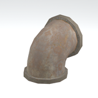](../assets/mgsv-tpp-mgom_pipe001_pipe002-96e66142dbf06f25.md) | [Unidentified model (mgom_pipe001_pipe002)](../assets/mgsv-tpp-mgom_pipe001_pipe002-96e66142dbf06f25.md) (unidentified) | mgom_pipe001_pipe002.fmdl | Native model reference; a readable object identification has not been reviewed. |  | Variant: No explicit variant token; LOD0; 214 triangles |
| [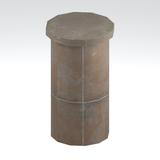](../assets/mgsv-tpp-mgom_pipe001_pipe003-6cf124a2c5e91a04.md) | [Unidentified model (mgom_pipe001_pipe003)](../assets/mgsv-tpp-mgom_pipe001_pipe003-6cf124a2c5e91a04.md) (unidentified) | mgom_pipe001_pipe003.fmdl | Native model reference; a readable object identification has not been reviewed. |  | Variant: No explicit variant token; LOD0; 68 triangles |
| [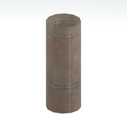](../assets/mgsv-tpp-mgom_pipe001_pipe004-35ad36d6cd7aaec8.md) | [Unidentified model (mgom_pipe001_pipe004)](../assets/mgsv-tpp-mgom_pipe001_pipe004-35ad36d6cd7aaec8.md) (unidentified) | mgom_pipe001_pipe004.fmdl | Native model reference; a readable object identification has not been reviewed. |  | Variant: No explicit variant token; LOD0; 24 triangles |
| [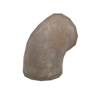](../assets/mgsv-tpp-mgom_pipe001_pipe005-87def46499c9c043.md) | [Unidentified model (mgom_pipe001_pipe005)](../assets/mgsv-tpp-mgom_pipe001_pipe005-87def46499c9c043.md) (unidentified) | mgom_pipe001_pipe005.fmdl | Native model reference; a readable object identification has not been reviewed. |  | Variant: No explicit variant token; LOD0; 174 triangles |

Pages: [1](unclassified-components-1.md) | [2](unclassified-components-2.md) | [3](unclassified-components-3.md) | [4](unclassified-components-4.md) | [5](unclassified-components-5.md) | [6](unclassified-components-6.md) | [7](unclassified-components-7.md) | [8](unclassified-components-8.md) | [9](unclassified-components-9.md) | [10](unclassified-components-10.md) | [11](unclassified-components-11.md) | [12](unclassified-components-12.md) | [13](unclassified-components-13.md) | [14](unclassified-components-14.md) | [15](unclassified-components-15.md) | [16](unclassified-components-16.md) | [17](unclassified-components-17.md) | [18](unclassified-components-18.md) | [19](unclassified-components-19.md) | [20](unclassified-components-20.md) | [21](unclassified-components-21.md) | [22](unclassified-components-22.md) | [23](unclassified-components-23.md) | [24](unclassified-components-24.md) | [25](unclassified-components-25.md) | [26](unclassified-components-26.md) | [27](unclassified-components-27.md) | [28](unclassified-components-28.md) | [29](unclassified-components-29.md)
