# Unclassified &gt; Unclassified components - page 25

[Library](../README.md) | [Source / advanced data](../catalogue.json) | [Credits](../sources-and-credits.md)

Static thumbnails only. Open a name or preview for its full still and 360-degree camera reference.

| Preview | Name | Game filename | Description | Tags | Variant / LOD |
|---|---|---|---|---|---|
| [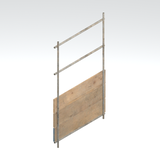](../assets/mgsv-tpp-mgoa_stfr004_vrtn011-7b5120490464e520.md) | [Unidentified model (mgoa_stfr004_vrtn011)](../assets/mgsv-tpp-mgoa_stfr004_vrtn011-7b5120490464e520.md) (unidentified) | mgoa_stfr004_vrtn011.fmdl | Native model reference; a readable object identification has not been reviewed. |  | Variant: vrtn011; LOD0; 136 triangles |
| [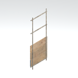](../assets/mgsv-tpp-mgoa_stfr004_vrtn012-d646211bbc7928b2.md) | [Unidentified model (mgoa_stfr004_vrtn012)](../assets/mgsv-tpp-mgoa_stfr004_vrtn012-d646211bbc7928b2.md) (unidentified) | mgoa_stfr004_vrtn012.fmdl | Native model reference; a readable object identification has not been reviewed. |  | Variant: vrtn012; LOD0; 136 triangles |
| [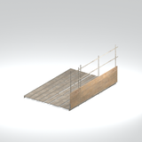](../assets/mgsv-tpp-mgoa_stfr004_vrtn013-8db87fe9a52c51ac.md) | [Unidentified model (mgoa_stfr004_vrtn013)](../assets/mgsv-tpp-mgoa_stfr004_vrtn013-8db87fe9a52c51ac.md) (unidentified) | mgoa_stfr004_vrtn013.fmdl | Native model reference; a readable object identification has not been reviewed. |  | Variant: vrtn013; LOD0; 584 triangles |
| [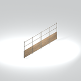](../assets/mgsv-tpp-mgoa_stfr004_vrtn015-ece985c350b3e780.md) | [Unidentified model (mgoa_stfr004_vrtn015)](../assets/mgsv-tpp-mgoa_stfr004_vrtn015-ece985c350b3e780.md) (unidentified) | mgoa_stfr004_vrtn015.fmdl | Native model reference; a readable object identification has not been reviewed. |  | Variant: vrtn015; LOD0; 312 triangles |
| [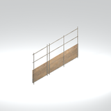](../assets/mgsv-tpp-mgoa_stfr004_vrtn016-aed4372abf8edf36.md) | [Unidentified model (mgoa_stfr004_vrtn016)](../assets/mgsv-tpp-mgoa_stfr004_vrtn016-aed4372abf8edf36.md) (unidentified) | mgoa_stfr004_vrtn016.fmdl | Native model reference; a readable object identification has not been reviewed. |  | Variant: vrtn016; LOD0; 292 triangles |
| [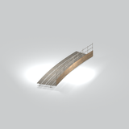](../assets/mgsv-tpp-mgoa_stfr004_vrtn017-72873e8a8db98061.md) | [Unidentified model (mgoa_stfr004_vrtn017)](../assets/mgsv-tpp-mgoa_stfr004_vrtn017-72873e8a8db98061.md) (unidentified) | mgoa_stfr004_vrtn017.fmdl | Native model reference; a readable object identification has not been reviewed. |  | Variant: vrtn017; LOD0; 1842 triangles |
| [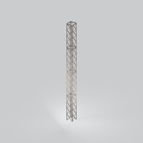](../assets/mgsv-tpp-mgoa_stfr005_vrtn001-258b330f2b39aef5.md) | [Unidentified model (mgoa_stfr005_vrtn001)](../assets/mgsv-tpp-mgoa_stfr005_vrtn001-258b330f2b39aef5.md) (unidentified) | mgoa_stfr005_vrtn001.fmdl | Native model reference; a readable object identification has not been reviewed. |  | Variant: vrtn001; LOD0; 304 triangles |
| [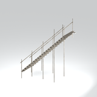](../assets/mgsv-tpp-mgoa_stfr006-b2d3faef42b6f2c0.md) | [Unidentified model (mgoa_stfr006)](../assets/mgsv-tpp-mgoa_stfr006-b2d3faef42b6f2c0.md) (unidentified) | mgoa_stfr006.fmdl | Native model reference; a readable object identification has not been reviewed. |  | Variant: No explicit variant token; LOD0; 1060 triangles |
| [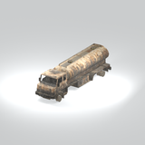](../assets/mgsv-tpp-mgoa_trck001-2dcaea1e457e0805.md) | [Unidentified model (mgoa_trck001)](../assets/mgsv-tpp-mgoa_trck001-2dcaea1e457e0805.md) (unidentified) | mgoa_trck001.fmdl | Native model reference; a readable object identification has not been reviewed. |  | Variant: No explicit variant token; LOD0; 2090 triangles |
| [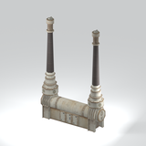](../assets/mgsv-tpp-mgoa_trsf001-99dd903c0d2f0020.md) | [Unidentified model (mgoa_trsf001)](../assets/mgsv-tpp-mgoa_trsf001-99dd903c0d2f0020.md) (unidentified) | mgoa_trsf001.fmdl | Native model reference; a readable object identification has not been reviewed. |  | Variant: No explicit variant token; LOD0; 884 triangles |
| [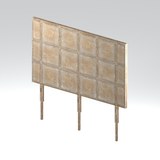](../assets/mgsv-tpp-mgoa_wdbr008_vrtn001-64b0b6fc3edca360.md) | [Unidentified model (mgoa_wdbr008_vrtn001)](../assets/mgsv-tpp-mgoa_wdbr008_vrtn001-64b0b6fc3edca360.md) (unidentified) | mgoa_wdbr008_vrtn001.fmdl | Native model reference; a readable object identification has not been reviewed. |  | Variant: vrtn001; LOD0; 334 triangles |
| [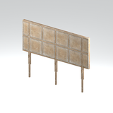](../assets/mgsv-tpp-mgoa_wdbr008_vrtn002-e0d6db29291c5add.md) | [Unidentified model (mgoa_wdbr008_vrtn002)](../assets/mgsv-tpp-mgoa_wdbr008_vrtn002-e0d6db29291c5add.md) (unidentified) | mgoa_wdbr008_vrtn002.fmdl | Native model reference; a readable object identification has not been reviewed. |  | Variant: vrtn002; LOD0; 328 triangles |

Pages: [1](unclassified-components-1.md) | [2](unclassified-components-2.md) | [3](unclassified-components-3.md) | [4](unclassified-components-4.md) | [5](unclassified-components-5.md) | [6](unclassified-components-6.md) | [7](unclassified-components-7.md) | [8](unclassified-components-8.md) | [9](unclassified-components-9.md) | [10](unclassified-components-10.md) | [11](unclassified-components-11.md) | [12](unclassified-components-12.md) | [13](unclassified-components-13.md) | [14](unclassified-components-14.md) | [15](unclassified-components-15.md) | [16](unclassified-components-16.md) | [17](unclassified-components-17.md) | [18](unclassified-components-18.md) | [19](unclassified-components-19.md) | [20](unclassified-components-20.md) | [21](unclassified-components-21.md) | [22](unclassified-components-22.md) | [23](unclassified-components-23.md) | [24](unclassified-components-24.md) | [25](unclassified-components-25.md) | [26](unclassified-components-26.md) | [27](unclassified-components-27.md) | [28](unclassified-components-28.md) | [29](unclassified-components-29.md) | [30](unclassified-components-30.md) | [31](unclassified-components-31.md) | [32](unclassified-components-32.md) | [33](unclassified-components-33.md)
