# Unclassified &gt; Unclassified components - page 28

[Library](../README.md) | [Source / advanced data](../catalogue.json) | [Credits](../sources-and-credits.md)

Static thumbnails only. Open a name or preview for its full still and 360-degree camera reference.

| Preview | Name | Game filename | Description | Tags | Variant / LOD |
|---|---|---|---|---|---|
| [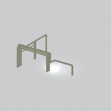](../assets/mgsv-tpp-mgom_pipe001_vrtn007-ab9adfcd2f117e89.md) | [Unidentified model (mgom_pipe001_vrtn007)](../assets/mgsv-tpp-mgom_pipe001_vrtn007-ab9adfcd2f117e89.md) (unidentified) | mgom_pipe001_vrtn007.fmdl | Native model reference; a readable object identification has not been reviewed. |  | Variant: vrtn007; LOD0; 2434 triangles |
| [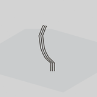](../assets/mgsv-tpp-mgom_pipe001_vrtn009-b94f2eafc649e496.md) | [Unidentified model (mgom_pipe001_vrtn009)](../assets/mgsv-tpp-mgom_pipe001_vrtn009-b94f2eafc649e496.md) (unidentified) | mgom_pipe001_vrtn009.fmdl | Native model reference; a readable object identification has not been reviewed. |  | Variant: vrtn009; LOD0; 384 triangles |
| [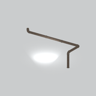](../assets/mgsv-tpp-mgom_pipe001_vrtn010-7e1cd5287f836d3f.md) | [Unidentified model (mgom_pipe001_vrtn010)](../assets/mgsv-tpp-mgom_pipe001_vrtn010-7e1cd5287f836d3f.md) (unidentified) | mgom_pipe001_vrtn010.fmdl | Native model reference; a readable object identification has not been reviewed. |  | Variant: vrtn010; LOD0; 918 triangles |
| [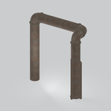](../assets/mgsv-tpp-mgom_pipe001_vrtn011-c51bdb11348c117e.md) | [Unidentified model (mgom_pipe001_vrtn011)](../assets/mgsv-tpp-mgom_pipe001_vrtn011-c51bdb11348c117e.md) (unidentified) | mgom_pipe001_vrtn011.fmdl | Native model reference; a readable object identification has not been reviewed. |  | Variant: vrtn011; LOD0; 1234 triangles |
|  | [Unidentified model (mgom_pipe001_vrtn012)](../assets/mgsv-tpp-mgom_pipe001_vrtn012-eb6dbb9fe7b93d8a.md) (unidentified) | mgom_pipe001_vrtn012.fmdl | Native model reference; a readable object identification has not been reviewed. |  | Variant: vrtn012; LOD0; 1392 triangles |
| [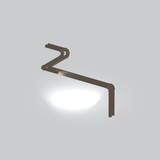](../assets/mgsv-tpp-mgom_pipe001_vrtn013-886789b9b96a9786.md) | [Unidentified model (mgom_pipe001_vrtn013)](../assets/mgsv-tpp-mgom_pipe001_vrtn013-886789b9b96a9786.md) (unidentified) | mgom_pipe001_vrtn013.fmdl | Native model reference; a readable object identification has not been reviewed. |  | Variant: vrtn013; LOD0; 1508 triangles |
| [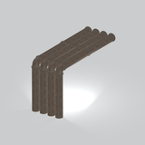](../assets/mgsv-tpp-mgom_pipe001_vrtn014-11da19cc3f370a80.md) | [Unidentified model (mgom_pipe001_vrtn014)](../assets/mgsv-tpp-mgom_pipe001_vrtn014-11da19cc3f370a80.md) (unidentified) | mgom_pipe001_vrtn014.fmdl | Native model reference; a readable object identification has not been reviewed. |  | Variant: vrtn014; LOD0; 1376 triangles |
| [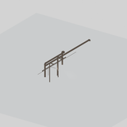](../assets/mgsv-tpp-mgom_pipe001_vrtn016-ba701067d5b19a74.md) | [Unidentified model (mgom_pipe001_vrtn016)](../assets/mgsv-tpp-mgom_pipe001_vrtn016-ba701067d5b19a74.md) (unidentified) | mgom_pipe001_vrtn016.fmdl | Native model reference; a readable object identification has not been reviewed. |  | Variant: vrtn016; LOD0; 1478 triangles |
| [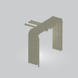](../assets/mgsv-tpp-mgom_pipe001_vrtn017-b21d2edf41aef58a.md) | [Unidentified model (mgom_pipe001_vrtn017)](../assets/mgsv-tpp-mgom_pipe001_vrtn017-b21d2edf41aef58a.md) (unidentified) | mgom_pipe001_vrtn017.fmdl | Native model reference; a readable object identification has not been reviewed. |  | Variant: vrtn017; LOD0; 2046 triangles |
| [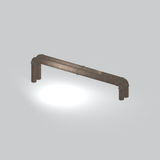](../assets/mgsv-tpp-mgom_pipe001_vrtn018-78655b870257f5fa.md) | [Unidentified model (mgom_pipe001_vrtn018)](../assets/mgsv-tpp-mgom_pipe001_vrtn018-78655b870257f5fa.md) (unidentified) | mgom_pipe001_vrtn018.fmdl | Native model reference; a readable object identification has not been reviewed. |  | Variant: vrtn018; LOD0; 1088 triangles |
| [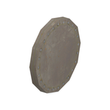](../assets/mgsv-tpp-mgom_pipe001_vrtn019-270ca7a6494aa169.md) | [Unidentified model (mgom_pipe001_vrtn019)](../assets/mgsv-tpp-mgom_pipe001_vrtn019-270ca7a6494aa169.md) (unidentified) | mgom_pipe001_vrtn019.fmdl | Native model reference; a readable object identification has not been reviewed. |  | Variant: vrtn019; LOD0; 44 triangles |
| [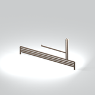](../assets/mgsv-tpp-mgom_pipe001_vrtn021-7d27cf1d60c4f472.md) | [Unidentified model (mgom_pipe001_vrtn021)](../assets/mgsv-tpp-mgom_pipe001_vrtn021-7d27cf1d60c4f472.md) (unidentified) | mgom_pipe001_vrtn021.fmdl | Native model reference; a readable object identification has not been reviewed. |  | Variant: vrtn021; LOD0; 1290 triangles |

Pages: [1](unclassified-components-1.md) | [2](unclassified-components-2.md) | [3](unclassified-components-3.md) | [4](unclassified-components-4.md) | [5](unclassified-components-5.md) | [6](unclassified-components-6.md) | [7](unclassified-components-7.md) | [8](unclassified-components-8.md) | [9](unclassified-components-9.md) | [10](unclassified-components-10.md) | [11](unclassified-components-11.md) | [12](unclassified-components-12.md) | [13](unclassified-components-13.md) | [14](unclassified-components-14.md) | [15](unclassified-components-15.md) | [16](unclassified-components-16.md) | [17](unclassified-components-17.md) | [18](unclassified-components-18.md) | [19](unclassified-components-19.md) | [20](unclassified-components-20.md) | [21](unclassified-components-21.md) | [22](unclassified-components-22.md) | [23](unclassified-components-23.md) | [24](unclassified-components-24.md) | [25](unclassified-components-25.md) | [26](unclassified-components-26.md) | [27](unclassified-components-27.md) | [28](unclassified-components-28.md) | [29](unclassified-components-29.md) | [30](unclassified-components-30.md)
