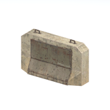
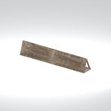
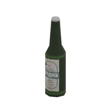
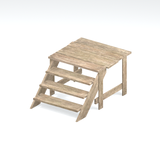
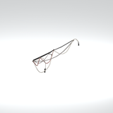
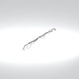
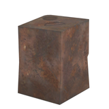
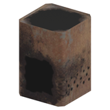
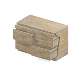

# Unclassified &gt; Unclassified components - page 3

[Library](../README.md) | [Source / advanced data](../catalogue.json) | [Credits](../sources-and-credits.md)

Static thumbnails only. Open a name or preview for its full still and 360-degree camera reference.

| Preview | Name | Game filename | Description | Tags | Variant / LOD |
|---|---|---|---|---|---|
|  | [Unidentified model (afgh_brrc002_brrc004_fl)](../assets/mgsv-tpp-afgh_brrc002_brrc004_fl-97b77978ecf85085.md) (unidentified) | afgh_brrc002_brrc004_fl.fmdl | Native model reference; a readable object identification has not been reviewed. |  | Variant: No explicit variant token; LOD0; 166 triangles |
|  | [Unidentified model (afgh_brrc005)](../assets/mgsv-tpp-afgh_brrc005-3070de04b8df5acd.md) (unidentified) | afgh_brrc005.fmdl | Native model reference; a readable object identification has not been reviewed. |  | Variant: No explicit variant token; LOD0; 148 triangles |
|  | [Unidentified model (afgh_bttl001_br)](../assets/mgsv-tpp-afgh_bttl001_br-1ff66e7a74fa563a.md) (unidentified) | afgh_bttl001_br.fmdl | Native model reference; a readable object identification has not been reviewed. |  | Variant: No explicit variant token; LOD0; 60 triangles |
|  | [Unidentified model (afgh_buld005_star002)](../assets/mgsv-tpp-afgh_buld005_star002-a07ebb16125a2d4f.md) (unidentified) | afgh_buld005_star002.fmdl | Native model reference; a readable object identification has not been reviewed. |  | Variant: No explicit variant token; LOD0; 154 triangles |
|  | [Unidentified model (afgh_cabl003)](../assets/mgsv-tpp-afgh_cabl003-cbd9ad792dcecf03.md) (unidentified) | afgh_cabl003.fmdl | Native model reference; a readable object identification has not been reviewed. |  | Variant: No explicit variant token; LOD0; 548 triangles |
|  | [Unidentified model (afgh_cabl003_vrtn001)](../assets/mgsv-tpp-afgh_cabl003_vrtn001-97741cfb35416939.md) (unidentified) | afgh_cabl003_vrtn001.fmdl | Native model reference; a readable object identification has not been reviewed. |  | Variant: vrtn001; LOD0; 531 triangles |
|  | [Unidentified model (afgh_cann004)](../assets/mgsv-tpp-afgh_cann004-d44c1c0604c4c0b7.md) (unidentified) | afgh_cann004.fmdl | Native model reference; a readable object identification has not been reviewed. |  | Variant: No explicit variant token; LOD0; 32 triangles |
|  | [Unidentified model (afgh_cann005)](../assets/mgsv-tpp-afgh_cann005-14e772e7fb14118a.md) (unidentified) | afgh_cann005.fmdl | Native model reference; a readable object identification has not been reviewed. |  | Variant: No explicit variant token; LOD0; 56 triangles |
|  | [Unidentified model (afgh_cbnt001_vrtn002)](../assets/mgsv-tpp-afgh_cbnt001_vrtn002-f1c3799b7ebc7c36.md) (unidentified) | afgh_cbnt001_vrtn002.fmdl | Native model reference; a readable object identification has not been reviewed. |  | Variant: vrtn002; LOD0; 449 triangles |
|  | [Unidentified model (afgh_clth005_fl)](../assets/mgsv-tpp-afgh_clth005_fl-55c86a008e45dfe2.md) (unidentified) | afgh_clth005_fl.fmdl | Native model reference; a readable object identification has not been reviewed. |  | Variant: No explicit variant token; LOD0; 319 triangles |
|  | [Unidentified model (afgh_cmmn002_dbri001)](../assets/mgsv-tpp-afgh_cmmn002_dbri001-b68faa58225d9efd.md) (unidentified) | afgh_cmmn002_dbri001.fmdl | Native model reference; a readable object identification has not been reviewed. |  | Variant: No explicit variant token; LOD0; 52 triangles |
|  | [Unidentified model (afgh_cupp001_br)](../assets/mgsv-tpp-afgh_cupp001_br-9a08f9747efd311a.md) (unidentified) | afgh_cupp001_br.fmdl | Native model reference; a readable object identification has not been reviewed. |  | Variant: No explicit variant token; LOD0; 84 triangles |

Pages: [1](unclassified-components-1.md) | [2](unclassified-components-2.md) | [3](unclassified-components-3.md) | [4](unclassified-components-4.md) | [5](unclassified-components-5.md) | [6](unclassified-components-6.md) | [7](unclassified-components-7.md) | [8](unclassified-components-8.md) | [9](unclassified-components-9.md) | [10](unclassified-components-10.md) | [11](unclassified-components-11.md) | [12](unclassified-components-12.md) | [13](unclassified-components-13.md) | [14](unclassified-components-14.md) | [15](unclassified-components-15.md) | [16](unclassified-components-16.md) | [17](unclassified-components-17.md) | [18](unclassified-components-18.md) | [19](unclassified-components-19.md) | [20](unclassified-components-20.md) | [21](unclassified-components-21.md) | [22](unclassified-components-22.md) | [23](unclassified-components-23.md) | [24](unclassified-components-24.md) | [25](unclassified-components-25.md) | [26](unclassified-components-26.md) | [27](unclassified-components-27.md)
