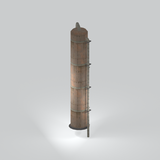
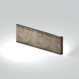
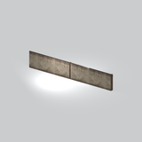
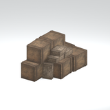
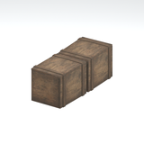
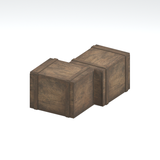
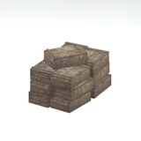
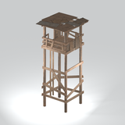
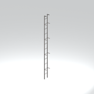

# Unclassified &gt; Unclassified components - page 32

[Library](../README.md) | [Source / advanced data](../catalogue.json) | [Credits](../sources-and-credits.md)

Static thumbnails only. Open a name or preview for its full still and 360-degree camera reference.

| Preview | Name | Game filename | Description | Tags | Variant / LOD |
|---|---|---|---|---|---|
|  | [Unidentified model (mgom_twer001_vrtn001)](../assets/mgsv-tpp-mgom_twer001_vrtn001-241a0c8e29dc1809.md) (unidentified) | mgom_twer001_vrtn001.fmdl | Native model reference; a readable object identification has not been reviewed. |  | Variant: vrtn001; LOD0; 822 triangles |
|  | [Unidentified model (mgom_wall001_vrtn001)](../assets/mgsv-tpp-mgom_wall001_vrtn001-2253714b3831e329.md) (unidentified) | mgom_wall001_vrtn001.fmdl | Native model reference; a readable object identification has not been reviewed. |  | Variant: vrtn001; LOD0; 134 triangles |
|  | [Unidentified model (mgom_wall001_vrtn002)](../assets/mgsv-tpp-mgom_wall001_vrtn002-0cdc0c3329f37f09.md) (unidentified) | mgom_wall001_vrtn002.fmdl | Native model reference; a readable object identification has not been reviewed. |  | Variant: vrtn002; LOD0; 236 triangles |
|  | [Unidentified model (mgom_wdbx001_vrtn001)](../assets/mgsv-tpp-mgom_wdbx001_vrtn001-a7081a751f6e35cc.md) (unidentified) | mgom_wdbx001_vrtn001.fmdl | Native model reference; a readable object identification has not been reviewed. |  | Variant: vrtn001; LOD0; 772 triangles |
|  | [Unidentified model (mgom_wdbx001_vrtn002)](../assets/mgsv-tpp-mgom_wdbx001_vrtn002-8fa1ac3bcc6e1df5.md) (unidentified) | mgom_wdbx001_vrtn002.fmdl | Native model reference; a readable object identification has not been reviewed. |  | Variant: vrtn002; LOD0; 184 triangles |
|  | [Unidentified model (mgom_wdbx001_vrtn003)](../assets/mgsv-tpp-mgom_wdbx001_vrtn003-9257d4b1769e5385.md) (unidentified) | mgom_wdbx001_vrtn003.fmdl | Native model reference; a readable object identification has not been reviewed. |  | Variant: vrtn003; LOD0; 184 triangles |
|  | [Unidentified model (mgom_wdbx002_vrtn001)](../assets/mgsv-tpp-mgom_wdbx002_vrtn001-bedf398ac61f11d9.md) (unidentified) | mgom_wdbx002_vrtn001.fmdl | Native model reference; a readable object identification has not been reviewed. |  | Variant: vrtn001; LOD0; 416 triangles |
|  | [Unidentified model (mgom_wtct001)](../assets/mgsv-tpp-mgom_wtct001-bc9d952daaaddf47.md) (unidentified) | mgom_wtct001.fmdl | Native model reference; a readable object identification has not been reviewed. |  | Variant: No explicit variant token; LOD0; 647 triangles |
|  | [Unidentified model (mgom_wtct001_lddr001)](../assets/mgsv-tpp-mgom_wtct001_lddr001-5ceb4add78347714.md) (unidentified) | mgom_wtct001_lddr001.fmdl | Native model reference; a readable object identification has not been reviewed. |  | Variant: No explicit variant token; LOD0; 148 triangles |

Pages: [1](unclassified-components-1.md) | [2](unclassified-components-2.md) | [3](unclassified-components-3.md) | [4](unclassified-components-4.md) | [5](unclassified-components-5.md) | [6](unclassified-components-6.md) | [7](unclassified-components-7.md) | [8](unclassified-components-8.md) | [9](unclassified-components-9.md) | [10](unclassified-components-10.md) | [11](unclassified-components-11.md) | [12](unclassified-components-12.md) | [13](unclassified-components-13.md) | [14](unclassified-components-14.md) | [15](unclassified-components-15.md) | [16](unclassified-components-16.md) | [17](unclassified-components-17.md) | [18](unclassified-components-18.md) | [19](unclassified-components-19.md) | [20](unclassified-components-20.md) | [21](unclassified-components-21.md) | [22](unclassified-components-22.md) | [23](unclassified-components-23.md) | [24](unclassified-components-24.md) | [25](unclassified-components-25.md) | [26](unclassified-components-26.md) | [27](unclassified-components-27.md) | [28](unclassified-components-28.md) | [29](unclassified-components-29.md) | [30](unclassified-components-30.md) | [31](unclassified-components-31.md) | [32](unclassified-components-32.md)
