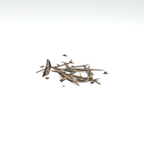
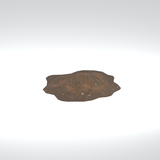
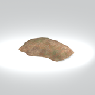

# Unclassified &gt; Unclassified components - page 4

[Library](../README.md) | [Source / advanced data](../catalogue.json) | [Credits](../sources-and-credits.md)

Static thumbnails only. Open a name or preview for its full still and 360-degree camera reference.

| Preview | Name | Game filename | Description | Tags | Variant / LOD |
|---|---|---|---|---|---|
|  | [Unidentified model (mafr_grbg003)](../assets/mgsv-tpp-mafr_grbg003-cf3ff25d79d064f4.md) (unidentified) | mafr_grbg003.fmdl | Native model reference; a readable object identification has not been reviewed. |  | Variant: No explicit variant token; LOD0; 330 triangles |
|  | [Unidentified model (mafr_grnd001_mudd003)](../assets/mgsv-tpp-mafr_grnd001_mudd003-96587b5a1f477998.md) (unidentified) | mafr_grnd001_mudd003.fmdl | Native model reference; a readable object identification has not been reviewed. |  | Variant: No explicit variant token; LOD0; 144 triangles |
|  | [Unidentified model (mafr_grnd001_mudd004)](../assets/mgsv-tpp-mafr_grnd001_mudd004-6e2383a51a9b6834.md) (unidentified) | mafr_grnd001_mudd004.fmdl | Native model reference; a readable object identification has not been reviewed. |  | Variant: No explicit variant token; LOD0; 199 triangles |
|  | [Unidentified model (mafr_grnd004)](../assets/mgsv-tpp-mafr_grnd004-9afc44bd29201075.md) (unidentified) | mafr_grnd004.fmdl | Native model reference; a readable object identification has not been reviewed. |  | Variant: No explicit variant token; LOD0; 680 triangles |
|  | [Unidentified model (mafr_grnd004_vrtn001)](../assets/mgsv-tpp-mafr_grnd004_vrtn001-48ca0901768b0700.md) (unidentified) | mafr_grnd004_vrtn001.fmdl | Native model reference; a readable object identification has not been reviewed. |  | Variant: vrtn001; LOD0; 441 triangles |
|  | [Unidentified model (mafr_grss009_vrtn002)](../assets/mgsv-tpp-mafr_grss009_vrtn002-0e964844a2584f69.md) (unidentified) | mafr_grss009_vrtn002.fmdl | Native model reference; a readable object identification has not been reviewed. |  | Variant: vrtn002; LOD0; 64 triangles |
|  | [Unidentified model (mafr_grss019)](../assets/mgsv-tpp-mafr_grss019-69c6c19bc109e294.md) (unidentified) | mafr_grss019.fmdl | Native model reference; a readable object identification has not been reviewed. |  | Variant: No explicit variant token; LOD0; 74 triangles |
|  | [Unidentified model (mafr_grss022)](../assets/mgsv-tpp-mafr_grss022-1ed9a46ccdd8c8a6.md) (unidentified) | mafr_grss022.fmdl | Native model reference; a readable object identification has not been reviewed. |  | Variant: No explicit variant token; LOD0; 57 triangles |
|  | [Unidentified model (mafr_grss022_vrtn001)](../assets/mgsv-tpp-mafr_grss022_vrtn001-32d8e40a833528cf.md) (unidentified) | mafr_grss022_vrtn001.fmdl | Native model reference; a readable object identification has not been reviewed. |  | Variant: vrtn001; LOD0; 57 triangles |
|  | [Unidentified model (mafr_grss022_vrtn005)](../assets/mgsv-tpp-mafr_grss022_vrtn005-92b4f58bb243f226.md) (unidentified) | mafr_grss022_vrtn005.fmdl | Native model reference; a readable object identification has not been reviewed. |  | Variant: vrtn005; LOD0; 74 triangles |
|  | [Unidentified model (mgom_hutt003_vrtn001)](../assets/mgsv-tpp-mgom_hutt003_vrtn001-2a1ffc6882b7ee80.md) (unidentified) | mgom_hutt003_vrtn001.fmdl | Native model reference; a readable object identification has not been reviewed. |  | Variant: vrtn001; LOD0; 194 triangles |
|  | [Unidentified model (mgom_pstr003_vrtn006)](../assets/mgsv-tpp-mgom_pstr003_vrtn006-2a6645d2bd73c641.md) (unidentified) | mgom_pstr003_vrtn006.fmdl | Native model reference; a readable object identification has not been reviewed. |  | Variant: vrtn006; LOD0; 20 triangles |

Pages: [1](unclassified-components-1.md) | [2](unclassified-components-2.md) | [3](unclassified-components-3.md) | [4](unclassified-components-4.md) | [5](unclassified-components-5.md)
